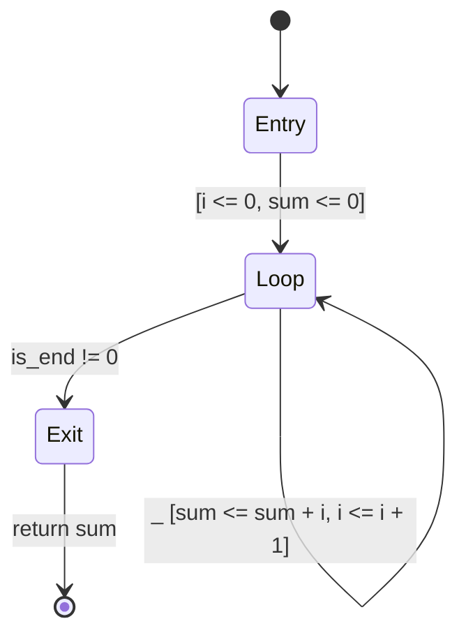
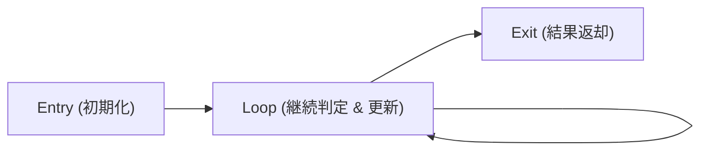

# StateSSA (FlowState) 言語仕様書 (Version 0.13.0)

StateSSA（開発コードネーム: FlowState）は、プログラマの思考範囲を限定し、決定論的でミスのないソフトウェアを設計するために開発された、データフロー・有限状態遷移プログラミング言語です。

---

## 目次

1. [第1章: 概要と設計思想（Introduction & Design Philosophy）](#第1章-概要と設計思想introduction--design-philosophy)
   - 1.1 [StateSSA とは何か？](#11-statessa-とは何か)
   - 1.2 [設計原則](#12-設計原則)
   - 1.3 [従来の言語との設計思想の違い](#13-従来の言語との設計思想の違い)
2. [第2章: クイックスタート（Getting Started）](#第2章-クイックスタートgetting-started)
   - 2.1 [最小のプログラム: Hello, World!](#21-最小のプログラム-hello-world)
   - 2.2 [ループの基礎: Simple Loop（1からNまでの合計計算）](#22-ループの基礎-simple-loop1からnまでの合計計算)
   - 2.3 [ビルドとネイティブ実行手順](#23-ビルドとネイティブ実行手順)
   - 2.4 [動作トレースの確認](#24-動作トレースの確認)
3. [第3章: 基本構文と構成要素（Language Fundamentals）](#第3章-基本構文と構成要素language-fundamentals)
   - 3.1 [マシン定義（machine）](#31-マシン定義machine)
   - 3.2 [データパスブロック（flow）: レジスタとワイヤー](#32-データパスブロックflow-レジスタとワイヤー)
   - 3.3 [コントロールパスブロック（states）: 状態と遷移](#33-コントロールパスブロックstates-状態と遷移)
   - 3.4 [式と演算子の優先順位・リテラル一覧](#34-式と演算子の優先順位リテラル一覧)
4. [第4章: 制御フロー設計パターン（Control Flow Patterns）](#第4章-制御フロー設計パターンcontrol-flow-patterns)
   - 4.1 [条件分岐（if-else）: デシジョン・ステート・パターン](#41-条件分岐if-else-デシジョンステートパターン)
   - 4.2 [ループ構造: Entry -> Loop -> Exit パターン](#42-ループ構造-entry---loop---exit-パターン)
   - 4.3 [早期脱出とエラーハンドリング（return / panic）](#43-早期脱出とエラーハンドリングreturn--panic)
   - 4.4 [合流状態におけるレジスタ値の決定（経路調停パターン）](#44-合流状態におけるレジスタ値の決定経路調停パターン)
5. [第5章: 型システムとメモリモデル（Type System & Memory Model）](#第5章-型システムとメモリモデルtype-system--memory-model)
   - 5.1 [プリミティブ型一覧](#51-プリミティブ型一覧)
   - 5.2 [ポインタ型（*T）と null リテラル](#52-ポインタ型tと-null-リテラル)
   - 5.3 [構造体型（type）とメモリレイアウト](#53-構造体型typeとメモリレイアウト)
   - 5.4 [明示的キャスト（cast）と型の厳格性](#54-明示的キャストcastと型の厳格性)
6. [第6章: モジュール構成と外部連携（Modules & ABI）](#第6章-モジュール構成と外部連携modules--abi)
   - 6.1 [単一定義の原則（Single Definition Rule）](#61-単一定義の原則single-definition-rule)
   - 6.2 [ソースコードの分割と結合（include と CLI 結合）](#62-ソースコードの分割と結合include-と-cli-結合)
   - 6.3 [外部環境連携（extern ブロックと C-ABI 境界規約）](#63-外部環境連携extern-ブロックと-c-abi-境界規約)

---

## 第1章: 概要と設計思想（Introduction & Design Philosophy）

### 1.1 StateSSA とは何か？

一般的な命令型言語（C言語、Rust、Goなど）では、コードは文や式の入れ子構造（構文木）として記述されます。開発者はネストした `while` ループや `if-else` 分岐、変数の再代入を用いながら処理を組み立てます。しかし、可変変数へのアクセスが散在し、制御フローが深くなるにつれて、プログラムが「今どの状態にあり、変数がいつ書き換わったのか」を正確に追跡することが難しくなり、バグの原因となります。

StateSSA は、プログラマの思考範囲を限定し、状態とデータの流れを明確に分離するために設計された言語です。

StateSSA には、ネストしたループ構文や隠蔽された三項演算子は存在しません。プログラムは、**データの依存関係を表すデータフロー（ワイヤー）** と、**処理の順序と状態の移り変わりを表す有限状態機械（FSM）** の2つの独立した要素のみで記述されます。これにより、意図しない副作用や暗黙の動作を排除し、仕様通りの決定論的な振る舞いを保証します。

### 1.2 設計原則

StateSSA は、以下の原則に基づいて設計されています。

1. **データパス（`flow`）とコントロールパス（`states`）の分離** :
   - `flow` ブロックには、マシン内で保持するレジスタ（`reg`）と、それらに基づいて計算されるワイヤー（`wire`）のみを宣言します。
   - `states` ブロックには、状態名（State）と、状態間の遷移ルールのみを記述します。
2. **状態ノードにデータを持たせない（引数なし）** :
   - 状態（State）は処理の段階を示すラベルであり、引数や独自の変数を所有しません。データはすべて `flow` ブロックで宣言されたレジスタやワイヤーを経由して扱われます。
3. **式における条件分岐（三項演算子）の禁止** :
   - 式の中に条件分岐（`? :` 三項演算子）を持ち込むことを禁止します。すべての条件分岐は `states` ブロック内の状態遷移として明示的に記述します。これにより、コードと状態遷移図が1対1に対応します。
4. **状態遷移に伴うレジスタ値の更新（ラッチ）** :
   - レジスタの更新は、状態が切り替わる遷移（`[ reg <= expr ]`）においてのみ発生します。コードの任意の場所で変数を再代入することはできません。どの遷移経路を通ったかによって値が確定するため、データの更新タイミングと因果関係が明確になります。
5. **開始状態（`Entry`）の不可逆性** :
   - 各マシンの最初の状態は必ず `Entry` という名前で宣言します。プログラムの開始地点は先行状態を持たない原点であるため、`Entry` 状態へ戻る遷移（`=> Entry`、自己ループ含む）は禁止されます。

### 1.3 従来の言語との設計思想の違い

| 観点 | 従来の言語（C, Rust 等） | StateSSA (FlowState) |
| :--- | :--- | :--- |
| **設計の単位** | 関数・手続き・ネストした文 | データフロー定義 ＋ 有限状態機械（FSM） |
| **変数の扱い** | 再代入可能な可変変数 | 不変の計算式（`wire`）と遷移時に更新される保持値（`reg`） |
| **ループ** | `while` / `for` によるブロックのネスト | 状態遷移エッジによる明示的な再帰遷移 |
| **条件分岐** | `if-else` 文や `? :` 三項演算子 | 状態遷移ルールによる明示的な状態分岐 |
| **状態の把握** | 複数の変数と実行位置の組み合わせで暗黙化 | 現在の状態ノードとレジスタ値として明確に把握可能 |

---

## 第2章: クイックスタート（Getting Started）

### 2.1 最小のプログラム: Hello, World!

文字列を出力する最小のプログラムです。外部の C 標準ライブラリ関数（`puts`）を呼び出し、終了コード `0` を返します。

```
// hello_world.ssa
extern {
    fn puts(s: *u8) -> i32;
}

machine main() -> i32 {
    flow {}
    states {
        Entry: {
            let _ = call puts("Hello, StateSSA World!");
            _ => return 0;
        }
    }
}
```

- `extern { ... }` : 外部の C-ABI 関数を宣言します。
- `machine main() -> i32` : エントリーポイントとなるマシンを定義します。
- `flow {}` : レジスタやワイヤーが不要な場合は空とします。
- `Entry:` : マシン開始時に最初に実行される必須の状態です。
- `let _ = call puts(...)` : 関数を呼び出し、戻り値を破棄（`_`）します。
- `_ => return 0;` : 無条件（`_`）にマシンを終了し、戻り値 `0` を返します。

---

### 2.2 ループの基礎: Simple Loop（1からNまでの合計計算）

StateSSA におけるループの記述例として、0 から 10 までの整数の総和を計算するプログラムです。

```
// simple_loop.ssa
machine sum_to_n(limit: u32) -> u32 {
    flow {
        reg i:   u32 = 0;
        reg sum: u32 = 0;

        wire is_end   = i >= limit;
        wire next_sum = sum + i;
        wire next_i   = i + 1;
    }
    states {
        Entry: {
            _ => Loop [ i <= 0, sum <= 0 ];
        }
        Loop: {
            is_end != 0 => Exit;
            _           => Loop [ sum <= next_sum, i <= next_i ];
        }
        Exit: {
            _ => return sum;
        }
    }
}
```

このプログラムの状態遷移は、以下の Mermaid 状態遷移図と1対1に対応します。



---

### 2.3 ビルドとネイティブ実行手順

StateSSA コンパイラ（`bin/ssac`）は、ソースコードから LLVM IR（`.ll`）を出力します。生成された LLVM IR を `clang` でリンクすることで、ネイティブ実行バイナリを作成できます。

#### 1. 単一ファイルのコンパイルと実行
```bash
# 1. StateSSA ソースコードを LLVM IR (.ll) へコンパイル
bin/ssac hello_world.ssa -o hello_world.ll

# 2. Clang でネイティブバイナリへビルド
clang -O2 hello_world.ll -o hello_world

# 3. 実行
./hello_world
# 出力: Hello, StateSSA World!
```

#### 2. C 言語ドライバとのリンク実行
`main` 関数を C 言語で記述し、StateSSA で記述したマシンをライブラリとしてリンクして実行することも可能です。

```c
// main.c
#include <stdio.h>
#include <stdint.h>

extern uint32_t sum_to_n(uint32_t limit);

int main(void) {
    uint32_t res = sum_to_n(10);
    printf("sum_to_n(10) = %u\n", res); // 45
    return 0;
}
```

```bash
# StateSSA マシンをコンパイル
bin/ssac simple_loop.ssa -o simple_loop.ll

# C 言語ドライバと一緒にリンク
clang -O2 main.c simple_loop.ll -o test_loop
./test_loop
# 出力: sum_to_n(10) = 45
```

---

### 2.4 動作トレースの確認

`sum_to_n(3)` を実行した際の状態遷移と、各遷移におけるレジスタおよびワイヤーの値の変化です。

| ステップ | 現在状態 | `reg i` | `reg sum` | `wire is_end` | `wire next_sum` | `wire next_i` | 遷移ルールとラッチ更新 |
| :---: | :---: | :---: | :---: | :---: | :---: | :---: | :--- |
| **T0** | `Entry` | 0 | 0 | 0 | 0 | 1 | `_ => Loop [ i <= 0, sum <= 0 ]` |
| **T1** | `Loop` | 0 | 0 | 0 | 0 | 1 | `is_end == 0` のため自己遷移 `[ sum <= 0, i <= 1 ]` |
| **T2** | `Loop` | 1 | 0 | 0 | 1 | 2 | `is_end == 0` のため自己遷移 `[ sum <= 1, i <= 2 ]` |
| **T3** | `Loop` | 2 | 1 | 0 | 3 | 3 | `is_end == 0` のため自己遷移 `[ sum <= 3, i <= 3 ]` |
| **T4** | `Loop` | 3 | 3 | 1 | 6 | 4 | `is_end != 0` が成立し `=> Exit` へ遷移 |
| **T5** | `Exit` | 3 | 3 | 1 | 6 | 4 | `_ => return sum;` （値 `3` を返却して終了） |

---

## 第3章: 基本構文と構成要素（Language Fundamentals）

### 3.1 マシン定義（`machine`）

StateSSA プログラムの基本単位は マシン（`machine`） です。マシンは外部から引数を受け取り、処理が完了すると値を1つ返します。

```
machine マシン名(引数名: 型, ...) -> 戻り値型 {
    flow { ... }
    states { ... }
}
```

- 引数は、マシン内のすべての `flow`（ワイヤー）および `states`（状態アクション）から不変の値として参照できます。
- 戻り値がない場合は `-> void` を指定します。

---

### 3.2 データパスブロック（`flow`）: レジスタとワイヤー

`flow` ブロックは、マシンが保持する値と、それらの依存関係を定義する領域です。このブロック内に制御構文（分岐やループ）を記述することはできません。

```
flow {
    reg レジスタ名: 型 = 初期値;
    wire ワイヤー名 = 式;
}
```

#### 1. レジスタ（`reg`）
- 役割 : 状態遷移をまたいで値を保持する変数です。
- 初期値 : 必ず `= 初期値;` を指定します。
- 更新 : レジスタの更新は、状態遷移時の角括弧内（`[ reg <= expr ]`）でのみ行われます。状態の内部で直接再代入することはできません。

#### 2. ワイヤー（`wire`）
- 役割 : レジスタや引数、他のワイヤーから計算される不変の式です。
- 連動性 : レジスタの値が更新されると、そのレジスタを参照しているすべてのワイヤーも連動して最新の値を指します。
- 副作用の排除 : ワイヤーの定義式には、関数呼び出しやメモリストアなどの副作用を含む式を記述することはできません。

---

### 3.3 コントロールパスブロック（`states`）: 状態と遷移

`states` ブロックは、処理の順序と状態遷移を定義する領域です。各状態はラベルとして定義され、内部に「アクション文」と「遷移ルール」を持ちます。

```
states {
    Entry: {
        // 1. アクション文群（上から順に実行）
        let x = ...;
        target <- value;

        // 2. 遷移ルール群（上から順に条件評価）
        cond1 => Target1 [ reg1 <= val1 ];
        _     => Target2;
    }
    ...
}
```

#### 1. エントリー状態（`Entry`）の規則
- 最初の状態は 必ず `Entry` という名前 で宣言します。
- Entryへの逆戻り禁止 : プログラムの開始地点は先行状態を持たない絶対的な原点であるため、いかなる状態からも `=> Entry` へ遷移すること（自己ループ含む）は禁止されます。

#### 2. 状態アクション文
状態に進入した際に実行される処理です。以下の3種類があります。
1. **局所束縛** (`let 名前 = 式;`) :
   その状態内でのみ使用可能な一時的な値を定義します。関数の戻り値を受け取る場合などに用います。
2. **メモリ書き込み** (`*ポインタ <- 式;` / `ポインタ.フィールド <- 式;`) :
   メモリに対する書き込み（ストア）を実行します。
3. **副作用呼び出し** (`call 関数名(実引数...);`) :
   戻り値を必要としない関数を実行します。

#### 3. 遷移ルールとガード条件
アクション文の直後に記述し、次にどの状態へ遷移するかを決定します。
- 条件付き遷移 (`条件式 => 遷移先;`) :
  条件式が非ゼロ（真）の場合に指定した状態へ遷移します。
- デフォルト遷移 (`_ => 遷移先;`) :
  いずれの条件も成立しなかった場合に無条件で遷移します。
- 終了ルール (`_ => return 式;` / `_ => panic(コード);`) :
  マシンを終了して値を返すか、エラーコードを伴ってプログラムを停止します。

#### 4. レジスタラッチ更新 (`[ reg <= expr ]`)
状態が切り替わるタイミングで、指定したレジスタに新しい値を設定します。
- 自己保持 : 角括弧内に指定されなかったレジスタは、現在の値をそのまま次の状態へ引き継ぎます。

---

### 3.4 式と演算子の優先順位・リテラル一覧

式（`wire` の計算式、状態アクション文、遷移のガード条件など）では、以下の純粋演算子およびリテラルが使用できます。

#### 1. 演算子の優先順位（高い順）
表の上にある演算子ほど優先順位が高く、先に評価されます。同一レベルの二項演算子は左から右へ評価されます（左結合）。

| 優先度 | 分類 | 記法 | 結合性 | 説明 |
| :---: | :--- | :--- | :---: | :--- |
| **1 (最高)** | プライマリ / 後置 | `( )`<br>`.`<br>`call fn(...)` | 左結合 | 丸括弧によるグループ化<br>構造体フィールド参照<br>関数呼び出し |
| **2** | 単項 / 前置 | `cast(T)`<br>`-`<br>`*`<br>`&` | 右結合 | 明示的型キャスト<br>符号反転（単項マイナス）<br>ポインタ逆参照（デリファレンス）<br>アドレス取得 |
| **3** | 乗除算 | `*`, `/` | 左結合 | 乗算、除算 |
| **4** | 加減算 | `+`, `-` | 左結合 | 加算（ポインタ加算含む）、減算（ポインタ減算含む） |
| **5** | ビットシフト | `<<`, `>>` | 左結合 | 左シフト、右シフト |
| **6** | 比較演算 | `==`, `!=`, `<`, `<=`, `>`, `>=` | 非結合 | 等価、不等価、大小比較（評価結果は `i1` 型） |
| **7** | ビット論理積 | `&` | 左結合 | ビット単位の AND（`i1` 同士の論理積としても機能） |
| **8** | ビット排他論理和 | `^` | 左結合 | ビット単位の XOR（`i1` 同士の排他的論理和としても機能） |
| **9 (最低)** | ビット論理和 | `\|` | 左結合 | ビット単位の OR（`i1` 同士の論理和としても機能） |

- 短絡評価（隠れた分岐）を行う論理演算子（`&&`, `||`）は存在しません。真偽値（`i1` 型）の論理演算は、上記ビット演算子（`&`, `|`）を用いて計算するか、状態遷移の分岐として明示的に設計します。

#### 2. リテラル定数
- 整数定数 : 10進数（例: `0`, `42`）および 16進数（例: `0x1f`, `0xFF`）
- 小数定数 : 10進小数（例: `1.5`, `0.125`）。`q64` 型（Q32.32 固定小数点数）として解釈されます。
- 文字列定数 : `"..."` （末尾ヌル文字を含む `*u8` 型の静的バイト配列アドレス）
- ポインタヌル定数 : `null` （有効な領域を指していないポインタ定数）

---

## 第4章: 制御フロー設計パターン（Control Flow Patterns）

### 4.1 条件分岐（if-else）: デシジョン・ステート・パターン

StateSSA には三項演算子が存在しないため、条件分岐は明示的な状態の分岐として設計します。

```
states {
    Entry: {
        val > 100 => ClampHigh;
        val < 0   => ClampLow;
        _         => Normal;
    }
    ClampHigh: {
        _ => NextState [ result <= 100 ];
    }
    ClampLow: {
        _ => NextState [ result <= 0 ];
    }
    Normal: {
        _ => NextState [ result <= val ];
    }
    NextState: {
        _ => return result;
    }
}
```

このパターンにより、分岐条件とそれに伴うレジスタ更新が状態遷移図上で明確に分離されます。

---

### 4.2 ループ構造: Entry -> Loop -> Exit パターン

ループ処理は、以下の3つの状態からなる構成で表現します。



```
machine count_down(start: u32) -> void {
    flow {
        reg n: u32 = 0;
        wire is_zero = n == 0;
        wire next_n  = n - 1;
    }
    states {
        Entry: {
            _ => Loop [ n <= start ]; // 初期化
        }
        Loop: {
            is_zero != 0 => Exit;      // 終了判定
            _            => Loop [ n <= next_n ]; // ループ継続
        }
        Exit: {
            _ => return;
        }
    }
}
```

---

### 4.3 早期脱出とエラーハンドリング（return / panic）

探索処理などで目的の値が見つかった際に、ループの途中で直ちに結果を返したい場合は、該当ステートから直接 `return` を実行します。

```
machine find_byte(buf: *u8, len: u32, target: u8) -> i32 {
    flow {
        reg idx: u32 = 0;
        wire has_more = idx < len;
        wire cur_ptr  = buf + idx;
        wire cur_byte = *cur_ptr;
        wire is_match = cur_byte == target;
    }
    states {
        Entry: {
            _ => Loop [ idx <= 0 ];
        }
        Loop: {
            has_more == 0 => NotFound;
            is_match != 0 => Found;
            _             => Loop [ idx <= idx + 1 ];
        }
        Found: {
            let res = cast(i32) idx;
            _ => return res; // 見つかった時点で直ちに返却
        }
        NotFound: {
            _ => return -1;  // 見つからなかった場合
        }
    }
}
```

---

### 4.4 合流状態におけるレジスタ値の決定（経路調停パターン）

複数の異なる状態から単一の状態へ合流する場合、レジスタは「どの状態から遷移してきたか」に応じて直前にラッチされた値を保持します。

```
states {
    StateA: {
        _ => Merge [ out_val <= wire_a ];
    }
    StateB: {
        _ => Merge [ out_val <= wire_b ];
    }
    Merge: {
        // StateA から遷移した場合は wire_a、StateB から遷移した場合は wire_b が格納される
        _ => return out_val;
    }
}
```

---

## 第5章: 型システムとメモリモデル（Type System & Memory Model）

### 5.1 プリミティブ型一覧

| 型名 | ビット幅 | 説明 |
| :--- | :---: | :--- |
| `i8`, `u8` | 8-bit | 符号付き / 符号なし 8ビット整数（バイト、文字） |
| `i16`, `u16` | 16-bit | 符号付き / 符号なし 16ビット整数 |
| `i32`, `u32` | 32-bit | 符号付き / 符号なし 32ビット整数（標準整数、インデックス） |
| `i64`, `u64` | 64-bit | 符号付き / 符号なし 64ビット整数（長整数、サイズ、アドレス） |
| `q64` | 64-bit | 符号付き固定小数点数（Q32.32 形式: 整数部32bit、小数部32bit） |
| `i1` | 1-bit | 真偽値（比較演算子 `==`, `<`, `!=` などの評価結果） |
| `void` | 0-bit | 値を持たない型（戻り値のないマシンの戻り値型） |

---

### 5.2 ポインタ型（`*T`）と `null` リテラル

ポインタ型 `*T` は、メモリ上の型 `T` の先頭アドレスを表します。

- `null` リテラル : 有効なメモリ領域を指していないことを示すポインタ定数です。整数 `0` とは区別され、整数型への代入はできません。
- デリファレンス (`*ptr`) : ポインタが指すメモリから値を読み出します。
- メモリストア (`*ptr <- val;`) : ポインタが指すメモリへ値を書き込みます。

#### ポインタ加算と減算
- ポインタ加算 (`ptr + offset`) :
  ポインタ型と整数の加算は、要素型 `T` のサイズに応じたアドレスオフセットを計算します（例: `*i32` のポインタに `1` を加算すると、アドレスは 4 バイト進みます）。
- ポインタ減算 (`ptr1 - ptr2`) :
  同一の要素型を持つポインタ同士の減算は、バイト単位のアドレス差分整数（`i32`）を計算します。

---

### 5.3 構造体型（`type`）とメモリレイアウト

`type` キーワードを用いて構造体を定義できます。構造体のフィールドは宣言順にメモリ上に配置されます。

```
type Point = {
    x: i32,
    y: i32
};

type Buffer = {
    data:     *u8,
    len:      u32,
    capacity: u32
};
```

- フィールド参照 (`ptr.field`) : 構造体ポインタからフィールドの値を読み出します。
- フィールド更新 (`ptr.field <- val;`) : 構造体ポインタのフィールドへ値を書き込みます。

---

### 5.4 明示的キャスト（`cast`）と型の厳格性

StateSSA では、暗黙の型変換（ビット幅の自動拡張・切り捨てや、ポインタと整数の暗黙混在）を行いません。
異なる型の間で値を渡す場合は、すべて `cast(TargetType)` を用いて明示的に変換する必要があります。

- 型の完全一致 : 関数の引数、レジスタへのラッチ代入、メモリストア、マシンの戻り値において、変数の型は要求される型と完全に一致している必要があります。
- リテラル定数の自動解釈 : 型を持たない数値リテラル定数（`0`, `42` 等）は、代入先や引数の整数型（`i8`〜`i64`, `u8`〜`u64`）に合わせて直接解釈されます。小数リテラル（`1.5` 等）は `q64` として解釈されます。同様に、`null` リテラルは任意のポインタ型（`*T`）に適合します。
- 明示的キャスト（`cast`）の適用例 :
  - 整数から `q64` への変換（例: `cast(q64) int_val`）
  - `q64` から整数への変換（例: `cast(i32) q_val`、小数部切り捨て）
  - 整数のビット幅拡張（例: `u8` から `i64`）
  - 整数のビット幅縮小（例: `u64` から `u32`）
  - 整数とポインタのアドレス相互変換
  - ポインタ型同士のキャスト（例: `*Buffer` から `*u8`）

```
// 整数から q64 への明示的変換
let q_val = cast(q64) int_val;

// q64 から整数への明示的変換（小数部切り捨て）
let int_res = cast(i32) q_val;

// 整数の明示的な拡張
let wide_val = cast(i64) small_u8;

// 整数の切り捨て（明示必須）
let byte_val = cast(u8) wide_i32;

// 整数とポインタのアドレス変換（明示必須）
let ptr = cast(*u8) int_address;

// ポインタ型の解釈変更（明示必須）
let raw_bytes = cast(*u8) struct_ptr;
```

---

## 第6章: モジュール構成と外部連携（Modules & ABI）

### 6.1 単一定義の原則（Single Definition Rule）

StateSSA では、単一のプロジェクト内で同名の型（`type`）およびマシン（`machine`）を重複して定義することはできません。すべての型とマシン定義はプロジェクト内で一意である必要があります。同名で二重定義された場合、コンパイラは構文エラーを出力して停止します。

外部関数（`extern fn`）については、モジュール間で同一の C 関数（例: `malloc`, `free`）が宣言されるケースを考慮し、パラメータ数・パラメータ型・戻り値型のシグネチャが完全一致している場合に限り、同一シンボルとして自動的に統合（重複排除）されます。シグネチャが一致しない重複宣言が存在する場合は、構文エラー（`Conflicting extern definition`）となります。

---

### 6.2 ソースコードの分割と結合（`include` と CLI 結合）

ソースコードを複数ファイルに分割して管理する方法として、以下の2つの手段が提供されます。

#### 1. ファイル間の依存宣言 (`include`)
```
// parser.ssa
include "ast.ssa";
include "lexer.ssa";

machine parse_tokens(...) -> *Node { ... }
```
- 相対パス解決 : `include` に指定された相対パスは、インクルード元ファイルが配置されている親ディレクトリを基準として解決されます。
- 自動重複排除（インクルードガード） : 同一ファイルが複数回 include された場合でも、二重読み込みは自動的に防止されます。

#### 2. コマンドラインによる一括結合
コンパイラの引数に複数のファイルを直接指定して結合・コンパイルできます。
```bash
bin/ssac src/types.ssa src/parser.ssa src/main.ssa -o compiler.ll
```
コマンドライン引数で指定されたファイルと `include` で指定されたファイルは、同一のファイルキューによって一元的に読み込まれ、処理されます。同一ファイルが引数と include の双方で指定された場合でも、二重読み込みは自動的に排除されます。

---

### 6.3 外部環境連携（`extern` ブロックと C-ABI 境界規約）

StateSSA は、標準的な C 言語の ABI と互換性があります。`extern "C"` ブロック内にシグネチャを宣言することで、C 標準ライブラリ関数や OS のシステムコールを直接呼び出せます。

```
extern "C" {
    fn malloc(size: u64) -> *u8;
    fn free(ptr: *u8) -> void;
    fn memcpy(dest: *u8, src: *u8, n: u64) -> *u8;
    fn write(fd: i32, buf: *u8, count: u64) -> i64;
    fn sin(x: f64) -> f64;
    fn cos(x: f64) -> f64;
}
```

StateSSA で定義したマシンも、外部の C 言語や他の言語から関数として直接呼び出すことができます。

#### C-ABI における実数型の自動変換
StateSSA の内部実数型である `q64` は、C-ABI 境界において `f32` または `f64` と自動的に相互変換されます。
- `f32` または `f64` を引数に取る外部関数に対し、`q64` の変数をそのまま渡すことができます（呼び出し時に浮動小数点数に変換されます）。
- `f32` または `f64` を返す外部関数の戻り値は、StateSSA 側で自動的に `q64` に変換されて受け取られます。
