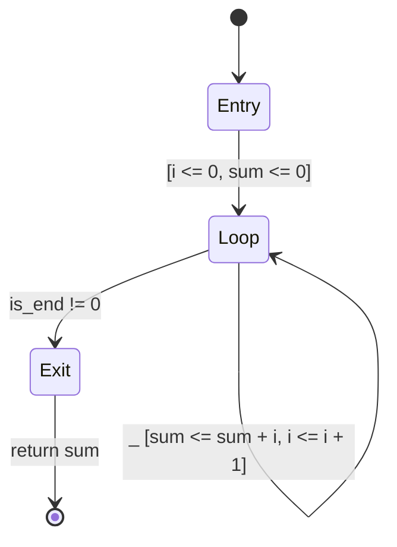

# StateSSA (FlowState) 言語仕様書 (Version 0.15.0)

StateSSA（開発コードネーム: FlowState）は、プログラマの思考範囲を限定し、決定論的でミスのないソフトウェアを設計するために開発された、データフロー・有限状態遷移プログラミング言語です。

---

## 目次

1. [第1章: 概要と設計思想（Introduction & Design Philosophy）](#第1章-概要と設計思想introduction--design-philosophy)
   - 1.1 [StateSSA とは何か？](#11-statessa-とは何か)
   - 1.2 [設計原則](#12-設計原則)
   - 1.3 [従来の言語との設計思想の違い](#13-従来の言語との設計思想の違い)
2. [第2章: クイックスタート（Getting Started）](#第2章-クイックスタートgetting-started)
   - 2.1 [最小のプログラム: Hello, World!](#21-最小のプログラム-hello-world)
   - 2.2 [ループの基礎: Simple Loop（1からNまでの合計計算）](#22-ループの基礎-simple-loop1からnまでの合計計算)
   - 2.3 [ビルドと実行手順](#23-ビルドと実行手順)
   - 2.4 [動作トレースの確認](#24-動作トレースの確認)
3. [第3章: 基本構文と構成要素（Language Fundamentals）](#第3章-基本構文と構成要素language-fundamentals)
   - 3.1 [マシン定義（machine）](#31-マシン定義machine)
   - 3.2 [データパスブロック（flow）: レジスタとワイヤー](#32-データパスブロックflow-レジスタとワイヤー)
   - 3.3 [コントロールパスブロック（states）: 状態と遷移](#33-コントロールパスブロックstates-状態と遷移)
   - 3.4 [ネットワーク定義（network）: ノード束縛とパイプライン](#34-ネットワーク定義network-ノード束縛とパイプライン)
   - 3.5 [式と演算子の優先順位・リテラル一覧](#35-式と演算子の優先順位リテラル一覧)
4. [第4章: 制御フロー設計パターン（Control Flow Patterns）](#第4章-制御フロー設計パターンcontrol-flow-patterns)
   - 4.1 [条件分岐（if-else）: デシジョン・ステート・パターン](#41-条件分岐if-else-デシジョンステートパターン)
   - 4.2 [ループ構造: Entry -> Loop -> Exit パターン](#42-ループ構造-entry---loop---exit-パターン)
   - 4.3 [早期脱出とエラーハンドリング（return / panic）](#43-早期脱出とエラーハンドリングreturn--panic)
   - 4.4 [合流状態におけるレジスタ値の決定（経路調停パターン）](#44-合流状態におけるレジスタ値の決定経路調停パターン)
   - 4.5 [SIMD データ並列処理パターン（音響・数値計算）](#45-simd-データ並列処理パターン音響数値計算)
   - 4.6 [アーキテクチャ制約パイプライン・パターン（同一スタック融合）](#46-アーキテクチャ制約パイプラインパターン同一スタック融合)
5. [第5章: 型システムとメモリモデル（Type System & Memory Model）](#第5章-型システムとメモリモデルtype-system--memory-model)
   - 5.1 [スカラー・プリミティブ型一覧](#51-スカラープリミティブ型一覧)
   - 5.2 [SIMD ベクトル型一覧](#52-simd-ベクトル型一覧)
   - 5.3 [Newtype（単一要素の名前付き型）](#53-newtype単一要素の名前付き型)
   - 5.4 [Bounded Type（上下限付き型）](#54-bounded-type上下限付き型)
   - 5.5 [ポインタ型（*T）と Distinct Memory Hint（distinct *T）](#55-ポインタ型tと-distinct-memory-hintdistinct-t)
   - 5.6 [構造体型（type）とメモリレイアウト](#56-構造体型typeとメモリレイアウト)
   - 5.7 [明示的キャスト（cast）と型の厳格性](#57-明示的キャストcastと型の厳格性)
6. [第6章: モジュール構成と外部連携（Modules & ABI）](#第6章-モジュール構成と外部連携modules--abi)
   - 6.1 [単一定義の原則（Single Definition Rule）](#61-単一定義の原則single-definition-rule)
   - 6.2 [ソースコードの分割と結合（include と宣言順序の独立性）](#62-ソースコードの分割と結合include-と宣言順序の独立性)
   - 6.3 [外部環境連携（extern ブロックと C-ABI / SIMD 境界規約）](#63-外部環境連携extern-ブロックと-c-abi--simd-境界規約)
   - 6.4 [エクスポート制御（封印マシンのシンボル非公開規約）](#64-エクスポート制御封印マシンのシンボル非公開規約)

---

## 第1章: 概要と設計思想（Introduction & Design Philosophy）

### 1.1 StateSSA とは何か？

一般的な命令型言語（C言語、Rust、Goなど）では、コードは文や式の入れ子構造（構文木）として記述されます。開発者はネストした `while` ループや `if-else` 分岐、変数の再代入を用いながら処理を組み立てます。しかし、可変変数へのアクセスが散在し、制御フローが深くなるにつれて、プログラムが「今どの状態にあり、変数がいつ書き換わったのか」を正確に追跡することが難しくなり、バグの原因となります。

StateSSA は、プログラマの思考範囲を限定し、状態とデータの流れを明確に分離するために設計された言語です。

StateSSA には、ネストしたループ構文や隠蔽された三項演算子は存在しません。プログラムは、**データの依存関係を表すデータフロー（ワイヤー）** と、**処理の順序と状態の移り変わりを表す有限状態機械（FSM）** の2つの独立した要素のみで記述されます。これにより、意図しない副作用や暗黙の動作を排除し、仕様通りの決定論的な振る舞いを保証します。

### 1.2 設計原則

StateSSA は、以下の原則に基づいて設計されています。

1. **データパス（`flow`）とコントロールパス（`states`）の分離** :
   - `flow` ブロックには、マシン内で保持するレジスタ（`reg`）と、それらに基づいて計算されるワイヤー（`wire`）のみを宣言します。
   - `states` ブロックには、状態名（State）と、状態間の遷移ルールのみを記述します。
2. **状態ノードにデータを持たせない（引数なし）** :
   - 状態（State）は処理の段階を示すラベルであり、引数や独自の変数を所有しません。データはすべて `flow` ブロックで宣言されたレジスタやワイヤーを経由して扱われます。
3. **式における条件分岐（三項演算子）の禁止** :
   - 式の中に条件分岐（`? :` 三項演算子）を持ち込むことを禁止します。すべての条件分岐は `states` ブロック内の状態遷移として明示的に記述します。これにより、コードと状態遷移図が1対1に対応します。
4. **状態遷移に伴うレジスタ値の更新（ラッチ）** :
   - レジスタの更新は、状態が切り替わる遷移（`[ reg <= expr ]`）においてのみ発生します。コードの任意の場所で変数を再代入することはできません。どの遷移経路を通ったかによって値が確定するため、データの更新タイミングと因果関係が明確になります。
5. **開始状態（`Entry`）の不可逆性** :
   - 各マシンの最初の状態は必ず `Entry` という名前で宣言します。プログラムの開始地点は先行状態を持たない原点であるため、`Entry` 状態へ戻る遷移（`=> Entry`、自己ループ含む）は禁止されます。
6. **マシン間結合の構造化（アーキテクチャ制約）** :
   - マシン間の連携は、アドホックな直接呼出を排し、ネットワークによる明示的なパイプラインとして構造化します。これにより、呼び出し関係のスパゲッティ化を静的に排除します。

### 1.3 従来の言語との設計思想の違い

| 観点 | 従来の言語（C, Rust 等） | StateSSA (FlowState) |
| :--- | :--- | :--- |
| **設計の単位** | 関数・手続き・ネストした文 | データフロー定義 ＋ 有限状態機械（FSM） |
| **変数の扱い** | 再代入可能な可変変数 | 不変の計算式（`wire`）と遷移時に更新される保持値（`reg`） |
| **ループ** | `while` / `for` によるブロックのネスト | 状態遷移エッジによる明示的な再帰遷移 |
| **条件分岐** | `if-else` 文や `? :` 三項演算子 | 状態遷移ルールによる明示的な状態分岐 |
| **状態の把握** | 複数の変数と実行位置の組み合わせで暗黙化 | 現在の状態ノードとレジスタ値として明確に把握可能 |
| **モジュール結合** | 任意の場所からの関数 call | `network` による明示的なトポロジー結合と同一スタック実行 |

---

## 第2章: クイックスタート（Getting Started）

### 2.1 最小のプログラム: Hello, World!

文字列を出力する最小のプログラムです。外部の C 標準ライブラリ関数（`puts`）を呼び出し、終了コード `0` を返します。

```
// hello_world.ssa
extern {
    fn puts(s: *u8) -> i32;
}

machine main() -> i32 {
    flow {}
    states {
        Entry: {
            let _ = call puts("Hello, StateSSA World!");
            _ => return 0;
        }
    }
}
```

- `extern { ... }` : 外部の C-ABI 関数を宣言します。
- `machine main() -> i32` : エントリーポイントとなるマシンを定義します。
- `flow {}` : レジスタやワイヤーが不要な場合は空とします。
- `Entry:` : マシン開始時に最初に実行される必須の状態です。
- `let _ = call puts(...)` : 関数を呼び出し、戻り値を破棄（`_`）します。
- `_ => return 0;` : 無条件（`_`）にマシンを終了し、戻り値 `0` を返します。

---

### 2.2 ループの基礎: Simple Loop（1からNまでの合計計算）

StateSSA におけるループの記述例として、0 から 10 までの整数の総和を計算するプログラムです。

```
// simple_loop.ssa
machine sum_to_n(limit: u32) -> u32 {
    flow {
        reg i:   u32 = 0;
        reg sum: u32 = 0;

        wire is_end   = i >= limit;
        wire next_sum = sum + i;
        wire next_i   = i + 1;
    }
    states {
        Entry: {
            _ => Loop [ i <= 0, sum <= 0 ];
        }
        Loop: {
            is_end != 0 => Exit;
            _           => Loop [ sum <= next_sum, i <= next_i ];
        }
        Exit: {
            _ => return sum;
        }
    }
}
```

このプログラムの状態遷移は、以下の Mermaid 状態遷移図と1対1に対応します。



---

### 2.3 ビルドと実行手順

StateSSA コンパイラ（`bin/ssac`）は、ソースコードからオブジェクトファイル（`.o`）または LLVM IR テキスト（`.ll`）を出力します。生成されたオブジェクトファイルを実行形式にするには、システムの C コンパイラやリンカ（Clang, GCC 等）を用いて C ランタイム（CRT）とリンクします。

#### 1. オブジェクトファイル出力（`-o <file>.o` オプション）
コンパイラ単体でターゲット環境の最適化済みネイティブオブジェクトファイル（`.o`）を直接生成します：

```bash
# 1. StateSSA ソースコードからオブジェクトファイル (.o) を生成
bin/ssac hello_world.ssa -o hello_world.o

# 2. システムの C コンパイラ / リンカで実行可能バイナリへリンク
clang hello_world.o -o hello_world

# 3. 実行
./hello_world
# 出力: Hello, StateSSA World!
```

#### 2. LLVM IR テキスト出力（`-o <file>.ll` オプション）
中間表現である LLVM IR テキスト形式を出力します：

```bash
# 1. StateSSA ソースコードを LLVM IR (.ll) へコンパイル
bin/ssac hello_world.ssa -o hello_world.ll

# 2. C コンパイラ / リンカでネイティブバイナリへビルド
clang -O2 hello_world.ll -o hello_world

# 3. 実行
./hello_world
```

#### 3. C 言語ドライバとのリンク実行
`main` 関数を C 言語で記述し、StateSSA で記述したマシンをライブラリとしてリンクして実行することも可能です。

```c
// main.c
#include <stdio.h>
#include <stdint.h>

extern uint32_t sum_to_n(uint32_t limit);

int main(void) {
    uint32_t res = sum_to_n(10);
    printf("sum_to_n(10) = %u\n", res); // 45
    return 0;
}
```

```bash
# StateSSA マシンをコンパイル
bin/ssac simple_loop.ssa -o simple_loop.ll

# C 言語ドライバと一緒にリンク
clang -O2 main.c simple_loop.ll -o test_loop
./test_loop
# 出力: sum_to_n(10) = 45
```

---

### 2.4 動作トレースの確認

デバッグフラグ（`--trace`）を指定してコンパイルすると、状態遷移のたびに遷移元、遷移先、レジスタ値の変化が標準エラー出力に出力されます。

```bash
bin/ssac simple_loop.ssa --trace -o simple_loop.ll
clang simple_loop.ll -o simple_loop
./simple_loop
```

---

## 第3章: 基本構文と構成要素（Language Fundamentals）

### 3.1 マシン定義（machine）

マシン（`machine`）は、独立した処理の単位です。引数と戻り値を持ち、外部からは通常の関数インターフェースとして見えます。

```
machine マシン名(引数リスト) -> 戻り値型 {
    flow {
        // レジスタとワイヤーの宣言
    }
    states {
        // 状態と遷移ルールの記述
    }
}
```

---

### 3.2 データパスブロック（flow）: レジスタとワイヤー

`flow` ブロック内には、状態をまたいで保持される `reg`（レジスタ）と、レジスタから計算される不変の論理式 `wire`（ワイヤー）を記述します。

```
flow {
    reg カウンタ名: 型 = 初期値;
    wire ワイヤー名 = 計算式;
}
```

- **レジスタ（`reg`）**: 状態遷移の瞬間にのみ新しい値がラッチされます。
- **ワイヤー（`wire`）**: 依存元のレジスタや引数が変化した瞬間に即時評価される純粋な計算式です。

---

### 3.3 コントロールパスブロック（states）: 状態と遷移

`states` ブロック内には、マシンの取り得る状態と、各状態における評価ルールを記述します。

```
states {
    状態名: {
        ガード条件1 => 遷移先状態 [ レジスタ <= 更新値, ... ];
        _           => デフォルト遷移先;
    }
}
```

- **ガード条件**: `i1`（真偽値）として評価される式です。上から順に評価され、最初に真となったルールの遷移が実行されます。
- **ワイルドカード（`_`）**: どのガードにも一致しなかった場合の無条件遷移を表します。

---

### 3.4 ネットワーク定義（network）: ノード束縛とパイプライン

ネットワーク（`network`）は、複数のマシンを直列結合し、単一の確定パイプラインとして統合するトップレベル構文です。

```
network ネットワーク名(引数リスト) -> 戻り値型 {
    node ノード名1 = マシン名1;
    node ノード名2 = マシン名2;

    pipeline: ノード名1 >> ノード名2;
}
```

#### 構文規則とセマンティクス
1. **排他ノード束縛**:
   `node` として宣言されたマシンはアーキテクチャ部品として専任化され、外部コードや他マシンからの直接呼び出しは禁止されます（コンパイルエラー `TypeError`）。
2. **単体関数の非公開化**:
   `node` 束縛されたマシンは、単体 LLVM 関数（`@machine`）としてのシンボルエクスポートが抑止されます。
3. **具象型パイプライン結合**:
   `>>` 演算子により、前段ノードの戻り値型と次段ノードの引数型が完全に一致していることが静的に検証されます。
4. **同一スタック・インライン融合（Same-Stack Fusion）**:
   ネットワーク内部に含まれるノードマシン群は、個別の関数呼び出し（`call`）を行わず、親ネットワークの同一スタックフレーム上に Basic Block 群としてインライン展開されます。

---

### 3.5 式と演算子の優先順位・リテラル一覧

| 優先度 | 演算子 | 説明 | 結合性 |
| :---: | :--- | :--- | :---: |
| 1 | `()`, 構造体アクセス (`.`) | グループ化、フィールド参照 | 左 |
| 2 | 単項 `+`, `-`, `*` | 符号、ポインタデリファレンス | 右 |
| 3 | `*`, `/` | 乗算、除算 | 左 |
| 4 | `+`, `-` | 加算、減算 | 左 |
| 5 | `<<`, `>>` | ビットシフト | 左 |
| 6 | `<`, `<=`, `>`, `>=` | 大小比較 | 左 |
| 7 | `==`, `!=` | 等価比較 | 左 |
| 8 | `&` | ビット論理積 | 左 |
| 9 | `^` | ビット排他的論理和 | 左 |
| 10 | `\|` | ビット論理和 | 左 |

---

## 第4章: 制御フロー設計パターン（Control Flow Patterns）

### 4.1 条件分岐（if-else）: デシジョン・ステート・パターン

StateSSA には構文木としての `if-else` 文は存在しません。状態遷移のガード条件を用いて明示的な分岐を表現します。

```
states {
    Entry: {
        val > 0  => PositiveState;
        val < 0  => NegativeState;
        _        => ZeroState;
    }
    PositiveState: {
        _ => return 1;
    }
    NegativeState: {
        _ => return -1;
    }
    ZeroState: {
        _ => return 0;
    }
}
```

---

### 4.2 ループ構造: Entry -> Loop -> Exit パターン

ループは、`Loop` 状態から自身への再帰遷移（自己ループ）によって表現されます。

```
states {
    Entry: {
        _ => Loop [ i <= 0 ];
    }
    Loop: {
        i >= 10 => Exit;
        _       => Loop [ i <= i + 1 ];
    }
    Exit: {
        _ => return;
    }
}
```

---

### 4.3 早期脱出とエラーハンドリング（return / panic）

異常系を検出した場合は、`return` による値の返却、または `panic` による即時トラップ（`@llvm.trap`）を選択します。

```
states {
    Entry: {
        ptr == null => ErrorExit;
        _           => ProcessState;
    }
    ErrorExit: {
        _ => panic; // LLVM trap により異常停止
    }
    ProcessState: {
        _ => return 0;
    }
}
```

---

### 4.4 合流状態におけるレジスタ値の決定（経路調停パターン）

複数の遷移元から単一の状態へ合流する場合、どの遷移経路を通過したかによってレジスタに異なる値をラッチします。これは LLVM SSA における `phi` ノードと 1:1 に対応します。

```
states {
    Branch: {
        flag != 0 => Merge [ result <= 100 ];
        _         => Merge [ result <= 200 ];
    }
    Merge: {
        _ => return result;
    }
}
```

---

### 4.5 SIMD データ並列処理パターン（音響・数値計算）

音響信号処理や物理計算などの高負荷ループでは、SIMD ベクトル型（`f32x8` 等）を用いて 1 サイクルあたり複数データを一括処理します。

```
machine process_audio(in: *f32x8, out: *f32x8, len: i32) -> void {
    flow {
        reg idx: i32 = 0;
    }
    states {
        Entry: { _ => Loop; }
        Loop: {
            idx >= len => Exit;
            _          => Loop [ idx <= idx + 1 ];
        }
        Exit: { _ => return; }
    }
}
```

---

### 4.6 アーキテクチャ制約パイプライン・パターン（同一スタック融合）

独立したマシン群を `network` でパイプライン結合します。各マシンが内部に複数の状態（FSM）を持つ場合でも、前段マシンの各 `return` パスは次段マシンの `Entry` 直前の合流ブロックへと短絡ジャンプし、`phi` ノードによって値が調停されます。

```
machine Sensor() -> f32 {
    flow {}
    states {
        Entry: { _ => return 10.0; }
    }
}

machine Filter(in: f32) -> f32 {
    flow {}
    states {
        Entry: {
            in > 5.0 => High;
            _        => Low;
        }
        High: { _ => return in * 2.0; }
        Low:  { _ => return 0.0; }
    }
}

network ProcessingPipeline() -> f32 {
    node s = Sensor;
    node f = Filter;

    pipeline: s >> f;
}
```

- `ProcessingPipeline` の内部には `call` 命令が生成されず、Basic Block 間ジャンプ（`br`）に変換されます。
- 親のスタックフレーム上でインライン展開されて実行されます。

---

## 第5章: 型システムとメモリモデル（Type System & Memory Model）

### 5.1 スカラー・プリミティブ型一覧

| 型名 | ビット幅 | 説明 |
| :--- | :---: | :--- |
| `i8`, `i16`, `i32`, `i64` | 8, 16, 32, 64 | 符号付き整数 |
| `u8`, `u16`, `u32`, `u64` | 8, 16, 32, 64 | 符号なし整数 |
| `f32`, `f64` | 32, 64 | IEEE 754 単精度・倍精度浮動小数点数 |
| `q64` | 64 | 符号付き固定小数点数（Q32.32）。完全決定論的数値計算を保証 |
| `i1` | 1 | 真偽値・述語ビット |
| `void` | 0 | 戻り値なし |

---

### 5.2 SIMD ベクトル型一覧

| 型名 | 要素数 | 合計ビット幅 | 主な用途 |
| :--- | :---: | :---: | :--- |
| `f32x4`, `f32x8`, `f32x16` | 4, 8, 16 | 128, 256, 512 | 単精度浮動小数点 SIMD（音響・物理・グラフィックス） |
| `f64x2`, `f64x4`, `f64x8` | 2, 4, 8 | 128, 256, 512 | 倍精度浮動小数点 SIMD（高精度数値解析） |
| `i32x4`, `i32x8`, `i32x16` | 4, 8, 16 | 128, 256, 512 | 整数ベクトル並列計算 |
| `u8x16` | 16 | 128 | バイトストリーム・文字列処理 |

---

### 5.3 Newtype（単一要素の名前付き型）

物理量（長さ、時間、質量など）を取り違えて計算することをコンパイル時に静的排除するための名目的型（Nominal Type）です。

```
type Meter = f32;
type Second = f32;
```

#### 演算規則と型制約
1. **ゼロコスト抽象化**:
   Newtype はコンパイル時の静的検査でのみ機能し、生成される LLVM IR 上では基底型（`float`）として直接展開されます。ラッパー構造体やメモリ割り当てなどの実行時オーバーヘッドは 0 です。
2. **同型同士の演算**:
   同じ Newtype 同士の加算（`+`）、減算（`-`）、比較（`==`, `<`, 等）が許可され、結果は同一の Newtype または `i1` となります。
   ```
   let m1: Meter = 10.0;
   let m2: Meter = 20.0;
   let m3: Meter = m1 + m2; // OK
   ```
3. **スカラー乗除算**:
   Newtype と基底スカラー型（`f32`, `i32` 等）との乗算（`*`）および除算（`/`）が許可され、結果は元の Newtype を保持します。
   ```
   let doubled: Meter = m1 * 2.0; // OK: スカラー倍
   ```
4. **暗黙縮退の禁止**:
   異なる Newtype 同士の加算や代入、基底型への暗黙代入はコンパイルエラー（`TypeError`）となります。
   ```
   let s: Second = 5.0;
   let bad = m1 + s;      // ERROR: Meter と Second は加算不可
   let raw: f32 = m1;     // ERROR: BaseType への暗黙代入不可
   ```

---

### 5.4 Bounded Type（上下限付き型）

値の取り得る範囲を型のレベルで静的に宣言します。

```
type NormalizedSignal = f32[-1.0 .. 1.0];
type ByteRange = i32[0 .. 255];
type FixedRatio = q64[0.0 .. 1.0];
```

#### 確定レイテンシ・自動クランプ
1. **ブランチフリー・ハードウェアクランプ**:
   Bounded Type への代入やキャスト、外部呼出境界において、コンパイラは `br` 命令を使わず、ハードウェア直接マッピングの `llvm.minnum` / `llvm.maxnum`、または `select` 命令による完全ブランチフリー（ジッター 0）のクランプコードを生成します。
2. **IEEE 754 NaN 抑制**:
   浮動小数点演算において計算途中に NaN（`0.0 / 0.0`）や $\pm\infty$ が混入した場合でも、実行時に即座に安全な上下限値へと確定収束させ、シミュレーションの発散クラッシュを防止します。

---

### 5.5 ポインタ型（*T）と Distinct Memory Hint（distinct *T）

StateSSA は、アドレス演算を行う生ポインタ型（`*T`）をサポートします。

#### Distinct Memory Hint (`distinct *T`)
関数の引数において、他のどの引数ともメモリ領域が重複（エイリアス）していないことを保証する修飾子です。

```
machine VectorAdd(a: distinct *f32, b: distinct *f32, c: distinct *f32, n: i32) -> void {
    // a, b, c の指すメモリ領域は互いに独立
}
```

#### コンパイラ最適化と静的検証
1. **LLVM `noalias` 直結**:
   `distinct *T` 引数は、LLVM IR 上で `noalias` 属性として出力されます。これにより、LLVM 公式エイリアス解析において NoAlias と判定されます。
2. **実行時チェックの消滅**:
   通常ポインタの配列ループでは、メモリ重複を懸念して数十行に及ぶ実行時重複比較チェック分岐（`vector.memcheck`）が生成されますが、`distinct` を付与することでこのチェック分岐が生成されず、クリーンなループへ収束します。
3. **コンパイル時重複排除**:
   呼び出し側において、同一シンボルの重複渡し、オフセット演算付きポインタ（`buf + 10`）の重複渡し、ローカル変数（`let`）経由の間接エイリアス重複渡しは、コンパイル時に即座に拒絶（`TypeError`）されます。

---

### 5.6 構造体型（type）とメモリレイアウト

複数のフィールドを持つ複合型を定義します。C 言語の構造体と完全な ABI 互換性を持ちます。

```
type Complex = {
    real: f32,
    imag: f32
};
```

---

### 5.7 明示的キャスト（cast）と型の厳格性

StateSSA では、暗黙の型変換（ビット幅の自動拡張・切り捨てや、ポインタと整数の暗黙混在）を行いません。
異なる型の間で値を渡す場合は、すべて `cast(TargetType)` を用いて明示的に変換する必要があります。

- **型の完全一致**: 関数の引数、レジスタへのラッチ代入、メモリストア、マシンの戻り値において、変数の型は要求される型と完全に一致している必要があります。
- **リテラル定数の自動解決**: 型を持たない整数リテラル（`0`, `42` 等）は、代入先や引数の整数型に合わせて直接解釈されます。小数リテラル（`1.5` 等）は、コンテキストに応じて `f32`, `f64`, `q64` へ自動解決されます。`null` リテラルは任意のポインタ型（`*T`）に適合します。
- **明示的キャスト（`cast`）の適用規則**:
  - 整数から `q64` への変換（例: `cast(q64) int_val`）
  - `q64` から整数への変換（例: `cast(i32) q_val`、小数部切り捨て）
  - **`q64` と浮動小数点数（`f32`/`f64`）の相互変換**:
    - `cast(f32) q_val`: Q32.32 固定小数点数を `float` へ変換
    - `cast(q64) f_val`: `float` / `double` を Q32.32 固定小数点数へ変換
  - 整数のビット幅拡張（例: `u8` から `i64`、符号付きは符号拡張、符号なしはゼロ拡張）
  - 整数のビット幅縮小（例: `u64` から `u32`、上位ビット切り捨て）
  - 整数とポインタのアドレス相互変換
  - ポインタ型同士のキャスト（例: `*Buffer` から `*u8`）

```
// 整数から q64 への明示的変換
let q_val = cast(q64) int_val;

// q64 から整数への明示的変換（小数部切り捨て）
let int_res = cast(i32) q_val;

// q64 と浮動小数点数の相互変換
let f_val = cast(f32) q_val;
let q_back = cast(q64) f_val;

// 整数の明示的な拡張
let wide_val = cast(i64) small_u8;

// 整数の切り捨て（明示必須）
let byte_val = cast(u8) wide_i32;

// 整数とポインタのアドレス変換（明示必須）
let ptr = cast(*u8) int_address;

// ポインタ型の解釈変更（明示必須）
let raw_bytes = cast(*u8) struct_ptr;
```

---

## 第6章: モジュール構成と外部連携（Modules & ABI）

### 6.1 単一定義の原則（Single Definition Rule）

すべてのマシン、型、ネットワーク、外部関数は、プログラム全体で一意の名前を持つ必要があります。同名の再定義やオーバーロードは禁止されています。

---

### 6.2 ソースコードの分割と結合（include と宣言順序の独立性）

`include "パス";` を用いて他のソースコードを取り込みます。StateSSA コンパイラは二層リレーショナル解決を行うため、マシンや型の宣言順序に依存しません。

```
include "types.ssa";
include "filters.ssa";
```

---

### 6.3 外部環境連携（extern ブロックと C-ABI / SIMD 境界規約）

C 言語ライブラリや OS システムコールと直接連携するために、`extern` ブロックを使用します。

```
extern {
    fn memcpy(dest: *u8, src: *u8, n: u64) -> *u8;
}
```

---

### 6.4 エクスポート制御（封印マシンのシンボル非公開規約）

通常のマシンは、リンク可能な C 関数シンボル（`define @MachineName`）としてエクスポートされます。
しかし、**`network` 内で `node` として束縛されたマシンは、シンボルエクスポートが抑止されます**。これにより、外部からの不正な直接呼び出しを遮断します。
