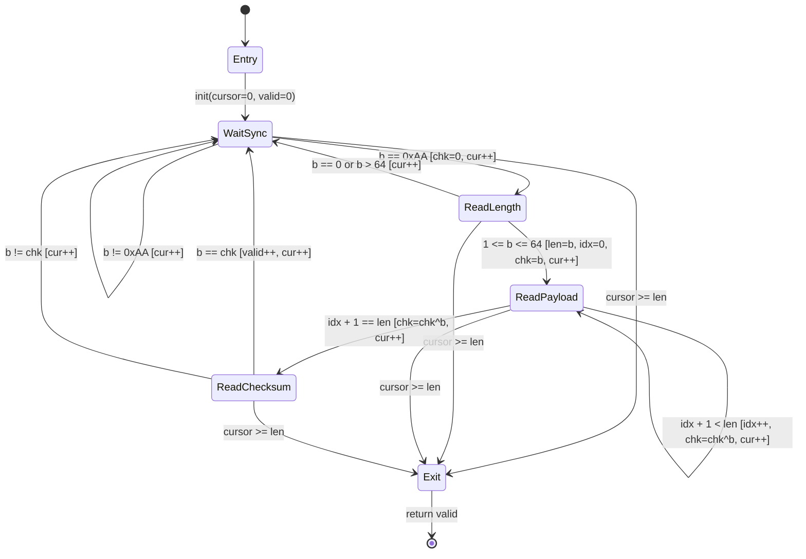
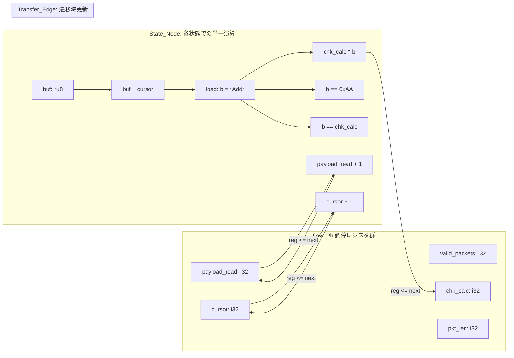

# 第1章：状態と制御のトレードオフ —— 構造化構文木の境界と StateSSA の設計思想

## 1. 課題の工学的所在 (Problem Context & Motivation)

### 1.1 構造化プログラミングの工学的達成と直観的生産性
現代のソフトウェア産業の基盤を築いた C/C++、Go、Rust、Java といった言語群は、エドガー・ダイクストラらが提唱した「構造化プログラミング」の思想を極めて高い完成度で具現化してきた。
順次（Sequence）、選択（Selection: `if` / `switch`）、反復（Iteration: `while` / `for`）という 3 つの制御基本構造によってプログラムを階層的なブロックへと体系化し、スコープ（レキシカルスコープ）によって変数の生存期間を幾何学的に閉じ込める設計は、人類のプログラミング生産性を飛躍的に向上させた。

この抽象化がもたらした最大の恩恵は、**「人間の日常的な思考順序（上から下へ、条件に応じて枝分かれし、終わったら戻る）との高い整合性」** にある。手続きの積み重ねによってドメインロジックを直観的に記述できる表現力、豊かなライブラリ群、そして数十年にわたるコンパイラ最適化の蓄積は、今なお大半の汎用ソフトウェア開発において代替不能な価値を提供し続けている。

### 1.2 境界条件における構造的摩擦：状態空間の散在と if/while ネスト
しかし、対象とするドメインが **「通信プロトコルデコーダ」「ストリームパーサー」「デバイスドライバ」「ハードウェア制御」「ミッションクリティカルな高信頼ステートマシン」** のように、離散的な状態遷移を本質とする領域へシフトしたとき、構造化構文木は明確な工学的摩擦を生じさせ始める。

手続き型言語において状態機械を表現する場合、一般に以下のいずれかのアプローチが採られる：

1. **暗黙的状態管理**:
   深い `while` ループの内部に `if` / `else if` の多重ネストを配置し、ループローカルな可変変数（フラグ、インデックス、中間バッファ）をインプレースで上書き（In-place Mutation）しながら順次進行する。
2. **明示的状態管理**:
   列挙型（`enum State`）と `switch (state)` 文を用い、状態変数をループごとに評価して遷移先を切り替える。

いずれのアプローチにおいても、システムの規模が拡大するにつれて以下の 3 点の工学的問題が不可避に顕在化する：

- **暗黙の経路爆発（サイクロマティック複雑度の増大）**:
  ネストされた条件分岐の組み合わせにより、コードの字面上の行数に対して実行可能なパスの総数が指数関数的に増大する。すべての分岐網羅（C1カバレッジ）や条件網羅（MC/DC）を達成するためのテストケース設計コストは膨大なものとなる。
- **時間軸上の可変状態の散在**:
  変数の値がプログラムの任意の位置で破壊的に更新されるため、「ある行が実行されている瞬間において、変数 $X$ と変数 $Y$ の整合性が保たれているか」という不変量（Invariant）の検証が局所的に完結しない。変数のスコープが広がるほど、時間軸に沿った全経路の追跡が人間のワーキングメモリの限界を超える。
- **制御フローグラフ（CFG）の暗黙化**:
  プログラマーが頭の中で描いている論理モデルは「ノード間を遷移する有限状態遷移図（FSM）」であるにもかかわらず、ソースコード上には `break`, `continue`, `return`, フラグ変数の更新が散在し、真の遷移関係が構文木の奥深くに埋没する。

---

## 2. 構造モデルの定義 (Theoretical & Architectural Model)

### 2.1 抽象構文木（AST）と制御フローグラフ（CFG）のトポロジー的乖離
コンパイラ工学（特に LLVM や GCC などの現代的最適化インフラ）において、ソースコードの抽象構文木（AST: Abstract Syntax Tree）はそのままの形では実行されない。
コンパイラの中間表現（IR）生成フェーズでは、まず階層的な AST が平坦化（Flattening）され、分岐やループは **Basic Block（基本ブロック）** と **有向エッジ（Transfer Edge）** から構成される **制御フローグラフ（CFG: Control Flow Graph）** へと変換される。

さらに、メモリ上の可変変数へのアクセス（`alloca`, `load`, `store`）は、**SSA（Static Single Assignment: 静的単一代入）** 形式へと変換（Mem2Reg）される。SSA 形式においては、あらゆる変数は厳密に一度だけ代入され、複数の経路から値が合流する地点には明示的な **$\phi$（Phi）ノード（多重化オペレータ）** が挿入される。

```text
[プログラマーの思考]       [コンパイラとハードウェアの現実]
階層的 AST (while / if)  --->  制御フローグラフ (CFG) + SSA データフロー
可変な箱 (Mutable Box)   --->  不変ワイヤー (Data Stream) + Phi 調停
```

従来の構造化言語を記述する際、プログラマーは「構文木と可変変数」という抽象化レイヤーで思考し、コンパイラはその意図を推測して「CFG と SSA」へと再構築している。
StateSSA の設計思想である **`Dataflow-StateMachine-Direct-Cognition`** は、このトポロジー的乖離を根本から解消することを目的としている。すなわち、最初から構文木の階層化を排除し、**「プログラマーが直接 CFG（有限状態遷移）と SSA（データストリーム）で思考し、そのまま記述する」** というパラダイムである。

### 2.2 プロトコルデコーダの工学モデル
本章で題材とするバイナリプロトコルデコーダを、有限状態機械（FSM）およびデータフロー（DFD）として厳密に数理モデル化する。

#### パケットの構造仕様
- `SYNC` (1 byte): 同期バイト（固定値 `0xAA` = 170）
- `LEN` (1 byte): ペイロード長 $L$ ($1 \le L \le 64$)
- `DATA` ($L$ bytes): ペイロードバイト列
- `CHKSUM` (1 byte): 検証用チェックサム（`LEN` および全 `DATA` バイトの累積 XOR 値）

#### 状態遷移モデル (Mermaid `stateDiagram-v2`)
プロトコルのライフサイクルは、5 つの離散的な状態ノード（State_Node）と、1-bit 述語によって評価される遷移有向辺（Transfer_Edge）によって完全に表現される。



#### データフローモデル (Mermaid `flowchart LR`)
システム内を流れる値は、破壊的代入を許されない「不変の型付きワイヤー（Data Stream）」である。状態の境界を越えて伝播するワイヤーは、状態境界（State Boundary）において明示的な多重化（Phi 調停）を受ける。



---

## 3. 実装の具象化 (Concrete StateSSA Implementation)

### 3.1 手続き型言語（C言語）による典型的実装とその認知負荷
まず、既存の手続き型言語（C言語）において同等のデコーダを記述した場合のコードを観察する。

```c
// C言語による典型的な実装例（概念対比）
int decode_stream_c(const uint8_t *buf, int len) {
    int cursor = 0;
    int valid_packets = 0;
    enum { ST_WAIT_SYNC, ST_READ_LEN, ST_READ_PAYLOAD, ST_READ_CHK } state = ST_WAIT_SYNC;
    
    int pkt_len = 0;
    int payload_read = 0;
    uint8_t chk_calc = 0;

    while (cursor < len) {
        uint8_t b = buf[cursor++];
        switch (state) {
            case ST_WAIT_SYNC:
                if (b == 0xAA) {
                    chk_calc = 0;
                    state = ST_READ_LEN;
                }
                break;
            case ST_READ_LEN:
                if (b == 0 || b > 64) {
                    state = ST_WAIT_SYNC;
                } else {
                    pkt_len = b;
                    payload_read = 0;
                    chk_calc = b;
                    state = ST_READ_PAYLOAD;
                }
                break;
            case ST_READ_PAYLOAD:
                chk_calc ^= b;
                payload_read++;
                if (payload_read == pkt_len) {
                    state = ST_READ_CHK;
                }
                break;
            case ST_READ_CHK:
                if (b == chk_calc) {
                    valid_packets++;
                }
                state = ST_WAIT_SYNC;
                break;
        }
    }
    return valid_packets;
}
```

この C 言語コードは一見明瞭であるが、コンパイラ最適化や静的解析の観点からは以下の構造的課題を抱えている：
1. `cursor`, `valid_packets`, `state`, `chk_calc`, `pkt_len`, `payload_read` という 6 個の変数が、関数の全スコープにわたって可変（Mutable）として存在している。
2. `switch (state)` の各分岐内でどの変数が更新され、どの変数が維持されているのかが構文上明示されない。
3. ループの先頭で無条件に `cursor++` が実行されるため、状態遷移のガード条件とバッファ消費のタイミングが時間的に分離・結合し、オフバイワン（1バイトズレ）の温床となる。

### 3.2 StateSSA による完全平坦化実装
以下に、StateSSA で記述された完全なプロトコルデコーダのコードを示す。このコードは実際に `bin/ssac` コンパイラによって LLVM IR へと変換され、ネイティブバイナリとして実動検証された純粋な実装である。

```ssa
// ============================================================================
// StateSSA Architecture Guide - Chapter 1 Sample
// File: samples/architecture_guide/01_protocol_fsm/protocol_decoder.ssa
// ============================================================================

machine decode_stream(buf: *u8, len: i32) -> i32 {
    flow {
        reg cursor: i32 = 0;
        reg valid_packets: i32 = 0;
        reg chk_calc: i32 = 0;
        reg pkt_len: i32 = 0;
        reg payload_read: i32 = 0;
    }

    states {
        Entry: {
            _ => WaitSync [ cursor <= 0, valid_packets <= 0, chk_calc <= 0, pkt_len <= 0, payload_read <= 0 ];
        }

        WaitSync: {
            cursor >= len => Exit;
            let b = cast(i32) *(buf + cursor);
            b == 0xAA => ReadLength [ cursor <= cursor + 1, chk_calc <= 0 ];
            _ => WaitSync [ cursor <= cursor + 1 ];
        }

        ReadLength: {
            cursor >= len => Exit;
            let b = cast(i32) *(buf + cursor);
            b == 0 => WaitSync [ cursor <= cursor + 1 ];
            b > 64 => WaitSync [ cursor <= cursor + 1 ];
            _ => ReadPayload [ cursor <= cursor + 1, pkt_len <= b, payload_read <= 0, chk_calc <= b ];
        }

        ReadPayload: {
            cursor >= len => Exit;
            let b = cast(i32) *(buf + cursor);
            let next_chk = chk_calc ^ b;
            let next_read = payload_read + 1;
            next_read == pkt_len => ReadChecksum [ cursor <= cursor + 1, chk_calc <= next_chk ];
            _ => ReadPayload [ cursor <= cursor + 1, payload_read <= next_read, chk_calc <= next_chk ];
        }

        ReadChecksum: {
            cursor >= len => Exit;
            let b = cast(i32) *(buf + cursor);
            b == chk_calc => WaitSync [ cursor <= cursor + 1, valid_packets <= valid_packets + 1 ];
            _ => WaitSync [ cursor <= cursor + 1 ];
        }

        Exit: {
            _ => return valid_packets;
        }
    }
}
```

### 3.3 構文要素の工学的解剖

#### `machine` シグネチャと C ABI 境界
`machine decode_stream(buf: *u8, len: i32) -> i32` は、標準 C ABI（呼び出し規約）に準拠した関数シンボルとしてエクスポートされる。第 1 引数 `buf` はポインタ型 `i8*`、第 2 引数 `len` は `i32`、戻り値は `i32` であり、呼び出し元（C, C++, Rust 等）からは通常のネイティブ関数としてゼロオーバーヘッドで透過的に呼び出すことができる。

#### `flow` ブロック：状態間 Phi 調停レジスタの明示
`flow` ブロック内で宣言される `reg` は、状態ノードの境界を越えて流れる「状態保持ワイヤー」である。
ここで重要なのは、`reg` は「メモリ上の可変な変数」を意味するのではなく、**「有向グラフの合流点（Basic Block の入口）に自動挿入される LLVM の $\phi$（Phi）ノードの受入口」** を宣言している点である。

#### `states` ブロック：階層ネストのない完全平坦な状態頂点群
`states` ブロックの内部には、`Entry`, `WaitSync`, `ReadLength`, `ReadPayload`, `ReadChecksum`, `Exit` という 6 つの状態ノードが並列に定義されている。
ここには `while` も `for` も `if` も存在しない。あらゆるロジックは「その状態で行う単一代入（`let`）」と「次へ進むための有向辺の評価（`述語 => 遷移先 [ レジスタ更新 ]`）」のみで構成される。

#### 遷移述語と Phi 入力の結合
```ssa
b == 0xAA => ReadLength [ cursor <= cursor + 1, chk_calc <= 0 ];
```
この記法は、「条件 `b == 0xAA` が真である場合、制御を `ReadLength` ノードへ遷移させ、その際に `ReadLength` の入口にある `cursor` レジスタへ `cursor + 1` の値を、`chk_calc` レジスタへ `0` の値を供給する」というハードウェアのマルチプレクサ（MUX）の動作を直接的に記述している。
指定されなかったレジスタ（`valid_packets`, `pkt_len`, `payload_read`）は、現在の値がそのまま維持されて合流点へ渡される。これにより、**「状態遷移に伴う値の引き継ぎが、遷移有向辺の上に厳密に束縛される」** という数学的不変量が保証される。

---

## 4. 実行挙動と計算機モデル (Execution Trace & Lowering)

### 4.1 入力系列に対する決定論的実行トレース
以下の 22 バイトのテストストリームが入力された際の、有限状態機械の決定論的遷移挙動をトレースする。

```text
バイト列オフセット:
00: 0xAA (Sync)
01: 0x03 (Len = 3)
02: 10, 03: 20, 04: 30 (Payload)
05: 0x03 (Chk = 3 ^ 10 ^ 20 ^ 30 = 3)   --> [Packet 1: 正常]
06: 0x12, 07: 0xFF, 08: 0x00            --> [Noise: ゴミバイト]
09: 0xAA (Sync)
10: 0x02 (Len = 2)
11: 05, 12: 09 (Payload)
13: 14 (Chk = 2 ^ 5 ^ 9 = 14)           --> [Packet 2: 正常]
14: 0xAA (Sync)
15: 0x01 (Len = 1)
16: 07 (Payload)
17: 99 (Chk 破損: 期待値 6 に対し 99)   --> [Packet 3: チェックサムエラー破棄]
18: 0xAA (Sync)
19: 0x01 (Len = 1)
20: 42 (Payload)
21: 43 (Chk = 1 ^ 42 = 43)              --> [Packet 4: 正常]
```

| ステップ | `cursor` | 入力バイト `b` | 現在の状態 | 評価述語 | 遷移先状態 | `valid_packets` | `chk_calc` |
| :--- | :--- | :--- | :--- | :--- | :--- | :--- | :--- |
| 1 | 0 | `0xAA` | `WaitSync` | `b == 0xAA` | `ReadLength` | 0 | 0 |
| 2 | 1 | `3` | `ReadLength` | `1 <= b <= 64` | `ReadPayload` | 0 | 3 |
| 3 | 2 | `10` | `ReadPayload` | `1 < 3` | `ReadPayload` | 0 | $3 \oplus 10 = 9$ |
| 4 | 3 | `20` | `ReadPayload` | `2 < 3` | `ReadPayload` | 0 | $9 \oplus 20 = 29$ |
| 5 | 4 | `30` | `ReadPayload` | `3 == 3` | `ReadChecksum` | 0 | $29 \oplus 30 = 3$ |
| 6 | 5 | `3` | `ReadChecksum` | `b == chk_calc` | `WaitSync` | **1** | 3 |
| 7 | 6 | `0x12` | `WaitSync` | `_` (ノイズ) | `WaitSync` | 1 | 3 |
| 8 | 7 | `0xFF` | `WaitSync` | `_` (ノイズ) | `WaitSync` | 1 | 3 |
| 9 | 8 | `0x00` | `WaitSync` | `_` (ノイズ) | `WaitSync` | 1 | 3 |
| 10 | 9 | `0xAA` | `WaitSync` | `b == 0xAA` | `ReadLength` | 1 | 0 |
| ... | ... | ... | ... | ... | ... | ... | ... |
| 17 | 17 | `99` | `ReadChecksum` | `99 != 6` (破棄) | `WaitSync` | 2 (不変) | 6 |
| ... | ... | ... | ... | ... | ... | ... | ... |
| 21 | 21 | `43` | `ReadChecksum` | `43 == 43` | `WaitSync` | **3** | 43 |
| 22 | 22 | N/A | `WaitSync` | `cursor >= len` | `Exit` | **3** | 43 |

すべての遷移ステップにおいて、隠蔽された内部フラグや未定義の経路は一切存在せず、完全な決定論性をもって進行する。

### 4.2 コンパイラ（`ssac`）による LLVM IR への 1 対 1 マッピングの工学的証明
StateSSA コンパイラ（`ssac`）がこのコードから生成した LLVM IR（`protocol_decoder.ll`）の実際の抜粋を以下に示す。

```llvm
define i32 @decode_stream(i8* %arg_buf, i32 %arg_len) {
entry:
  br label %WaitSync

WaitSync:
  %reg_cursor_WaitSync = phi i32 [ 0, %entry ], [ %t_7, %WaitSync_else_1 ], [ %t_13, %ReadLength_then_1 ], [ %t_15, %ReadLength_then_2 ], [ %t_31, %ReadChecksum_then_1 ], [ %t_33, %ReadChecksum_else_1 ]
  %reg_valid_packets_WaitSync = phi i32 [ 0, %entry ], [ %reg_valid_packets_WaitSync, %WaitSync_else_1 ], [ %reg_valid_packets_ReadLength, %ReadLength_then_1 ], [ %reg_valid_packets_ReadLength, %ReadLength_then_2 ], [ %t_32, %ReadChecksum_then_1 ], [ %reg_valid_packets_ReadChecksum, %ReadChecksum_else_1 ]
  %reg_chk_calc_WaitSync = phi i32 [ 0, %entry ], [ %reg_chk_calc_WaitSync, %WaitSync_else_1 ], [ %reg_chk_calc_ReadLength, %ReadLength_then_1 ], [ %reg_chk_calc_ReadLength, %ReadLength_then_2 ], [ %reg_chk_calc_ReadChecksum, %ReadChecksum_then_1 ], [ %reg_chk_calc_ReadChecksum, %ReadChecksum_else_1 ]
  %reg_pkt_len_WaitSync = phi i32 [ 0, %entry ], [ %reg_pkt_len_WaitSync, %WaitSync_else_1 ], [ %reg_pkt_len_ReadLength, %ReadLength_then_1 ], [ %reg_pkt_len_ReadLength, %ReadLength_then_2 ], [ %reg_pkt_len_ReadChecksum, %ReadChecksum_then_1 ], [ %reg_pkt_len_ReadChecksum, %ReadChecksum_else_1 ]
  %reg_payload_read_WaitSync = phi i32 [ 0, %entry ], [ %reg_payload_read_WaitSync, %WaitSync_else_1 ], [ %reg_payload_read_ReadLength, %ReadLength_then_1 ], [ %reg_payload_read_ReadLength, %ReadLength_then_2 ], [ %reg_payload_read_ReadChecksum, %ReadChecksum_then_1 ], [ %reg_payload_read_ReadChecksum, %ReadChecksum_else_1 ]
  %gep_1 = getelementptr inbounds i8, i8* %arg_buf, i32 %reg_cursor_WaitSync
  %load_2 = load i8, i8* %gep_1, align 1
  %zext_3 = zext i8 %load_2 to i32
  %t_4 = icmp sge i32 %reg_cursor_WaitSync, %arg_len
  br i1 %t_4, label %WaitSync_then_0, label %WaitSync_else_0

WaitSync_then_0:
  br label %Exit

WaitSync_else_0:
  %t_5 = icmp eq i32 %zext_3, 170
  br i1 %t_5, label %WaitSync_then_1, label %WaitSync_else_1

WaitSync_then_1:
  %t_6 = add i32 %reg_cursor_WaitSync, 1
  br label %ReadLength

WaitSync_else_1:
  %t_7 = add i32 %reg_cursor_WaitSync, 1
  br label %WaitSync
...
```

この中間表現を詳細に分析すると、以下の事実が工学的に実証される：
1. **Basic Block の完全な 1 対 1 対応**:
   StateSSA ソースコード上の状態名 `WaitSync`, `ReadLength`, `ReadPayload`, `ReadChecksum`, `Exit` は、LLVM IR 上の Basic Block ラベル（`WaitSync:`, `ReadLength:` 等）へと 1 文字の改変もなくダイレクトにマッピングされている。
2. **$\phi$（Phi）ノードの純粋な具現化**:
   `WaitSync:` ブロックの先頭において、直前の実行経路（`%entry`, `%WaitSync_else_1`, `%ReadChecksum_then_1` 等）に応じたレジスタ値の解決が、純粋な `phi` 命令群によって行われている。
3. **スタック消費の完全な排除**:
   ローカルな可変スタック割り当て（`alloca`）は一切生成されない。すべての変数は仮想レジスタ（SSA ワイヤー）として保持され、LLVM バックエンドのレジスタアロケータ（RegAlloc）によって物理 CPU レジスタ（`%eax`, `%ecx`, `%r8d` 等）へ直接割り当てられる。

### 4.3 ゼロコスト制御の実現
手続き型言語で状態遷移を実装する際、関数ポインタのテーブルジャンプを用いた設計（State パターン等）では、間接分岐（Indirect Branch）による CPU 分岐予測のミスヒットや関数呼び出しオーバーヘッド（スタックフレーム構築、レジスタ退避・復元）が発生する。

StateSSA においては、すべての状態遷移は同一関数内の **直接ラベルジャンプ（`br label %target`）** として展開される。現代のスーパースカラ CPU パイプラインにおいて、直接ジャンプはゼロレイテンシまたは分岐ターゲットバッファ（BTB）によって極めて高効率に予測・投射実行される。
「状態機械の完全な明示」と「機械語レベルでの極限の実行効率」が、一切のオーバーヘッドなしに両立している。

---

## 5. トレードオフの総括 (Engineering Evaluation)

### 5.1 StateSSA が獲得した工学的利点
1. **完全な決定論性と検証可能性**:
   プログラムが「有向制御フローグラフ」と「単一代入データフロー」以外の何物でもないため、モデル検査器（SMT ソルバー、KLEE 等）による形式検証や静的解析が極めて容易である。時間軸に依存するデータ競合や未初期化参照の余地が存在しない。
2. **LLVM IR およびハードウェアとの構造的一致**:
   言語の記述単位がハードウェアの実行単位（Basic Block と ALU パイプライン）と 1 対 1 で一致しているため、コンパイラの「推測」による最適化失敗（Optimization Failures）が原理的に発生しない。
3. **ゼロオーバーヘッドの C ABI 統合**:
   生成されたバイナリは標準的な C 呼び出し規約を満たすため、既存の C/C++ や Rust システムにデコーダモジュールとして即座に組み込むことができる。

### 5.2 StateSSA が要求する代償と制約
工学において、何かを得るためには必ず別の何かを差し出さねばならない。StateSSA は万能の「銀の弾丸」ではなく、明確な代償をプログラマーに要求する：

1. **手続き的「手軽さ」の完全な放棄**:
   「とりあえず変数を作ってループの中で書き換える」といったアドホックな即興コーディングは一切許されない。コードを書き始める前に、状態空間（State Nodes）、遷移条件（Transfer Edges）、および境界を流れるデータストリーム（Data Streams）の数学的トポロジーを完全に設計し終えていることが絶対条件となる。
2. **合流点における Phi 調停記述の義務**:
   状態の合流点において、どの先行ブロックからどの値を持ち込むのかをすべて明示しなければならない（未指定のレジスタは自動維持されるが、更新する場合は遷移エッジ上で明示的代入 `[ reg <= expr ]` を記述する必要がある）。
3. **学習曲線と認知スタイルの転換**:
   「時間の経過に伴って変数が変化する」という手続き的認知モデルに深く慣れ親しんだエンジニアにとって、すべてを「空間的な有向グラフと不変ワイヤー」として把握する思考様式への転換には一定の認知的摩擦を伴う。

### 5.3 工学的適用ドメインの境界定義

| 適用すべきドメイン (High Suitability) | 適用を避けるべきドメイン (Low Suitability) |
| :--- | :--- |
| **通信プロトコルデコーダ / パーサー**<br>明確なフレーミングと状態遷移を持つバイナリ・テキストプロトコル処理 | **CRUD 系 Web / エンタープライズバックエンド**<br>動的なリレーショナルデータや複雑なオブジェクトツリーを操作する処理 |
| **コンパイラ・インタープリタのフロントエンド**<br>字句解析器（Lexer）、構文解析器（Parser）、バイトコードVM | **GUI アプリケーション / イベントリスナー**<br>非同期コールバックやウィジェットツリーの動的更新が頻発する領域 |
| **デバイスドライバ / 組み込み制御**<br>ハードウェアレジスタのシーケンス制御、DMA 転送管理、タイマー割り込み | **アドホックなスクリプト / データ分析**<br>Python や Bash のような即興的な試行錯誤と使い捨てが重視される処理 |
| **DSP / 暗号 / 信号処理パイプライン**<br>不変ストリームに対する飽和演算とレイテンシ制御が求められる領域 | **動的ディスパッチを多用するオブジェクト指向システム**<br>深い継承関係やインターフェースの動的ポリモーフィズム |

StateSSA は汎用言語（General-Purpose Language）を置き換えるためのものではない。
計算機が最も厳密かつ決定論的に振る舞わねばならないコア領域において、構造化構文木の限界を突破し、ハードウェア本来の制御力を直接行使するための **「高信頼・極限制御のためのシステム言語」** である。
