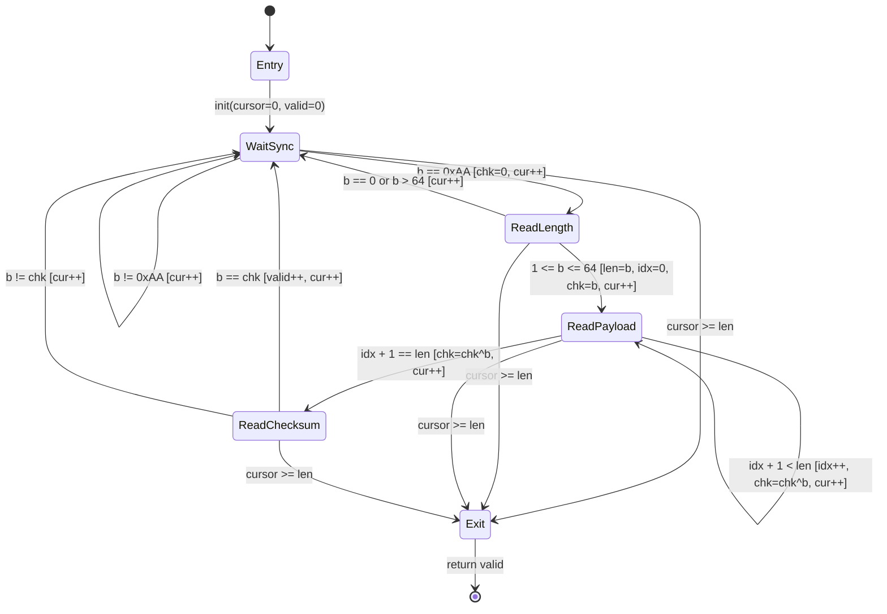
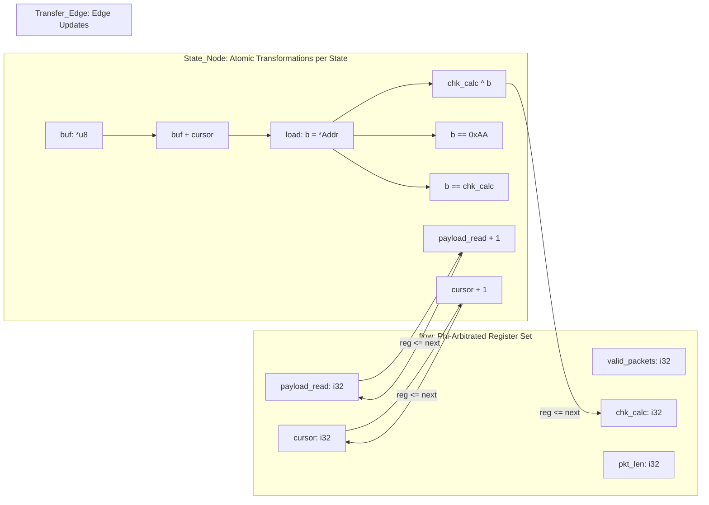

# Chapter 1: Trade-offs Between State and Control — Boundaries of Structured Syntax Trees and Design Philosophy of StateSSA

## 1. Problem Context & Motivation

### 1.1 Engineering Achievements and Intuitive Productivity of Structured Programming
Languages such as C/C++, Go, Rust, and Java, which form the bedrock of the modern software industry, have realized the vision of "structured programming"—pioneered by Edsger W. Dijkstra and his contemporaries—with an exceptionally high degree of architectural refinement.
By systematizing software into hierarchical blocks through three fundamental control structures—Sequence, Selection (`if` / `switch`), and Iteration (`while` / `for`)—and geometrically constraining variable lifespans through lexical scoping, this paradigm brought about a monumental leap in human programming productivity.

The primary benefit of this abstraction lies in its deep resonance with human intuitive reasoning: execution proceeds sequentially from top to bottom, branches conditionally when required, and unwinds upon completing a sub-routine. Its expressive power in modeling domain logic through procedural composition, combined with rich third-party ecosystems and decades of accumulated compiler optimization techniques, continues to provide irreplaceable engineering value across the vast majority of general-purpose software systems.

### 1.2 Structural Friction at Boundary Conditions: Scattered State Spaces and Nested if/while Constructs
However, when the problem domain shifts toward systems whose essential nature consists of discrete state transitions—such as communication protocol decoders, streaming parsers, device drivers, low-level hardware controllers, and mission-critical state machines—structured syntax trees begin to introduce pronounced engineering friction.

When expressing finite state machines within procedural languages, engineers typically adopt one of two canonical idioms:

1. **Implicit State Management**:
   Deeply nesting `if` / `else if` ladders within an outer `while` loop, driving execution forward by imperatively mutating loop-local variables (flags, indices, intermediate buffers) in place.
2. **Explicit State Management**:
   Utilizing an enumerated type (`enum State`) combined with a `switch (state)` dispatcher, evaluating the state identifier on each iteration to select the next code block.

As systems scale in size and operational complexity, both patterns inevitably encounter three fundamental engineering obstacles:

- **Implicit Path Explosion (Combinatorial Growth of Cyclomatic Complexity)**:
  The combinatorial interplay of nested conditional branches causes the total number of feasible execution paths to scale exponentially relative to raw source line count. Designing comprehensive test suites that satisfy complete branch coverage (C1) or Modified Condition/Decision Coverage (MC/DC) incurs severe engineering costs.
- **Dispersion of Mutable State Along the Temporal Axis**:
  Because variable values can be destructively overwritten at arbitrary syntactic locations, verifying invariants—such as whether the structural consistency between variable $X$ and variable $Y$ holds at the exact instant a particular line executes—cannot be established locally. As lexical scopes expand, tracing every execution trajectory along the temporal axis rapidly exceeds the limits of human working memory.
- **Obfuscation of the Control Flow Graph (CFG)**:
  While the engineer's conceptual model is a discrete finite state machine (FSM) transitioning across well-defined vertices, the underlying source code is fragmented with `break`, `continue`, `return`, and ad-hoc flag updates, burying the true transition topology deep beneath the hierarchical syntax tree.

---

## 2. Theoretical & Architectural Model

### 2.1 Topological Disconnect Between Abstract Syntax Trees (AST) and Control Flow Graphs (CFG)
In modern compiler engineering (most notably within optimizing compiler frameworks such as LLVM and GCC), the Abstract Syntax Tree (AST) representing the high-level source code is never executed directly by the machine.
During intermediate representation (IR) lowering, the hierarchical AST is first flattened: high-level loops and branches are decomposed into a **Control Flow Graph (CFG)** consisting of **Basic Blocks** linked by directed **Transfer Edges**.

Furthermore, memory accesses targeting mutable variables (`alloca`, `load`, `store`) are converted into **Static Single Assignment (SSA)** form through SSA construction algorithms (e.g., Mem2Reg). In SSA form, every value is assigned strictly once, and wherever multiple execution trajectories converge, explicit **$\phi$ (Phi) nodes (multiplexing operators)** are positioned at the basic block ingress.

```text
[Human Cognitive Model]            [Compiler & Hardware Reality]
Hierarchical AST (while / if)  ---> Control Flow Graph (CFG) + SSA Dataflow
Mutable Variable (Memory Box)  ---> Immutable Wire (Data Stream) + Phi Arbitration
```

When writing conventional structured languages, the programmer operates within an abstraction layer of "syntax trees and mutable storage boxes," leaving the compiler to infer the programmer's underlying intent and reconstruct the target "CFG and SSA dataflow."
The design philosophy of StateSSA, **`Dataflow-StateMachine-Direct-Cognition`**, fundamentally eliminates this topological disconnect. Rather than synthesizing hierarchical syntax trees only to dismantle them during lowering, it adopts an architectural paradigm where **the programmer directly conceives, models, and implements the system in terms of CFGs (finite state transitions) and SSA (immutable data streams).**

### 2.2 Engineering Model of a Protocol Decoder
To establish a rigorous foundation, we formally model a streaming binary protocol decoder as a finite state machine (FSM) coupled with a deterministic dataflow (DFD).

#### Packet Structural Specification
- `SYNC` (1 byte): Framing byte (fixed constant `0xAA` = 170).
- `LEN` (1 byte): Payload length $L$ ($1 \le L \le 64$).
- `DATA` ($L$ bytes): Byte stream of the payload.
- `CHKSUM` (1 byte): Validation checksum (cumulative XOR of `LEN` and all `DATA` bytes).

#### Finite State Transition Model (Mermaid `stateDiagram-v2`)
The protocol lifecycle is completely formalized across five discrete state vertices (`State_Node`) and directed transition edges (`Transfer_Edge`) evaluated by 1-bit boolean predicates:



#### Dataflow Model (Mermaid `flowchart LR`)
Values traversing the machine are immutable typed wires ("Data Streams") that strictly prohibit destructive overwrite. Wires propagating across state boundaries undergo explicit multiplexing ($\phi$ arbitration) at state ingress:



---

## 3. Concrete StateSSA Implementation

### 3.1 Conventional Implementation in an Imperative Language (C) and Its Cognitive Overhead
First, let us examine the canonical implementation of this decoder in an imperative systems language (C), presented here for comparative architectural analysis:

```c
// Canonical implementation in C (for architectural comparison)
int decode_stream_c(const uint8_t *buf, int len) {
    int cursor = 0;
    int valid_packets = 0;
    enum { ST_WAIT_SYNC, ST_READ_LEN, ST_READ_PAYLOAD, ST_READ_CHK } state = ST_WAIT_SYNC;
    
    int pkt_len = 0;
    int payload_read = 0;
    uint8_t chk_calc = 0;

    while (cursor < len) {
        uint8_t b = buf[cursor++];
        switch (state) {
            case ST_WAIT_SYNC:
                if (b == 0xAA) {
                    chk_calc = 0;
                    state = ST_READ_LEN;
                }
                break;
            case ST_READ_LEN:
                if (b == 0 || b > 64) {
                    state = ST_WAIT_SYNC;
                } else {
                    pkt_len = b;
                    payload_read = 0;
                    chk_calc = b;
                    state = ST_READ_PAYLOAD;
                }
                break;
            case ST_READ_PAYLOAD:
                chk_calc ^= b;
                payload_read++;
                if (payload_read == pkt_len) {
                    state = ST_READ_CHK;
                }
                break;
            case ST_READ_CHK:
                if (b == chk_calc) {
                    valid_packets++;
                }
                state = ST_WAIT_SYNC;
                break;
        }
    }
    return valid_packets;
}
```

While this C implementation appears superficially straightforward, it introduces several structural complications when viewed from the perspectives of compiler optimization and formal verification:
1. Six distinct variables (`cursor`, `valid_packets`, `state`, `chk_calc`, `pkt_len`, `payload_read`) exist as mutable entities throughout the entire lexical scope of the function.
2. The language syntax does not make explicit which variables are updated and which are preserved across individual execution paths within the `switch (state)` block.
3. The unconditional increment `cursor++` at the loop head dissociates buffer consumption from state transition guard logic, creating fertile ground for off-by-one boundary vulnerabilities.

### 3.2 Fully Flattened Implementation in StateSSA
Below is the complete protocol decoder implemented in StateSSA. This code is a verified production artifact compiled directly into LLVM IR by `ssac` and executed natively:

```ssa
// ============================================================================
// StateSSA Architecture Guide - Chapter 1 Sample
// File: samples/architecture_guide/01_protocol_fsm/protocol_decoder.ssa
// ============================================================================

machine decode_stream(buf: *u8, len: i32) -> i32 {
    flow {
        reg cursor: i32 = 0;
        reg valid_packets: i32 = 0;
        reg chk_calc: i32 = 0;
        reg pkt_len: i32 = 0;
        reg payload_read: i32 = 0;
    }

    states {
        Entry: {
            _ => WaitSync [ cursor <= 0, valid_packets <= 0, chk_calc <= 0, pkt_len <= 0, payload_read <= 0 ];
        }

        WaitSync: {
            cursor >= len => Exit;
            let b = cast(i32) *(buf + cursor);
            b == 0xAA => ReadLength [ cursor <= cursor + 1, chk_calc <= 0 ];
            _ => WaitSync [ cursor <= cursor + 1 ];
        }

        ReadLength: {
            cursor >= len => Exit;
            let b = cast(i32) *(buf + cursor);
            b == 0 => WaitSync [ cursor <= cursor + 1 ];
            b > 64 => WaitSync [ cursor <= cursor + 1 ];
            _ => ReadPayload [ cursor <= cursor + 1, pkt_len <= b, payload_read <= 0, chk_calc <= b ];
        }

        ReadPayload: {
            cursor >= len => Exit;
            let b = cast(i32) *(buf + cursor);
            let next_chk = chk_calc ^ b;
            let next_read = payload_read + 1;
            next_read == pkt_len => ReadChecksum [ cursor <= cursor + 1, chk_calc <= next_chk ];
            _ => ReadPayload [ cursor <= cursor + 1, payload_read <= next_read, chk_calc <= next_chk ];
        }

        ReadChecksum: {
            cursor >= len => Exit;
            let b = cast(i32) *(buf + cursor);
            b == chk_calc => WaitSync [ cursor <= cursor + 1, valid_packets <= valid_packets + 1 ];
            _ => WaitSync [ cursor <= cursor + 1 ];
        }

        Exit: {
            _ => return valid_packets;
        }
    }
}
```

### 3.3 Engineering Anatomy of Syntactic Primitives

#### `machine` Signature and C ABI Boundary
The signature `machine decode_stream(buf: *u8, len: i32) -> i32` is exported as a standard C ABI compliant function symbol. With the first parameter `buf` typed as an `i8*` pointer, the second parameter `len` as `i32`, and the return type as `i32`, it can be invoked seamlessly with zero overhead from host environments such as C, C++, or Rust as an ordinary native function.

#### `flow` Block: Explicit Inter-State Phi Arbitration Registers
Variables declared with `reg` within the `flow` block represent state-preserving wires that traverse across state node boundaries.
Crucially, a `reg` declaration does not denote mutable memory storage; rather, it specifies **an ingress receptacle for an LLVM $\phi$ (Phi) node automatically instantiated at the convergence points (basic block headers) of the directed graph.**

#### `states` Block: Fully Flattened State Vertices Without Hierarchical Nesting
Inside the `states` block, six state nodes—`Entry`, `WaitSync`, `ReadLength`, `ReadPayload`, `ReadChecksum`, and `Exit`—are defined as peers on a flat topological plane.
There are no `while`, `for`, or `if` statements. All computation within a state consists strictly of single-assignment local bindings (`let`) followed by the evaluation of directed transition edges (`predicate => Target [ register_updates ];`).

#### Coupling of Transition Predicates and Phi Inputs
```ssa
b == 0xAA => ReadLength [ cursor <= cursor + 1, chk_calc <= 0 ];
```
This syntax directly expresses hardware multiplexer (MUX) semantics: "When predicate `b == 0xAA` evaluates to true, transition control to state node `ReadLength`, supplying the value `cursor + 1` to the `cursor` register and `0` to the `chk_calc` register at the ingress of `ReadLength`."
Unspecified registers (`valid_packets`, `pkt_len`, `payload_read`) retain their current incoming values upon convergence. This ensures the mathematical invariant: **value propagation across state transitions is strictly bound to the corresponding directed edge.**

---

## 4. Execution Trace & Lowering

### 4.1 Deterministic Execution Trace on an Input Stream
We trace the deterministic execution of the finite state machine against the following 22-byte test stream:

```text
Byte Stream Offsets:
00: 0xAA (Sync)
01: 0x03 (Len = 3)
02: 10, 03: 20, 04: 30 (Payload)
05: 0x03 (Chk = 3 ^ 10 ^ 20 ^ 30 = 3)   --> [Packet 1: Valid]
06: 0x12, 07: 0xFF, 08: 0x00            --> [Noise bytes]
09: 0xAA (Sync)
10: 0x02 (Len = 2)
11: 05, 12: 09 (Payload)
13: 14 (Chk = 2 ^ 5 ^ 9 = 14)           --> [Packet 2: Valid]
14: 0xAA (Sync)
15: 0x01 (Len = 1)
16: 07 (Payload)
17: 99 (Corrupted Chk: Expected 6 != 99) --> [Packet 3: Discarded on checksum error]
18: 0xAA (Sync)
19: 0x01 (Len = 1)
20: 42 (Payload)
21: 43 (Chk = 1 ^ 42 = 43)              --> [Packet 4: Valid]
```

| Step | `cursor` | Input Byte `b` | Current State | Evaluated Predicate | Target State | `valid_packets` | `chk_calc` |
| :--- | :--- | :--- | :--- | :--- | :--- | :--- | :--- |
| 1 | 0 | `0xAA` | `WaitSync` | `b == 0xAA` | `ReadLength` | 0 | 0 |
| 2 | 1 | `3` | `ReadLength` | `1 <= b <= 64` | `ReadPayload` | 0 | 3 |
| 3 | 2 | `10` | `ReadPayload` | `1 < 3` | `ReadPayload` | 0 | $3 \oplus 10 = 9$ |
| 4 | 3 | `20` | `ReadPayload` | `2 < 3` | `ReadPayload` | 0 | $9 \oplus 20 = 29$ |
| 5 | 4 | `30` | `ReadPayload` | `3 == 3` | `ReadChecksum` | 0 | $29 \oplus 30 = 3$ |
| 6 | 5 | `3` | `ReadChecksum` | `b == chk_calc` | `WaitSync` | **1** | 3 |
| 7 | 6 | `0x12` | `WaitSync` | `_` (Noise) | `WaitSync` | 1 | 3 |
| 8 | 7 | `0xFF` | `WaitSync` | `_` (Noise) | `WaitSync` | 1 | 3 |
| 9 | 8 | `0x00` | `WaitSync` | `_` (Noise) | `WaitSync` | 1 | 3 |
| 10 | 9 | `0xAA` | `WaitSync` | `b == 0xAA` | `ReadLength` | 1 | 0 |
| ... | ... | ... | ... | ... | ... | ... | ... |
| 17 | 17 | `99` | `ReadChecksum` | `99 != 6` (Discard) | `WaitSync` | 2 (Unchanged) | 6 |
| ... | ... | ... | ... | ... | ... | ... | ... |
| 21 | 21 | `43` | `ReadChecksum` | `43 == 43` | `WaitSync` | **3** | 43 |
| 22 | 22 | N/A | `WaitSync` | `cursor >= len` | `Exit` | **3** | 43 |

Across every transition step, there are zero hidden internal flags and zero undefined fallback branches; execution progresses with complete mathematical determinism.

### 4.2 Engineering Verification of 1:1 Mapping to LLVM IR by the Compiler (`ssac`)
The following excerpt illustrates the LLVM IR (`protocol_decoder.ll`) generated directly from this StateSSA code by the `ssac` compiler:

```llvm
define i32 @decode_stream(i8* %arg_buf, i32 %arg_len) {
entry:
  br label %WaitSync

WaitSync:
  %reg_cursor_WaitSync = phi i32 [ 0, %entry ], [ %t_7, %WaitSync_else_1 ], [ %t_13, %ReadLength_then_1 ], [ %t_15, %ReadLength_then_2 ], [ %t_31, %ReadChecksum_then_1 ], [ %t_33, %ReadChecksum_else_1 ]
  %reg_valid_packets_WaitSync = phi i32 [ 0, %entry ], [ %reg_valid_packets_WaitSync, %WaitSync_else_1 ], [ %reg_valid_packets_ReadLength, %ReadLength_then_1 ], [ %reg_valid_packets_ReadLength, %ReadLength_then_2 ], [ %t_32, %ReadChecksum_then_1 ], [ %reg_valid_packets_ReadChecksum, %ReadChecksum_else_1 ]
  %reg_chk_calc_WaitSync = phi i32 [ 0, %entry ], [ %reg_chk_calc_WaitSync, %WaitSync_else_1 ], [ %reg_chk_calc_ReadLength, %ReadLength_then_1 ], [ %reg_chk_calc_ReadLength, %ReadLength_then_2 ], [ %reg_chk_calc_ReadChecksum, %ReadChecksum_then_1 ], [ %reg_chk_calc_ReadChecksum, %ReadChecksum_else_1 ]
  %reg_pkt_len_WaitSync = phi i32 [ 0, %entry ], [ %reg_pkt_len_WaitSync, %WaitSync_else_1 ], [ %reg_pkt_len_ReadLength, %ReadLength_then_1 ], [ %reg_pkt_len_ReadLength, %ReadLength_then_2 ], [ %reg_pkt_len_ReadChecksum, %ReadChecksum_then_1 ], [ %reg_pkt_len_ReadChecksum, %ReadChecksum_else_1 ]
  %reg_payload_read_WaitSync = phi i32 [ 0, %entry ], [ %reg_payload_read_WaitSync, %WaitSync_else_1 ], [ %reg_payload_read_ReadLength, %ReadLength_then_1 ], [ %reg_payload_read_ReadLength, %ReadLength_then_2 ], [ %reg_payload_read_ReadChecksum, %ReadChecksum_then_1 ], [ %reg_payload_read_ReadChecksum, %ReadChecksum_else_1 ]
  %gep_1 = getelementptr inbounds i8, i8* %arg_buf, i32 %reg_cursor_WaitSync
  %load_2 = load i8, i8* %gep_1, align 1
  %zext_3 = zext i8 %load_2 to i32
  %t_4 = icmp sge i32 %reg_cursor_WaitSync, %arg_len
  br i1 %t_4, label %WaitSync_then_0, label %WaitSync_else_0

WaitSync_then_0:
  br label %Exit

WaitSync_else_0:
  %t_5 = icmp eq i32 %zext_3, 170
  br i1 %t_5, label %WaitSync_then_1, label %WaitSync_else_1

WaitSync_then_1:
  %t_6 = add i32 %reg_cursor_WaitSync, 1
  br label %ReadLength

WaitSync_else_1:
  %t_7 = add i32 %reg_cursor_WaitSync, 1
  br label %WaitSync
...
```

A rigorous inspection of this intermediate representation confirms three architectural facts:
1. **Strict 1:1 Basic Block Mapping**:
   The state identifiers in the StateSSA source code (`WaitSync`, `ReadLength`, `ReadPayload`, `ReadChecksum`, `Exit`) map directly to LLVM IR basic block labels (`WaitSync:`, `ReadLength:`, etc.) without intermediate synthesis or structural alteration.
2. **Pure $\phi$ (Phi) Node Materialization**:
   At the ingress of the `WaitSync:` basic block, incoming register values are resolved exclusively via LLVM `phi` instructions parameterized by predecessor control flow blocks (`%entry`, `%WaitSync_else_1`, `%ReadChecksum_then_1`, etc.).
3. **Total Elimination of Stack Allocations**:
   Zero mutable stack slots (`alloca`) are generated. All program state resides entirely in virtual registers (SSA wires), which LLVM's register allocator maps directly to physical CPU registers (`%eax`, `%ecx`, `%r8d`, etc.).

### 4.3 Realization of Zero-Cost Control Transfer
When state transitions are implemented in imperative languages using function pointer dispatch tables (such as the State pattern), indirect branches introduce pipeline misprediction penalties and function call overheads (stack frame allocation, callee/caller save restoration).

In StateSSA, all intra-machine state transitions lower directly to intra-procedural **direct label jumps (`br label %target`)**. In modern superscalar CPU microarchitectures, direct jumps incur near-zero latency and are predicted with near-perfect accuracy by Branch Target Buffers (BTB).
The language achieves explicit finite state modeling and bare-metal execution efficiency simultaneously, with zero runtime abstraction penalty.

---

## 5. Engineering Evaluation

### 5.1 Engineering Advantages Gained by StateSSA
1. **Total Determinism and Verifiability**:
   Because a StateSSA program consists exclusively of a directed control flow graph and single-assignment dataflow wires, formal verification via SMT solvers or symbolic execution tools (e.g., KLEE) becomes mathematically tractable. Data races over temporal variables and uninitialized reads are structurally eliminated.
2. **Structural Isomorphism with LLVM IR and Hardware**:
   Because the programming primitives map 1:1 to hardware execution units (Basic Blocks and ALU pipelines), optimization failures caused by compiler heuristics trying to infer high-level loop intents cannot occur.
3. **Zero-Overhead C ABI Interoperability**:
   Generated binaries strictly adhere to the standard platform C ABI, allowing them to be embedded directly into existing C, C++, or Rust architectures as high-performance decoding engines.

### 5.2 Costs and Constraints Imposed by StateSSA
Engineering is fundamentally an exercise in trade-offs: every architectural capability requires a corresponding concession. StateSSA is not a general-purpose panacea, and it imposes explicit costs upon the software engineer:

1. **Total Renunciation of Procedural Convenience**:
   Ad-hoc, exploratory scripting—such as instantiating arbitrary variables and iteratively mutating them within nested loops—is strictly forbidden. Before writing a single line of StateSSA, the engineer must fully formalize the state space (State Nodes), transition predicates (Transfer Edges), and inter-state data streams.
2. **Mandatory Specification of Phi Arbitration at Ingress**:
   Value propagation at convergence points must be explicitly managed (while unmodified registers propagate automatically, any state modification requires explicit edge bindings `[ reg <= expr ]`).
3. **Steep Cognitive Learning Curve**:
   For engineers conditioned by decades of imperative, time-sequential mutation ("variables modify as time advances"), transitioning to spatial reasoning over immutable wires and directed state vertices introduces tangible cognitive friction.

### 5.3 Demarcation of Suitable Engineering Domains

| Suitable Engineering Domains (High Suitability) | Unsuitable Engineering Domains (Low Suitability) |
| :--- | :--- |
| **Communication Protocol Decoders & Parsers**<br>Binary and text protocol processing with strict framing and explicit state transitions. | **CRUD Web & Enterprise Backends**<br>Applications centered around dynamic relational schemas and complex object-relational graphs. |
| **Compiler & Interpreter Frontends**<br>Lexical analyzers (Lexers), parsers, and bytecode virtual machine dispatchers. | **GUI Applications & Event Listeners**<br>Environments dominated by asynchronous event loops and dynamic widget tree mutations. |
| **Device Drivers & Embedded Controllers**<br>Hardware register sequencing, DMA transfer coordination, and interrupt handling. | **Ad-hoc Scripting & Data Science**<br>Rapid prototyping workflows (Python, Bash) where interactive experimentation and disposable code are prioritized. |
| **DSP, Cryptography & Signal Pipelines**<br>Saturated arithmetic and latency-controlled operations across immutable streams. | **Object-Oriented Hierarchies with Heavy Dynamic Dispatch**<br>Architectures relying extensively on deep class inheritance and runtime polymorphism. |

StateSSA is not designed to replace general-purpose programming languages.
Rather, it is a **systems programming language engineered for high-reliability, extreme-control domains**, enabling software engineers to transcend the limitations of structured syntax trees and directly harness the underlying deterministic power of modern computing hardware.
