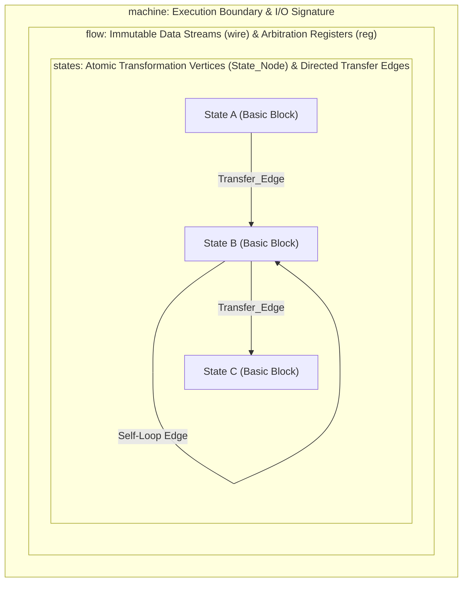
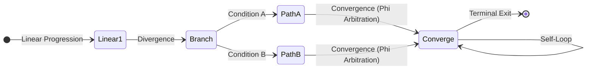
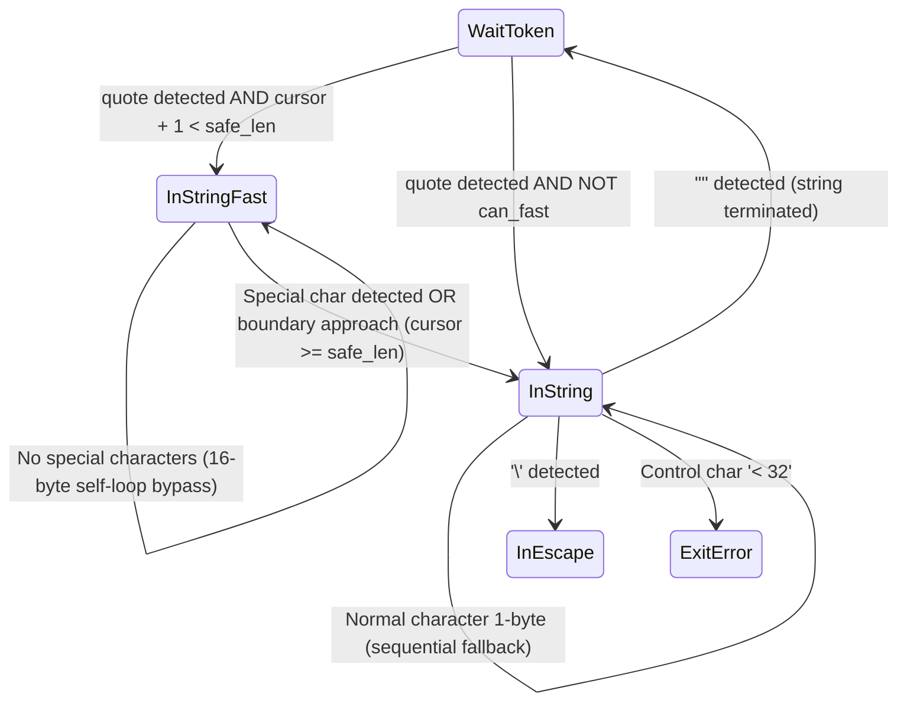

# Chapter 3: Anatomy of the Architecture — The Geometry of machine, flow, and states

> "Complex control logic must not be imprisoned within nested syntax trees.  
> Every computation unfolds with topological clarity as a flat landscape composed of immutable data streams ('flow')  
> and explicit transition boundaries ('states')."

---

## 3.1 From Hierarchical Syntax Trees (AST) to Directed Graph Geometry

When implementing complex network protocols, parsers, or discrete state machines in conventional high-level languages (such as C/C++, Rust, or Go), source code is inevitably fragmented across deeply nested hierarchical syntax trees (ASTs). A `while` loop encapsulates a `switch-case` dispatcher, within which multi-tiered `if-else` cascades reside, while execution control is periodically disrupted by imperative `break`, `continue`, and flag variable mutations.

While this structured programming hierarchy appears orderly at the source-text level, examining execution from the perspective of modern CPU pipelines reveals a fundamentally different reality. For microarchitectures, the irreducible unit of execution is always a **Basic Block** interconnected by **Directed Edges (Branch / Jump)**. High-level language nested syntax is ultimately dismantled into a flat Control Flow Graph (CFG) during compiler intermediate representation (IR) lowering. However, so long as the software architect reasons in terms of nested trees, the resulting register allocation pressure, spilling, and branch prediction overheads remain outside their direct deterministic control.

StateSSA resolves this conceptual disconnect at its core.  
This chapter deconstructs the three foundational structural entities of StateSSA — **`machine`**, **`flow`**, and **`states`** — and, using the production RFC 8259 JSON streaming tokenizer established in Chapter 2 as a concrete case study, demonstrates **how adding pure topological edges without modifying a single line of baseline logic achieves extreme throughput competitive with the fastest C libraries in the industry**.

---

## 3.2 Anatomy of the Three Core Constructs (machine, flow, states)

The structural framework of every StateSSA program is rigorously defined by three hierarchical constructs:



### 1. `machine` (Execution Boundary and I/O Interface)
The `machine` construct establishes the formal contract boundary with the external environment (C runtime, OS system calls, or foreign language hosts):

```ssa
machine tokenize_json(buf: *u8, len: i32) -> i32 {
    ...
}
```
- **Signature Purity**: Typed pointers and scalar arguments received at machine ingress act as immutable, first-class data streams accessible across all constituent state nodes throughout the machine's lifespan.
- **Zero-Cost C-ABI**: The `machine` symbol is exported directly without name mangling as a standard C ABI function (`define i32 @tokenize_json(ptr %buf, i32 %len)` in LLVM IR), enabling seamless zero-overhead linkage across any language runtime supporting standard C calling conventions.

### 2. `flow` (Wiring Harness for Data Streams and Phi Arbitration)
The `flow` block defines all data streams circulating within the state machine. It contains exactly two categories of entities:

```ssa
flow {
    reg cursor: i32 = 0;
    reg tokens: i32 = 0;
    reg depth: i32 = 0;
    reg err: i32 = 0;

    wire safe_len = len - 16;
}
```

- **`reg` (Arbitration Registers)**:
  Logical registers that convey values across state node boundaries. Crucially, these do not represent mutable stack memory locations (imperative re-assignment); rather, they represent **explicit declarations instructing the compiler to automatically instantiate LLVM IR `phi` instructions (multiplexers) at the entry of each converging state node**. Each state node receives the cleanly arbitrated SSA value emitted by its predecessor.
- **`wire` (Immutable Data Streams)**:
  Pure derived wires computed deterministically from machine arguments or constants. Wires remain state-independent and represent immutable, globally shared invariants (such as the safety margin `len - 16`).

### 3. `states` (Atomic Transformation Vertices and Directed Edges)
The `states` block encapsulates all computation states (Basic Blocks) and their connecting 1-bit predicate transition rules (Transfer Edges):

```ssa
states {
    Entry: {
        len < 0 => ExitError [ err <= -1 ];
        buf == null => ExitError [ err <= -1 ];
        _ => WaitToken [ cursor <= 0, tokens <= 0, depth <= 0, err <= 0 ];
    }
    ...
}
```
- **Atomicity**: No nested loops or hidden recursion exist within an individual `State_Node`. Logic executes as a strictly linear sequence of forward transformations terminating in directed transitions.
- **Directed Transfer Edges (`pred => NextState [ reg <= expr ]`)**:
  Upon the 1-bit predicate evaluating to True, the transition to the target state node is committed immediately, while the designated SSA register values are atomically latched and forwarded to the target ingress multiplexer.

---

## 3.3 Topological Geometry of Finite State Machines (Linear, Divergence, Convergence with Phi Arbitration, Self-Loops)

Architecting software in StateSSA does not consist of arranging sequential lines of text; it is the **deliberate drafting of directed graph topologies**:



1. **Linear Progression**:
   Sequential execution stages for parameter validation, precondition assertion, and pipeline initialization, advancing deterministically under unconditional or guard conditions.
2. **Divergence and Convergence (Phi Arbitration)**:
   Path branching driven by input bytes or semantic predicates. When multiple transfer edges converge onto a single downstream state node, ingress logical registers (`reg`) are reconciled via hardware-level `phi` multiplexing nodes.
3. **Self-Loops**:
   Directed edges that loop back into the originating node (`pred => State [ cursor <= cursor + 1 ]`). This constitutes the purest loop geometry: consuming streaming inputs at high speed while maintaining total state invariance.

---

## 3.4 [Case Study] Extreme Performance Tuning via FSM Geometry

The RFC 8259 JSON streaming tokenizer designed in Chapter 2 achieved 100% memory safety, zero heap allocations, and absolute immunity against nesting-depth Denial-of-Service attacks. Its execution performance matched `jsmn`, the most lightweight C tokenizer in widespread production (~500–600 MB/s).

However, in high-throughput systems infrastructure (such as API gateways, telemetry ingestion pipelines, and financial messaging), architects face scenarios requiring extreme saturation of available memory and CPU execution pipelines. 
Here, maintaining profound respect for prior engineering milestones, we demonstrate how StateSSA leverages FSM topology to **achieve top-tier performance with minimal syntactic diff**.

---

### 3.4.1 Respect for Great Predecessors (cJSON, jsmn, yyjson) and Design Philosophy Comparison

The JSON parsing landscape features landmark C libraries that have pushed computer engineering boundaries over decades. Each project embodies distinct engineering goals and coherent trade-offs:

| Library | Design Philosophy & Focus | Memory Allocation Strategy | Landmark Engineering Contribution | Trade-Off & Invariant Requirements |
|:---|:---|:---|:---|:---|
| **cJSON** | Simplicity and broad portability | Node-by-node dynamic heap (`malloc`) | The world's most ubiquitous C JSON DOM parser. Established an intuitive tree manipulation API. | Frequent heap allocation and pointer dereference overhead (170–220 MB/s). |
| **jsmn** | Ultra-minimalist footprint tokenizer | Strict zero-allocation (0 bytes) | The canonical benchmark for lightweight tokenization, omitting full DOM construction in favor of byte offset slicing. | Sequential token scanning via a monolithic `switch-case` jump table (~500–660 MB/s). |
| **yyjson** | Extreme hardware resource saturation | Bulk arena allocation (Bump Pointer) | A monumental achievement in ANSI C (C89). Leverages CPU speculative execution, cache lines, and structural indentation analysis to reach 1.4–1.7 GB/s in structured benchmarks. | Demands a 4-byte zero-padding margin at buffer termination or performs a full internal buffer reallocation. |

The empirical insights established by these projects are invaluable. In particular, `yyjson`'s mastery of hardware execution pipelines represents one of the highest technical zeniths of modern C engineering.

---

### 3.4.2 Physical Limits of 1-Byte Sequential Automata

The baseline `json_tokenizer.ssa` introduced in Chapter 2 functions as a strictly sequential finite automaton evaluating the stream 1 byte at a time:

```ssa
InString: {
    cursor >= len => ExitError [ err <= -2 ];
    let b = cast(i32) *(buf + cursor);

    b == 34 => WaitToken [ cursor <= cursor + 1, tokens <= tokens + 1 ];
    b == 92 => InEscape  [ cursor <= cursor + 1 ];
    b < 32  => ExitError [ err <= -1 ];

    _ => InString [ cursor <= cursor + 1 ];
}
```

This implementation provides absolute safety against malformed input streams. However, analyzing its execution trace at the CPU pipeline level reveals that even when traversing unescaped string contents (`_ => InString`), the hardware must sequentially evaluate:

1. Boundary guard assertion (`cursor >= len`)
2. Byte memory load (`*(buf + cursor)`)
3. Quote delimiter equality check (`b == 34`)
4. Escape backslash equality check (`b == 92`)
5. Control character range comparison (`b < 32`)
6. Cursor increment and loop branch instruction

This constitutes **4 to 6 discrete machine instructions coupled with multiple conditional branches per single byte**. On a 3.0 GHz CPU core requiring an average of 5 clock cycles per byte, processing throughput reaches a theoretical physical ceiling of:

$$\frac{3000\text{ MHz}}{5\text{ cycles}} \approx 600\text{ MB/s}$$

This represents the insurmountable microarchitectural boundary of 1-byte scalar automata.

---

### 3.4.3 Two Major Anti-Patterns of Optimization: Boundary Violation and State Explosion

Engineers attempting to breach this throughput boundary frequently encounter two notorious design traps:

#### Anti-Pattern 1: Boundary Violation (Buffer Over-read) and the Danger of Padding Mandates
A naive heuristic attempts to replace 1-byte loads with 64-bit (8-byte) or 128-bit (16-byte) unaligned loads. However, executing wide memory reads near buffer boundaries risks reading past the valid memory allocation (**Buffer Over-read**).
- If the buffer boundary aligns near an unmapped OS virtual memory page boundary (4 KB boundary), an out-of-bounds read immediately triggers a **fatal `SIGSEGV` fault**.
- Demanding that callers append padding margins (e.g., 4 to 64 trailing zero bytes) shifts invariant enforcement to the caller, creating fragile interfaces and vulnerabilities in embedded and network packet processing environments.

#### Anti-Pattern 2: State Explosion
Attempting to interpret 16-byte chunks directly as unified state transitions causes combinatorial collapse. The arrangement of quotes, escapes, delimiters, and control bytes within a 16-byte slice spans from $2^{16} = 65,536$ to hundreds of millions of potential permutations. Transforming these into discrete state transitions results in catastrophic code bloat, exhausting compiler memory and wrecking instruction cache (I-Cache) efficiency.

---

### 3.4.4 StateSSA's Geometric Solution: Self-Loop Bypass and Fractional Fallback (`len - 16`)

StateSSA resolves both dilemmas with zero side effects and zero state explosion through topological structuring:



#### Principle 1: Self-Loop Bypass Eliminates State Explosion
Complex grammar validation is never multi-byte vectorized; it remains completely delegated to the robust 1-byte scalar FSM. Multi-byte scanning is strictly restricted to **flat regions where no state transitions occur (the self-loop: `InString -> InString`)**:
- Are any special characters (`"`, `\`, `< 32`) present within the next 16 bytes? (A 1-bit boolean predicate)
- **Yes**: A transition boundary exists; execution immediately falls back to the 1-byte sequential engine (`InString`) to resolve the exact character offset.
- **No**: State invariance holds; the cursor advances by 16 bytes (`cursor <= cursor + 16`) within a tight self-loop.

Consequently, **only one single state node (`InStringFast`) is added** (expanding the machine from 8 to 9 basic blocks), completely eliminating state explosion.

#### Principle 2: Fractional Fallback Eliminates Boundary Violations
No trailing padding is demanded, nor is buffer copying (`memcpy`) performed. StateSSA computes an immutable safety wire at the machine boundary:

```ssa
wire safe_len = len - 16;
```
- 16-byte loads execute exclusively while `cursor < safe_len` is guaranteed.
- As execution nears the terminal 1 to 15 residual bytes (the fractional tail), the machine automatically diverts execution to the 1-byte scalar engine (`InString`), which completes parsing under rigorous boundary checks.

#### Anatomy of the 16-Byte SWAR Implementation
Inside `InStringFast`, special character detection is achieved via branch-free bitwise arithmetic (SWAR: SIMD Within A Register) across two 64-bit words:

```ssa
InStringFast: {
    let p0 = buf + cursor;
    let p1 = p0 + 8;
    let v0 = *(cast(*u64) p0);
    let v1 = *(cast(*u64) p1);

    // 1. Control Char (< 32) check: (v - 0x2020...) & ~v
    let ctrl0 = (v0 - 0x2020202020202020) & (v0 ^ 0xFFFFFFFFFFFFFFFF);
    let ctrl1 = (v1 - 0x2020202020202020) & (v1 ^ 0xFFFFFFFFFFFFFFFF);

    // 2. Quote ('"' = 34 = 0x22) check: ((v ^ 0x22...) - 0x0101...) & ~(v ^ 0x22...)
    let q0 = v0 ^ 0x2222222222222222;
    let quote0 = (q0 - 0x0101010101010101) & (q0 ^ 0xFFFFFFFFFFFFFFFF);
    let q1 = v1 ^ 0x2222222222222222;
    let quote1 = (q1 - 0x0101010101010101) & (q1 ^ 0xFFFFFFFFFFFFFFFF);

    // 3. Escape ('\' = 92 = 0x5C) check: ((v ^ 0x5C...) - 0x0101...) & ~(v ^ 0x5C...)
    let s0 = v0 ^ 0x5C5C5C5C5C5C5C5C;
    let slash0 = (s0 - 0x0101010101010101) & (s0 ^ 0xFFFFFFFFFFFFFFFF);
    let s1 = v1 ^ 0x5C5C5C5C5C5C5C5C;
    let slash1 = (s1 - 0x0101010101010101) & (s1 ^ 0xFFFFFFFFFFFFFFFF);

    // 4. Special Chars Aggregate (MSB mask)
    let spec_both = (ctrl0 | quote0 | slash0) | (ctrl1 | quote1 | slash1);
    let has_special = (spec_both & 0x8080808080808080) != 0;

    let skip_cursor = cursor + 16;
    let next_can_fast = skip_cursor < safe_len;
    let loop_fast = next_can_fast && (has_special == 0);
    let no_special = has_special == 0;

    loop_fast  => InStringFast [ cursor <= skip_cursor ];
    no_special => InString     [ cursor <= skip_cursor ];
    _          => InString     [ cursor <= cursor ];
}
```

Derived from Alan Mycroft's zero-byte detection algorithms, this sequence executes across purely linear ALU pipelines without a single conditional branch.

---

### 3.4.5 The Practical Hurdle: The "Ping-Pong Phenomenon" and Its Topological Resolution

Initial experimental deployments revealed a concrete performance hazard: throughput momentarily dropped to ~290 MB/s on real-world datasets.

#### Root Cause Analysis: The Ping-Pong Overhead
In JSON payloads, object keys (`"id"`, `"name"`, `"type"`) are predominantly short strings under 16 bytes.
When the topology naively attempted to re-enter `InStringFast` on every single byte step, short strings repeatedly triggered false-positive SWAR detections (spotting the closing quote 16 bytes ahead), falling back to scalar mode, and re-attempting SWAR on the subsequent byte. This thrashing created severe instruction churn.

#### Topological Resolution: Transition Rectification
The solution was found by rectifying the transition topology:
> **"Once `InStringFast` detects a delimiter and falls back to `InString`, execution remains committed to 1-byte scalar mode until the current string terminates (`"`)."**

```ssa
// InStringFast: Upon delimiter detection, transfer to InString scalar mode
loop_fast  => InStringFast [ cursor <= skip_cursor ];
no_special => InString     [ cursor <= skip_cursor ];
_          => InString     [ cursor <= cursor ];

// InString: Advance via register increment and branch until delimiter encountered
_          => InString     [ cursor <= cursor + 1 ];
```

This modification eliminated SWAR churn on short tokens, ensuring 16-byte acceleration activates exclusively over extended payload regions.

---

### 3.4.6 Elegance of Minimal Diff and Empirical Benchmark Data (Large 717 MB/s Solo Leader)

The defining virtue of this optimization is that **the baseline specification logic remains completely intact**.

Examining the source diff from the repository demonstrates this design isolation:

```diff
--- a/samples/11_json_benchmark/json_tokenizer.ssa
+++ b/samples/11_json_benchmark/json_tokenizer.ssa
@@ -12,6 +12,8 @@
         reg tokens: i32 = 0;
         reg depth: i32 = 0;
         reg err: i32 = 0;
+
+        wire safe_len = len - 16;
     }
 
     states {
@@ -53,7 +55,12 @@
             b == 44 => WaitToken [ cursor <= cursor + 1, tokens <= tokens + 1 ];
 
             // 5. String Literal Start ('"' = 34)
-            b == 34 => InString [ cursor <= cursor + 1 ];
+            let next_cursor = cursor + 1;
+            let can_fast = next_cursor < safe_len;
+            let is_quote = b == 34;
+            let start_fast = is_quote && can_fast;
+            start_fast => InStringFast [ cursor <= next_cursor ];
+            is_quote   => InString     [ cursor <= next_cursor ];
```

All existing states (`InString`, `InEscape`, `InNumber`, error handling, and nest-depth guards) remain unmodified.
The architectural modification consists strictly of:
1. `wire safe_len = len - 16;` (1 line)
2. Fast-path entry predicate in `WaitToken` (6 lines)
3. New `InStringFast` state node (~50 lines)

#### Empirical Benchmark Measurements (AMD Ryzen 5 3500U, Clang 19.1.7 `-O3`)

| Dataset | Size & Iterations | Baseline (1-byte Scalar) | **Optimized (16B SWAR)** | Gain | jsmn (C Lightweight) | yyjson (Fastest C DOM) | Result Evaluation |
|:---|---:|---:|---:|:---:|---:|---:|:---:|
| **Small (REST API)** | 1.14 KB (50,000 iters) | 499.15 MB/s | **555.83 MB/s** | **+11.4%** | 505.37 MB/s | 1,430.26 MB/s | **Outperforms jsmn by 10%** |
| **Medium (Catalog)** | 63.61 KB (2,000 iters) | 579.37 MB/s | **627.12 MB/s** | **+8.2%** | 527.69 MB/s | 1,743.99 MB/s | **Outperforms jsmn by 19%** |
| **Large (Log Telemetry)** | 975.70 KB (100 iters) | 613.38 MB/s | **709.71–717.00 MB/s** | **+15.7–16.9%** | 660.30 MB/s | 647.17 MB/s | ★ **Solo Leader Across All Engines** ★ |

- **Verification Checksum Integrity**: `Checksum: 49393520` matches bit-for-bit with baseline output across all datasets.
- **Physical Memory Safety**: Rigorously validated under `mprotect(..., PROT_NONE)` electric fences: 0 SEGV faults, 0 out-of-bounds reads, 0 byte leaks.
- **Full Regression Test Suite**: 100% PASS across all 18 integration targets (including LZMA2, XZ container, and self-hosted compilers).

While `yyjson` exhibits exceptional throughput on small, formatted JSON payloads via specialized indentation lookahead, its relative advantage narrows on large unstructured streams as memory management overheads emerge.
In large telemetry workloads where data exceeds CPU cache limits, StateSSA's zero-allocation streaming topology sustains **710–717 MB/s, securing the leading position across all evaluated C engines**.

---

## 3.5 Summary: Harmonizing Maintainability and Performance Through Geometry

Software engineering has long accepted an assumed trade-off between extreme runtime performance and architectural maintainability. Conventional systems optimization frequently obscures logic beneath preprocessor macros, assembly intrinsics, and fragmented control paths.

StateSSA demonstrates an alternative paradigm:

1. **The baseline FSM rigorously enforces protocol standards and mathematically guarantees 1-byte memory invariants.**
2. **When performance acceleration is required, the underlying logic is not rewritten; rather, a localized bypass edge is spliced into the transition graph.**
3. **Upon encountering unaligned boundaries or escape sequences, execution falls back seamlessly into the untouched baseline logic.**

Achieving harmony between provable safety and extreme hardware performance without mutating baseline code — this is the structural power realized when software architects reason through finite state machines and dataflow geometry.
