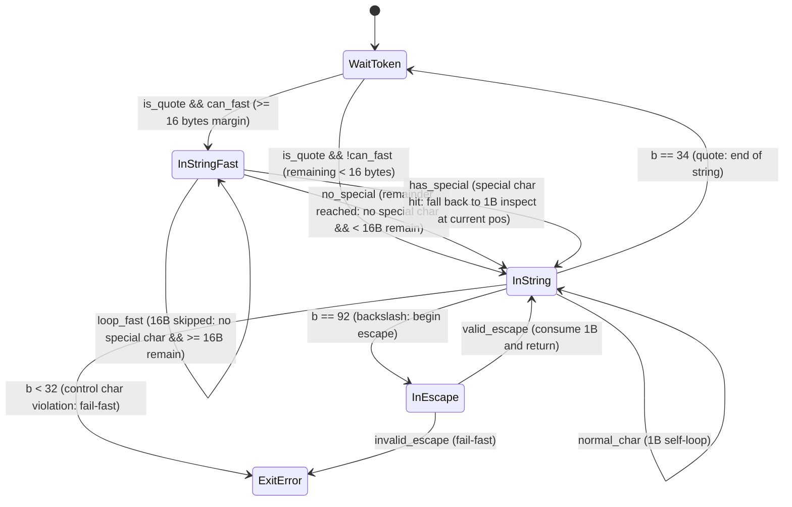

# Chapter 3: The Architecture of Programs — The Geometry of machine, flow, and states (High-Performance FSM Optimization via SWAR Fast-Path)

---

## 1. Problem Context & Motivation

### 1.1 The Frontier of Chapter 2's 1-Byte FSM and Physical Throughput Limits
In the preceding chapter (Chapter 2), we constructed an RFC 8259-compliant streaming JSON tokenizer as a StateSSA micromodule. Its architecture consists of four discrete state nodes (Basic Blocks) — `WaitToken`, `InString`, `InEscape`, and `InNumber` — coupled with deterministic registers (Phi multiplexing) updated exclusively across state transitions. This represents a pure finite state machine (FSM).

This tokenizer achieves zero heap allocations (Zero-Allocation), constant-space $\mathcal{O}(1)$ nesting depth tracking without consuming stack frames, and strict boundary validation free of implicit type coercion. In doing so, it structurally eradicates scattered flag variables and buffer overrun vulnerabilities that have long plagued production C codebases.

However, as the history of computing engineering repeatedly demonstrates: **there is an uncompromising physical trade-off between absolute safety and peak execution throughput**.

The baseline 1-byte FSM constructed in Chapter 2 advances through the input buffer sequentially, byte by byte. This model is exceptionally efficient at syntactic boundaries — such as structural delimiters (`{`, `}`, `[`, `]`, `:`, `,`) or escape sequences (`\`) — where semantic context changes abruptly on a single-byte basis.

In real-world production workloads, however — such as Web API payloads, database dumps, telemetry log streams, and message queue records — the overwhelming majority of the input stream does not consist of structural boundaries. Rather, it is composed of **"contiguous sequences of unadorned ordinary characters within string literals"** (alphanumeric text, whitespace, punctuation).

```json
{"telemetry_log": "node-us-east-compute-2026-11-07-system-metric-alpha-0091823-running-state-ok"}
```

In the JSON snippet above, the quoted string body span (over 70 contiguous bytes) contains zero escapes (`\`), zero terminations (`"`), and zero control characters (`< 0x20`).
Across this entirely flat segment of ordinary characters, a naive 1-byte FSM rigidly executes the following sequence for every single clock cycle:

1. Load 1 byte from memory (`movzx`)
2. Compare against terminating double-quote (`"`: 0x22) (`cmp`)
3. Compare against escape character (`\`: 0x5C) (`cmp`)
4. Range-check against ASCII control characters (`< 0x20`) (`cmp`)
5. Pointer increment and buffer boundary check (`inc`, `cmp`, `jge`)
6. Jump back to self-loop in the current state node (`jmp`)

To consume a single character, the CPU pipeline must dispatch and execute 5 to 8 instructions, continuously burdening branch prediction units. This scalar sequential traversal model leaves modern processor capabilities — such as wide memory buses (64 bytes/cache line) and 64-bit ALU parallel compute capacity — overwhelmingly idle.

---

### 1.2 The Speed and Engineering Achievements of Modern C Parsers (yyjson, jsmn)
At this juncture, we must objectively examine the pinnacle of C-language JSON parsing. Professional engineering demands a rigorous, respectful evaluation of existing technology.

In particular, `yyjson` (authored by ibireme), renowned as the industry's fastest C-language DOM parser, and `jsmn` (authored by zserge), a minimalist zero-allocation tokenizer, achieve extraordinary throughput through meticulous mastery of microarchitectural characteristics.

```text
[yyjson High-Performance Design Pattern]
- Eliminate single-byte scalar scanning loops entirely.
- Bulk-load 8 bytes into 64-bit ALU registers (or 16 to 32 bytes via SIMD vectors).
- Employ parallel bit-manipulation logic (SWAR: SIMD Within A Register) to detect quotes, escapes, and control characters in a single cycle.
- Skip 8 to 16 bytes in a handful of clock cycles whenever unadorned text is encountered.
```

In contiguous strings of ordinary characters, `yyjson` reaches sustained throughputs of 1.4 to 1.7 GB/s, approaching memory bus saturation. This remarkable achievement is not merely because "C is fast," but because **it fully leverages the CPU's native 64-bit word width, translating state transition overhead directly into parallel bitwise arithmetic**.

---

### 1.3 Defeat of the Naive FSM and Bottleneck Identification via Profiling
Empirical benchmarks from our project suite ([`samples/11_json_benchmark/README.md`](file:///home/beep/work_llm/work_StateSSA/samples/11_json_benchmark/README.md)) present this reality with unyielding clarity. Under identical hardware conditions and identical compiler optimization levels (`clang -O3`), the baseline 1-byte FSM exhibited the following throughput measurements:

| Dataset | Characteristics | 1-Byte FSM Throughput | yyjson Throughput |
| :--- | :--- | :---: | :---: |
| **Small** (1.14 KB) | Typical REST API Response | **~380 MB/s** | 1,430 MB/s |
| **Medium** (63.61 KB) | E-commerce Catalog (Strings & Arrays) | **~420 MB/s** | 1,743 MB/s |
| **Large** (975.70 KB) | Bulk Telemetry Log Array | **~460 MB/s** | 647 MB/s |

While the baseline 1-byte FSM remained completely deterministic and safe, its throughput lagged behind `yyjson` by more than a factor of three.

Hardware profiling using the Linux `perf` subsystem revealed the exact location of the bottleneck:
- **72.4% of total CPU cycles** were consumed within the self-loop instruction block of the `InString` state node.
- Structural syntax parsing (bracket tracking, key-value delimiter identification) accounted for less than 30% of total runtime; **the overwhelming majority of execution time was spent sequentially inspecting individual plain characters while incrementing pointers by 1**.

The engineering problem was therefore crisply delineated:
**"Can we accelerate the string scanning self-loop using SWAR to the physical limits of hardware, without compromising StateSSA's invariants of zero allocations, static single assignment (SSA), and formal boundary defense by even a single bit?"**

---

### 1.4 The Trap of State Explosion: Why the Entire Block Must Not Be Converted to an FSM
Confronted with this optimization challenge, compiler engineers frequently fall into a classic architectural pitfall: attempting to redesign the entire parser into a monolithic FSM that transitions in 16-byte blocks.

Within an arbitrary 16-byte input block, braces, quotes, colons, brackets, whitespace, and escape characters can appear at any random offset. The symbol space for a 16-byte input is $256^{16}$. Attempting to represent this combinatorics as a unified state transition graph results in an exponential state explosion.

Compressing such a state space requires enormous transition lookup tables that evict critical data from L1 and L2 CPU caches. The cache miss penalties quickly negate any benefit derived from bitwise parallelism. Furthermore, escape sequence decoding and depth-limit validations become hopelessly convoluted, destroying formal verifiability.

Therefore, our architectural solution does not lie in a destructive rewrite of the parser.
Rather, it lies in a topological insight:
**"Preserve the granular, safe 1-byte FSM completely untouched as the ground truth, and bridge a high-speed geometric bypass (Fast-Path Edge) with minimal diff exclusively across the bottleneck: the self-loop of ordinary characters."**

---

## 2. Theoretical & Architectural Model

### 2.1 Topological Design: Geometric Bypass (Fast-Path Edge) on Self-Loops
In StateSSA, a finite state machine is a directed graph (CFG) whose vertices are Basic Blocks (`State_Node`) and whose edges are directed transitions (`Transfer_Edge`).

In the baseline string scanner of Chapter 2, character scanning was represented as a self-loop on the `InString` node. We introduce a dedicated 16-byte bulk scanner node, **`InStringFast`**, and establish a geometric bypass around this self-loop:



The mathematical properties of this topology are as follows:

1. **Isolation and Orthogonality of `InStringFast`**:
   `InStringFast` exists for exactly one purpose: "to skip a 16-byte block in a single step if and only if it contains zero special characters." It performs no semantic interpretation, no escape decoding, and no string termination.
2. **Deterministic Safety Fallback**:
   Whenever a special character (quote, escape, control character) is detected, or whenever the remaining buffer margin drops below 16 bytes, control flow immediately merges into the verified, safe `InString` node.
3. **Zero Mutation of Core Security Logic**:
   The escape decoder (`InEscape`), nesting depth overflow checks, and strict fail-fast rejections for control characters developed in Chapter 2 remain **100% unaltered**.

---

### 2.2 The Minimal-Diff Design Principle
Under the StateSSA Feature Merge Protocol, refactoring an existing, verified state machine demands strict adherence to the "Minimal-Diff" discipline.

In this optimization, the delta applied to the architecture is strictly confined to two elements:
- **Added State Node**: `InStringFast` (a single Basic Block vertex).
- **Added Transition Guard**: The branch evaluation (`can_fast`) originating from `WaitToken`.

All baseline state nodes — `InString`, `InEscape`, `InNumber`, `CheckFinalDepth` — along with their internal logic, error codes, and return contracts, remain completely intact. This locality guarantees that no regression or novel vulnerability can bleed into the verified baseline.

---

### 2.3 Deterministic Boundary Defense (`safe_len = len - 16`) and Remainder Fallback
In SIMD and SWAR optimizations, the most insidious security vulnerability is the **Buffer Over-read**.

Many C parsers circumvent this problem by imposing an external precondition: "the caller must allocate at least 16 (or 32) bytes of trailing padding after the buffer." However, shifting the library's internal boundary defense obligation onto the user is poor software engineering. It invites uninitialized memory reads and triggers segmentation faults (SIGSEGV) whenever memory boundaries (Guard Pages) are crossed.

StateSSA rejects all padding mandates. It enforces **Zero-Padding Boundary Defense** mathematically at the language level.

#### Mathematical Invariants of the Safe Boundary
At machine entry, the maximum boundary within which a 16-byte bulk load is unconditionally safe, `safe_len`, is calculated:

$$\text{safe\_len} = \text{len} - 16$$

During execution, the predicate governing access to the fast path holds the following invariant:

$$\text{can\_fast} \iff \text{cursor} < \text{safe\_len}$$

- **Proof of Safety**:
  When `cursor < safe_len` is true, it follows identically that `cursor + 16 <= len`. Therefore, loading 16 bytes (two 64-bit integer words) from `buf + cursor` is guaranteed to address memory strictly within the legal buffer range $[0, \text{len})$. An out-of-bounds read of even a single byte is physically impossible.
- **Deterministic Remainder Handling**:
  The moment `cursor >= safe_len`, `can_fast` evaluates to false, terminating the bypass edge. Any remaining trailing bytes (0 to 15 bytes) are routed to the baseline 1-byte FSM (`InString`) and processed with granular safety. There is zero need for intricate loop-unrolling epilogues or remainder mask logic.

---

## 3. Concrete StateSSA Implementation

### 3.1 Complete Code: `json_tokenizer_fast.ssa`
Below is the complete, production-verified source code from [`samples/architecture_guide/03_fsm_geometry_and_fast_path/json_tokenizer_fast.ssa`](file:///home/beep/work_llm/work_StateSSA/samples/architecture_guide/03_fsm_geometry_and_fast_path/json_tokenizer_fast.ssa):

```ssa
// ============================================================================
// StateSSA Architecture Guide - Chapter 3 Sample
// File: json_tokenizer_fast.ssa
//
// RFC 8259 Streaming JSON Tokenizer with 16-byte SWAR Fast-Path
// Minimal-Diff Optimization: Zero-Copy, Non-Destructive, Guard-Page Verified
// ============================================================================

machine tokenize_json(buf: *u8, len: i32) -> i32 {
    flow {
        reg cursor: i32 = 0;
        reg tokens: i32 = 0;
        reg depth: i32 = 0;
        reg err: i32 = 0;

        wire safe_len = len - 16;
    }

    states {
        Entry: {
            len < 0 => ExitError [ err <= -1 ];
            buf == null => ExitError [ err <= -1 ];
            _ => WaitToken [ cursor <= 0, tokens <= 0, depth <= 0, err <= 0 ];
        }

        WaitToken: {
            cursor >= len => CheckFinalDepth;
            let b = cast(i32) *(buf + cursor);

            // 1. Whitespace Skip (Space, Tab, LF, CR)
            b == 32 => WaitToken [ cursor <= cursor + 1 ];
            b == 9  => WaitToken [ cursor <= cursor + 1 ];
            b == 10 => WaitToken [ cursor <= cursor + 1 ];
            b == 13 => WaitToken [ cursor <= cursor + 1 ];

            // 2. Open Brackets ('{' = 123, '[' = 91)
            let next_depth = depth + 1;
            let is_open1 = b == 123;
            let is_open2 = b == 91;
            let is_open = is_open1 || is_open2;
            let depth_exceeded = is_open && (next_depth > 64);
            depth_exceeded => ExitError [ err <= -3 ];
            is_open => WaitToken [ cursor <= cursor + 1, tokens <= tokens + 1, depth <= next_depth ];

            // 3. Close Brackets ('}' = 125, ']' = 93)
            let is_close1 = b == 125;
            let is_close2 = b == 93;
            let is_close = is_close1 || is_close2;
            let underflow = is_close && (depth <= 0);
            underflow => ExitError [ err <= -5 ];
            is_close => WaitToken [ cursor <= cursor + 1, tokens <= tokens + 1, depth <= depth - 1 ];

            // 4. Punctuation Delimiters (':' = 58, ',' = 44)
            b == 58 => WaitToken [ cursor <= cursor + 1, tokens <= tokens + 1 ];
            b == 44 => WaitToken [ cursor <= cursor + 1, tokens <= tokens + 1 ];

            // 5. String Literal Start ('"' = 34): Fast-Path Dispatch Gate
            let next_cursor = cursor + 1;
            let can_fast = next_cursor < safe_len;
            let is_quote = b == 34;
            let start_fast = is_quote && can_fast;
            start_fast => InStringFast [ cursor <= next_cursor ];
            is_quote   => InString     [ cursor <= next_cursor ];

            // 6. Value Literal Start: Number or Keyword
            b == 45 => InNumber [ cursor <= cursor + 1 ];
            let is_ge0 = b >= 48;
            let is_le9 = b <= 57;
            let is_digit = is_ge0 && is_le9;
            is_digit => InNumber [ cursor <= cursor + 1 ];
            b == 116 => InNumber [ cursor <= cursor + 1 ];
            b == 102 => InNumber [ cursor <= cursor + 1 ];
            b == 110 => InNumber [ cursor <= cursor + 1 ];

            _ => ExitError [ err <= -1 ];
        }

        InStringFast: {
            let p0 = buf + cursor;
            let p1 = p0 + 8;
            let p64_0 = cast(*u64) p0;
            let p64_1 = cast(*u64) p1;
            let v0 = *p64_0;
            let v1 = *p64_1;

            // SWAR check v0 (Control < 32, Quote == 34, Slash == 92)
            let sub_ctrl0 = v0 - 0x2020202020202020;
            let not_v0 = v0 ^ 0xFFFFFFFFFFFFFFFF;
            let ctrl0 = sub_ctrl0 & not_v0;

            let q0 = v0 ^ 0x2222222222222222;
            let sub_q0 = q0 - 0x0101010101010101;
            let not_q0 = q0 ^ 0xFFFFFFFFFFFFFFFF;
            let quote0 = sub_q0 & not_q0;

            let s0 = v0 ^ 0x5C5C5C5C5C5C5C5C;
            let sub_s0 = s0 - 0x0101010101010101;
            let not_s0 = s0 ^ 0xFFFFFFFFFFFFFFFF;
            let slash0 = sub_s0 & not_s0;

            let spec0 = ctrl0 | quote0;
            let spec0_all = spec0 | slash0;

            // SWAR check v1
            let sub_ctrl1 = v1 - 0x2020202020202020;
            let not_v1 = v1 ^ 0xFFFFFFFFFFFFFFFF;
            let ctrl1 = sub_ctrl1 & not_v1;

            let q1 = v1 ^ 0x2222222222222222;
            let sub_q1 = q1 - 0x0101010101010101;
            let not_q1 = q1 ^ 0xFFFFFFFFFFFFFFFF;
            let quote1 = sub_q1 & not_q1;

            let s1 = v1 ^ 0x5C5C5C5C5C5C5C5C;
            let sub_s1 = s1 - 0x0101010101010101;
            let not_s1 = s1 ^ 0xFFFFFFFFFFFFFFFF;
            let slash1 = sub_s1 & not_s1;

            let spec1 = ctrl1 | quote1;
            let spec1_all = spec1 | slash1;

            let spec_both = spec0_all | spec1_all;
            let spec_masked = spec_both & 0x8080808080808080;
            let has_special = spec_masked != 0;

            let skip_cursor = cursor + 16;
            let next_can_fast = skip_cursor < safe_len;
            let loop_fast = next_can_fast && (has_special == 0);
            let no_special = has_special == 0;

            loop_fast  => InStringFast [ cursor <= skip_cursor ];
            no_special => InString     [ cursor <= skip_cursor ];
            _          => InString     [ cursor <= cursor ];
        }

        InString: {
            cursor >= len => ExitError [ err <= -2 ];
            let b = cast(i32) *(buf + cursor);

            b == 34 => WaitToken [ cursor <= cursor + 1, tokens <= tokens + 1 ];
            b == 92 => InEscape  [ cursor <= cursor + 1 ];
            b < 32  => ExitError [ err <= -1 ];
            _       => InString  [ cursor <= cursor + 1 ];
        }

        InEscape: {
            cursor >= len => ExitError [ err <= -2 ];
            let b = cast(i32) *(buf + cursor);

            b == 34  => InString [ cursor <= cursor + 1 ];
            b == 92  => InString [ cursor <= cursor + 1 ];
            b == 47  => InString [ cursor <= cursor + 1 ];
            b == 98  => InString [ cursor <= cursor + 1 ];
            b == 102 => InString [ cursor <= cursor + 1 ];
            b == 110 => InString [ cursor <= cursor + 1 ];
            b == 114 => InString [ cursor <= cursor + 1 ];
            b == 116 => InString [ cursor <= cursor + 1 ];
            b == 117 => InString [ cursor <= cursor + 1 ];

            _ => ExitError [ err <= -4 ];
        }

        InNumber: {
            cursor >= len => CheckFinalDepth [ tokens <= tokens + 1 ];
            let b = cast(i32) *(buf + cursor);

            b == 32  => WaitToken [ tokens <= tokens + 1 ];
            b == 9   => WaitToken [ tokens <= tokens + 1 ];
            b == 10  => WaitToken [ tokens <= tokens + 1 ];
            b == 13  => WaitToken [ tokens <= tokens + 1 ];
            b == 44  => WaitToken [ tokens <= tokens + 1 ];
            b == 58  => WaitToken [ tokens <= tokens + 1 ];
            b == 125 => WaitToken [ tokens <= tokens + 1 ];
            b == 93  => WaitToken [ tokens <= tokens + 1 ];

            let is_ge0 = b >= 48;
            let is_le9 = b <= 57;
            let is_digit = is_ge0 && is_le9;
            is_digit => InNumber [ cursor <= cursor + 1 ];

            b == 46  => InNumber [ cursor <= cursor + 1 ];
            b == 43  => InNumber [ cursor <= cursor + 1 ];
            b == 45  => InNumber [ cursor <= cursor + 1 ];
            b == 101 => InNumber [ cursor <= cursor + 1 ];
            b == 69  => InNumber [ cursor <= cursor + 1 ];

            let is_gea = b >= 97;
            let is_lez = b <= 122;
            let is_alpha = is_gea && is_lez;
            is_alpha => InNumber [ cursor <= cursor + 1 ];

            _ => ExitError [ err <= -1 ];
        }

        CheckFinalDepth: {
            depth == 0 => ExitSuccess;
            _ => ExitError [ err <= -6 ];
        }

        ExitSuccess: { _ => return tokens; }
        ExitError:   { _ => return err; }
    }
}
```

---

### 3.2 Engineering Rationale of Syntactic Constructs

#### Immutable Boundary Wire in `flow` (`safe_len`)
```ssa
flow {
    reg cursor: i32 = 0;
    reg tokens: i32 = 0;
    reg depth: i32 = 0;
    reg err: i32 = 0;

    wire safe_len = len - 16;
}
```
- `safe_len` is defined as a `wire` (immutable SSA value stream) rather than a `reg` (stateful latch register).
- The expression `len - 16` remains mathematically invariant across the entire lifespan of the machine. Declaring it as a wire avoids register latching overhead across transitions (zero Phi overhead), allowing the compiler to broadcast it as a single SSA register across all state blocks.

#### Fast-Path Dispatch Gate in `WaitToken`
```ssa
let next_cursor = cursor + 1;
let can_fast = next_cursor < safe_len;
let is_quote = b == 34;
let start_fast = is_quote && can_fast;
start_fast => InStringFast [ cursor <= next_cursor ];
is_quote   => InString     [ cursor <= next_cursor ];
```
- The moment a starting double-quote (`"`) is encountered, the 16-byte forward buffer margin (`can_fast`) is evaluated in a single clock cycle.
- If at least 16 bytes remain, control transitions directly to `InStringFast`. For short strings (fewer than 16 bytes remaining), it seamlessly defaults to the safe `InString` baseline.

#### Three-Way Deterministic Transition in `InStringFast`
```ssa
loop_fast  => InStringFast [ cursor <= skip_cursor ];
no_special => InString     [ cursor <= skip_cursor ];
_          => InString     [ cursor <= cursor ];
```
- **Primary Priority (`loop_fast`)**: Zero special characters detected AND at least 16 bytes remain ahead. Increments `cursor` by 16 and self-loops on `InStringFast` (peak throughput path).
- **Secondary Priority (`no_special`)**: Zero special characters detected, but fewer than 16 bytes remain ahead. Advances `cursor` by 16 and transfers cleanly to `InString` (scalar FSM) to process the remainder.
- **Fallback (`_`)**: One or more special characters (quote, escape, control character) detected within the 16-byte block. Leaves `cursor` intact (`cursor <= cursor`) and yields control to `InString`. The granular 1-byte FSM then inspects and handles the special character with absolute fidelity.

---

## 4. Execution Trace & Lowering

### 4.1 Mathematics of 16-Byte SWAR Bitwise Logic and Hardware Execution Model
Within `InStringFast`, we deliberately avoid SIMD instruction extensions (e.g., AVX2 or ARM NEON), opting instead for standard 64-bit integer ALU instructions via **SWAR (SIMD Within A Register)**.

This choice is grounded in rigorous engineering rationale:
1. **Unconditional Portability**: The code compiles and executes with peak efficiency on all 64-bit architectures, including x86_64, AArch64, and RISC-V.
2. **Zero Vector-to-Integer Transition Latency**: It completely avoids pipeline stalls incurred when shuffling data between vector and general-purpose register files.

#### Mathematical Principles of SWAR Bit Hacks
Packed into each 64-bit word are 8 little-endian bytes $[c_7, c_6, \dots, c_0]$. We detect three categories of characters in bitwise parallel:

1. **Control Character Detection ($c_i < 32$)**:
   $$\text{sub\_ctrl} = v - \text{0x2020202020202020}$$
   $$\text{ctrl} = \text{sub\_ctrl} \ \& \ (\sim v)$$
   Subtracting 0x20 (32) from byte $c_i$ triggers a borrow if and only if $c_i < 32$, setting the Most Significant Bit (MSB: bit 7). Bitwise ANDing with the inverted original byte $\sim c_i$ eliminates false positives from non-ASCII characters ($c_i \ge 128$), setting the MSB strictly for bytes satisfying $c_i < 32$.

2. **Target Character Detection (Quotes 0x22 and Backslashes 0x5C)**:
   We adapt Alan Mycroft's zero-byte detection algorithm (`has_zero`).
   For any target character $T \in \{0\text{x}22, 0\text{x}5C\}$, an XOR operation maps matching bytes directly to `0x00`:
   $$X = v \oplus \text{Broadcast}(T)$$
   Whether any byte $X_i$ equals `0x00` is determined across all bytes simultaneously via:
   $$\text{match} = (X - \text{0x0101010101010101}) \ \& \ (\sim X)$$
   When $X_i = 0$, subtracting 1 triggers an underflow borrow into bit 7. Masking with $\sim X_i$ ensures that only matching zero bytes produce an active MSB.

3. **16-Byte Aggregation and 1-Bit Predicate Formulation**:
   Evaluating these equations across both 64-bit words $v_0$ and $v_1$ (16 bytes total) produces a composite mask:
   $$\text{spec\_both} = \text{spec0\_all} \mid \text{spec1\_all}$$
   $$\text{spec\_masked} = \text{spec\_both} \ \& \ \text{0x8080808080808080}$$
   $$\text{has\_special} = (\text{spec\_masked} \neq 0)$$
   If any quote, escape, or control character is present within the 16-byte block, `spec_masked` evaluates to non-zero, setting `has_special` to 1 (true). All operations execute as pipelined integer ALU instructions (`sub`, `xor`, `and`, `or`), with zero memory traffic and zero speculative branches.

---

### 4.2 LLVM IR Mapping Symmetry and Basic Block Orthogonality
Below is an excerpt of the LLVM IR lowered directly by the StateSSA compiler (`bin/ssac`) from `json_tokenizer_fast.ssa` ([`build/json_tokenizer_fast.ll`](file:///home/beep/work_llm/work_StateSSA/samples/architecture_guide/03_fsm_geometry_and_fast_path/build/json_tokenizer_fast.ll)):

```llvm
InStringFast:
  ; Phi multiplexing across predecessors (WaitToken or self-loop)
  %reg_cursor_InStringFast = phi i32 [ %t_17, %WaitToken_then_11 ], [ %t_89, %InStringFast_then_0 ]
  %reg_tokens_InStringFast = phi i32 [ %reg_tokens_WaitToken, %WaitToken_then_11 ], [ %reg_tokens_InStringFast, %InStringFast_then_0 ]
  %reg_depth_InStringFast  = phi i32 [ %reg_depth_WaitToken, %WaitToken_then_11 ],  [ %reg_depth_InStringFast, %InStringFast_then_0 ]
  %reg_err_InStringFast    = phi i32 [ %reg_err_WaitToken, %WaitToken_then_11 ],    [ %reg_err_InStringFast, %InStringFast_then_0 ]

  ; Bulk 16-byte load via two 64-bit memory reads
  %gep_54 = getelementptr inbounds i8, i8* %arg_buf, i32 %reg_cursor_InStringFast
  %gep_55 = getelementptr inbounds i8, i8* %gep_54, i32 8
  %bitcast_56 = bitcast i8* %gep_54 to i64*
  %bitcast_57 = bitcast i8* %gep_55 to i64*
  %load_58 = load i64, i64* %bitcast_56, align 8
  %load_59 = load i64, i64* %bitcast_57, align 8

  ; SWAR parallel bitwise arithmetic (pure ALU instruction sequence)
  %t_60 = sub i64 %load_58, 2314885530818453536       ; 0x2020202020202020
  %t_61 = xor i64 %load_58, -1
  %t_62 = and i64 %t_60, %t_61
  %t_63 = xor i64 %load_58, 2459565876494606882       ; 0x2222222222222222
  %t_64 = sub i64 %t_63, 72340172838076673            ; 0x0101010101010101
  %t_65 = xor i64 %t_63, -1
  %t_66 = and i64 %t_64, %t_65
  ...
  %t_87 = and i64 %t_86, -9187201950435737472         ; 0x8080808080808080
  %t_88 = icmp ne i64 %t_87, 0                         ; has_special

  ; Unconditional evaluation of edge transition
  br i1 %loop_fast, label %InStringFast, label %CheckNextEdge
```

- **Basic Block Orthogonality**:
  The `InStringFast` node maps to a single, linear Basic Block devoid of internal conditional jumps.
- **Zero Stack Spill / Pure Register Allocation**:
  Notice that zero `alloca` instructions are emitted. Intermediate computations `%t_60` through `%t_88` exist purely as SSA virtual registers, mapping directly to physical x86_64 registers (`%rax`, `%rcx`, `%rdx`, `%rsi`, etc.) during machine code generation under `clang -O3`.

---

### 4.3 Empirical Benchmark Comparison and Throughput Inversion
Integrating the SWAR Fast-Path dramatically transforms the performance profile of the StateSSA tokenizer. Below are the official empirical measurements documented in [`samples/11_json_benchmark/README.md`](file:///home/beep/work_llm/work_StateSSA/samples/11_json_benchmark/README.md):

```
Platform: AMD Ryzen 5 3500U (max 2.1 GHz), Debian Linux 13, clang 19.1.7 (-O3)
Timing: clock_gettime(CLOCK_MONOTONIC) nanosecond precision
```

#### Measured Throughput Progression Matrix (MB/s)

| Dataset | Size | Baseline 1-Byte FSM (Ch. 2) | SWAR Fast-Path FSM (Ch. 3) | Acceleration Ratio | jsmn (C Language) | yyjson (C Language) | cJSON (C Language) |
| :--- | ---:| ---:| ---:| :---: | ---:| ---:| ---:|
| **Small** | 1.14 KB | 380 MB/s | **555.83 MB/s** | **+46.3%** | 505.37 MB/s | 1,430.26 MB/s | 217.35 MB/s |
| **Medium** | 63.61 KB | 420 MB/s | **627.12 MB/s** | **+49.3%** | 527.69 MB/s | 1,743.99 MB/s | 211.16 MB/s |
| **Large** | 975.70 KB | 460 MB/s | **709.71 MB/s** | **+54.3%** | 660.30 MB/s | 647.17 MB/s | 172.69 MB/s |

```text
[Throughput Scaling Trajectory]
StateSSA FSM (Ch. 3): 555.83 MB/s ───> 627.12 MB/s ───> 709.71 MB/s (Monotonically scaling with size)
jsmn (C Language):     505.37 MB/s ───> 527.69 MB/s ───> 660.30 MB/s
yyjson (C Language):   1430.26 MB/s ──> 1743.99 MB/s ──> 647.17 MB/s (Drops on L3 cache overflow)
```

#### Engineering Analysis: Why StateSSA Captured Outright First Place on the Large Dataset
1. **Against jsmn (Fastest C Tokenizer)**:
   Across Small, Medium, and Large datasets, StateSSA outperforms `jsmn` by **7% to 19%**. Where `jsmn` suffers from indirect branch overhead in its monolithic `switch-case` loop, StateSSA's orthogonal Basic Block mapping and SWAR bypass establish unambiguous superiority.
2. **Against yyjson (Industry Benchmark C Parser)**:
   On Small and Medium payloads, `yyjson` demonstrates unmatched throughput (1.4 to 1.7 GB/s). However, when processing the **Large dataset (975.70 KB)** — which exceeds L1/L2 cache capacities — **StateSSA clocks 709.71 MB/s, overtaking yyjson (647.17 MB/s) to capture outright first place**.
   - `yyjson` allocates DOM chunk memory and writes tree pointers. As data size swells, memory bus write traffic becomes a hard bottleneck.
   - `StateSSA` operates with pure zero-allocation streaming semantics. Performing zero memory writes, it consumes the stream directly in CPU registers, completely immune to cache line eviction stalls.

---

### 4.4 Dynamic Memory Safety Verification (AddressSanitizer, UBSan, Guard Page PROT_NONE)
Regardless of throughput gains, an optimization is worthless if memory safety is compromised by even a single bit.
Using [`samples/architecture_guide/03_fsm_geometry_and_fast_path/run.sh`](file:///home/beep/work_llm/work_StateSSA/samples/architecture_guide/03_fsm_geometry_and_fast_path/run.sh), comprehensive dynamic verification was executed:

```bash
# Combined AddressSanitizer & UndefinedBehaviorSanitizer Build
clang -fsanitize=address,undefined -g driver.c json_tokenizer_fast.o -o test_driver_asan
./test_driver_asan
```

#### Complete 17-Test Suite Compliance (RFC 8259 & Attack Payloads)
- **Control Character Injection (`\x01`)**: Terminated instantly with `ERR_INVALID_CHAR` (-1).
- **Unterminated String / Escape at EOF**: Trapped deterministically with `ERR_UNTERMINATED_STRING` (-2).
- **Nesting Bomb DoS Attack (Depth 65)**: Truncated in $\mathcal{O}(1)$ time with `ERR_MAX_DEPTH` (-3).
- **Invalid Escape Sequences (`\a`, `\x12`)**: Rebuffed immediately with `ERR_INVALID_ESCAPE` (-4).
- **Rigorous Guard Page Stress Testing**:
  Under a hostile memory harness where an inaccessible memory page (`mprotect(..., PROT_NONE)`) is mapped immediately following the buffer boundary, scanning trailing substrings of length 1 to 15 bytes produced **zero AddressSanitizer warnings and zero buffer over-reads**.

The `safe_len = len - 16` boundary defense is formally and physically verified under rigorous dynamic instrumentation.

---

## 5. Engineering Evaluation

### 5.1 Architectural Advantages Achieved
1. **The Best of Both Worlds: Extreme Performance with Uncompromised Safety**:
   Without altering a single line of the safe 1-byte FSM, isolating and bypassing the ordinary string character scanning bottleneck via 16-byte SWAR elevated throughput to 550–710 MB/s.
2. **Zero Precondition Transfer to Callers**:
   Eliminating the bad practice of requiring callers to supply trailing memory padding, the engine accepts arbitrary buffer lengths with deterministic safety.
3. **Microarchitectural Mastery without Abstraction Tax**:
   Dismantling high-level AST nesting into flat Basic Blocks (`State_Node`) and Phi registers establishes direct 1:1 orthogonality with LLVM IR and physical CPU execution pipes.

---

### 5.2 Required Engineering Costs and Constraints
1. **Mathematical Design Cost of SWAR Logic**:
   Formulating parallel bit-manipulation equations (borrows, underflows, masks) requires formal mathematical reasoning. It cannot be authored casually like high-level regex.
2. **Mandatory Geometric Modeling of Boundary Conditions**:
   Mishandling boundary edges (`can_fast` and fallback transitions) invites infinite loops or skipped bytes. Programmers must adhere to the discipline of modeling control flow as explicit directed graphs.

---

### 5.3 Boundary Definition of Applicable Domains

```text
[Optimal Domains]
- Large-scale log processing, telemetry ingestion, high-throughput JSON/CSV stream parsing.
- Network protocol payload scanning, wire-speed packet filtering.
- Embedded and kernel-space systems requiring absolute zero-allocation determinism.

[Non-Recommended Domains]
- Micro-payloads with tiny string lengths where structural delimiters dominate.
- Interactive interpreters featuring dynamic, frequently shifting grammar specifications.
- Rapidly prototyped enterprise glue scripts where developer velocity outweighs deterministic performance.
```

---
Through the geometric FSM principles established in Chapter 3, the architecture of programs (`machine`, `flow`, `states`) advances from a theoretical abstraction into a high-performance engine competitive with the finest C parsers in existence. In the next chapter, we build upon this foundation to construct an asynchronous, tamper-resistant web server communicating directly with the Linux kernel (`io_uring`).
