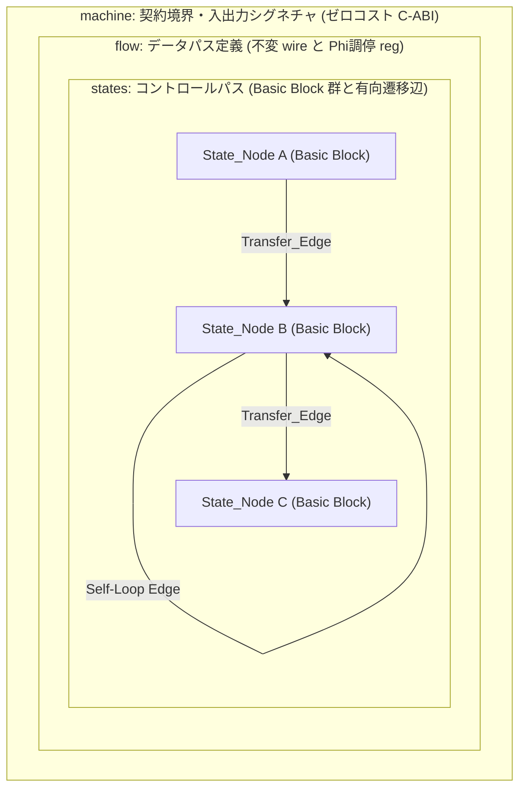
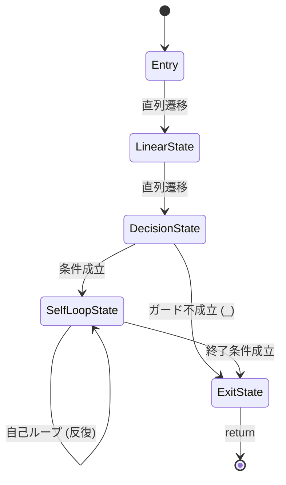
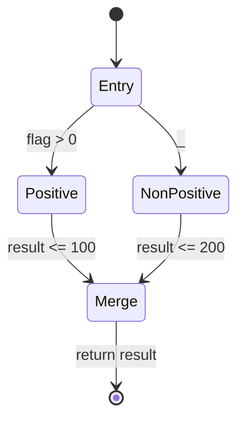

# 第3章：プログラムの骨格 —— machine, flow, states の幾何学

## 1. 抽象構文木（AST）思考から、有向グラフ幾何学へのパラダイムシフト

### 1.1 構文木の入れ子構造と認知限界：暗黙の経路爆発
C/C++、Rust、Go などの構造化プログラミング言語において、処理ロジックの構築は構文要素の階層的ネスト（入れ子構造）を基礎として行われる。順次実行されるブロックの内部に `while` や `for` による反復が配置され、その内部に `if-else` や `switch-case`（あるいはパターンマッチ）による条件分岐が多重に重なり、さらに必要に応じてブロックを脱出するための `break`、`continue`、`return` や、例外送出構文が挿入される。

この構造化アプローチは、プログラムを局所的なブロック単位で分割・隠蔽できるという点で、ソフトウェア開発の初期生産性を飛躍的に高めた。しかし、処理対象が通信プロトコル、パケットパーサー、ステートマシン、デバイスドライバのように離散的な状態遷移を伴うストリーム処理へと移行したとき、この構文木の入れ子構造はプログラマの認知に対して深刻な構造的負荷を課し始める。

```c
// 構文木のネストによる暗黙の制御フローと可変状態の散在例
while (cursor < len) {
    char c = buf[cursor++];
    if (in_escape) {
        in_escape = false;
        if (c == 'u') {
            unicode_digits = 4;
        } else {
            // エスケープ処理
        }
    } else if (c == '\\') {
        in_escape = true;
    } else if (c == '"') {
        if (unicode_digits > 0) {
            // 不正なエスケープシーケンス途中の終端
            return ERROR_MALFORMED;
        }
        break; // 文字列終端
    } else {
        if (unicode_digits > 0) {
            unicode_digits--;
            // 16進数判定と値の累積
        }
    }
}
```

上記のコードにおいて、字面上は単純な `while` ループとその内部の分岐に見えるが、プログラマが正しく振る舞いを把握するために追跡すべき状態変数は `in_escape`、`unicode_digits`、`cursor`、`len` と多岐にわたる。

深さ $k$ のネスト構造の中に $m$ 個の可変変数（ブールフラグやカウンタ）が存在する場合、ある実行ステップにおいてシステムが取り得る潜在的な状態空間は $\mathcal{O}(2^m)$ のオーダーで増大する。ソースコードの字面上の行数（テキスト行）に対して、実行可能な制御パスの組み合わせ（サイクロマティック複雑度）が指数関数的に爆発するため、以下の工学的問題が不可避に発生する：

1. **不変量（Invariant）の追跡困難**:
   変数の値が複数のネストした分岐の内部で破壊的に更新されるため、「ある行が実行されている瞬間に、他のフラグ変数がどのような整合性を保っているべきか」を静的に証明することが人間のワーキングメモリの限界を超える。
2. **到達不能パスと初期化漏れの温床**:
   外側の条件式と内側の条件式の組み合わせにより、字面上は書かれているが実際には到達不能なパスが生じたり、特定の分岐ルートを通過した際に変数のリセットが漏れるといった不具合が温床化する。
3. **字面と実行パスの乖離**:
   `break` や `continue`、早期 `return` は、構文木の階層構造を非局所的にジャンプする制御命令である。インデントによって表現される視覚的な親子関係と、実行時に制御が遷移する実際の有向グラフ（CFG）との間にトポロジー的な乖離が生じる。

### 1.2 計算機の実行モデルへの直結：Basic Block と Directed Edge
プログラマが高水準言語において構文木（AST: Abstract Syntax Tree）の階層構造を記述している一方で、それを実行する CPU および最適化コンパイラの視座において、構文木の入れ子構造は一切存在しない。

現代のスーパースカラー・アウトオブオーダー型プロセッサが命令をフェッチし、デコードし、パイプラインへ投入する単位は、常に以下の 2 つの構成要素からなる **制御フローグラフ（CFG: Control Flow Graph）** である：

1. **基本ブロック（Basic Block）**:
   単一のエントリーポイント（入口）から開始され、末尾の分岐命令（終端命令: Terminator Instruction）に至るまで、途中に分岐や合流を一切含まない直線的な命令シーケンス。内部の命令は必ず最初から最後まで連続して実行される。
2. **有向エッジ（Directed Edge / Transfer Edge）**:
   Basic Block の終端から、後続の Basic Block の先頭へと制御を渡す有向遷移。条件分岐（1-bit 述語による 2 方向への分岐）または無条件ジャンプによって構成される。

```text
高水準言語 (AST):
  while / for / if / else / break などの階層的入れ子構造
         │
         ▼ [コンパイラによる平坦化 (Lowering / Flattening)]
中間表現 (LLVM IR / CFG):
  Basic Block A ──(True Edge)──> Basic Block B
       │                                │
       └──(False Edge)──> Basic Block C ◄──┘ (Phi ノードによる合流調停)
         │
         ▼ [アセンブリ / 機械語]
ハードウェア CPU:
  命令キャッシュ ➔ デコード ➔ ALU パイプライン ➔ 分岐予測 / リオーダバッファ
```

LLVM や GCC などの現代的コンパイラは、フロントエンドにおいて受け取った AST を直ちに平坦化（Flattening）し、Basic Block と Branch 命令による CFG へと解体する。さらに、メモリ上の可変変数へのアクセス（`alloca`, `load`, `store`）を静的単一代入形式（SSA: Static Single Assignment）へ変換（LLVM における Mem2Reg パス）し、複数の先行ブロックからの値の合流点に明示的な $\phi$（Phi）ノードを挿入する。

従来の高水準言語における最大の問題は、**「プログラマが思考するモデル（構文木のネストと可変変数）と、コンパイラおよび CPU が実行するモデル（CFG と SSA データフロー）の間に、巨大な抽象化の溝が存在すること」** にある。

プログラマが構文木の中で可変変数を再代入した結果、コンパイラがそれをどのように Basic Block へ分割し、どのレジスタに割り当て、どのような Phi 合流を生成するかは、プログラマの直接の制御を離れる。その結果、レジスタ退避・復元（Spill）の発生、パイプラインのストール（バブル）、予測不能な分岐ペナルティが不可視の領域で発生する。

StateSSA は、このトポロジー的乖離を根本から排除する。
StateSSA の設計思想である **`Dataflow-StateMachine-Direct-Cognition`** においては、構文木の入れ子構造を一切導入しない。プログラマ自身が、計算機が真に実行する基本単位である **「Basic Block（State_Node）」** と **「有向遷移辺（Transfer_Edge）」**、そして **「不変な SSA データストリーム（Data_Stream / Wire）」** で直接思考し、それをそのままソースコードとして記述する。これにより、ソースコードの構造と CPU 実行パイプラインの挙動が 1 対 1 で完全に一致する。

---

## 2. 3大構文要素の解剖学（machine, flow, states）

StateSSA のプログラムは、3 つの厳格な階層要素によって構成される。これらは互いに責務が直交しており、曖昧な混同を許さない。



### 2.1 `machine`：契約境界とゼロコスト C-ABI
`machine` は、外部のホスト環境（C/C++ プログラム、OS カーネル、他言語ランタイム）とのインターフェースを画定する契約境界である。

```ssa
machine parse_header(buf: *u8, len: i32) -> i32 {
    flow { ... }
    states { ... }
}
```

`machine` の特性は以下の工学的要件によって規定される：

1. **シグネチャの純粋性**:
   `machine` の引数として宣言された型付きポインタや値（上記例における `buf: *u8`, `len: i32`）は、マシンの生存期間を通じて不変な第一級データストリームとして各状態ノードへ供給される。
2. **ゼロコスト C-ABI 直結**:
   `machine` のシンボルは、名前修飾（Name Mangling）を受けることなく、LLVM IR 上で標準的な C 言語関数シンボル（`define i32 @parse_header(ptr %buf, i32 %len)`）として直接出力される。
3. **呼び出しオーバーヘッドのゼロ化**:
   System V AMD64 ABI 等の標準呼び出し規約に基づき、引数は物理レジスタ（`%rdi`, `%rsi` 等）を介して直接渡され、戻り値は `%eax` を介して返却される。StateSSA マシンを呼び出すためのグルーコードやラッパー関数は一切不要であり、C 言語のネイティブ関数呼び出しと同一のレイテンシでリンク・実行される。

### 2.2 `flow`：不変データストリーム（wire）とラッチ代入レジスタ（reg）
`flow` ブロックは、マシン内部におけるデータパス（Data Path）の構造を定義する。ここには 2 種類の実体のみが存在する。

```ssa
flow {
    reg cursor: i32 = 0;
    reg token_count: i32 = 0;
    reg error_code: i32 = 0;

    wire safe_limit = len - 8;
    wire is_eof = cursor >= len;
}
```

#### `wire`（不変データストリーム）
`wire` は、マシンの引数、定数、またはレジスタ値から算出される純粋な導出式である。
- **不変性**: 一度定義された `wire` は再代入できない。
- **データ依存関係に基づく解決**: `wire` は実行順序を持たない。依存元の値が確定した時点で即時評価される純粋なデータパス配線として機能する。
- **最適化親和性**: LLVM IR 生成時、`wire` は一時的な SSA 値（`%wire = add i32 ...`）としてインライン展開されるか、コンパイル時定数畳み込み（Constant Folding）の対象となる。

#### `reg`（ラッチ代入レジスタ）
`reg` は、状態ノードの境界を越えて値を引き継ぐための論理レジスタである。
ここで決定的に重要な工学的事実は、**`reg` はメモリ上の可変変数（スタック上の領域へのポインタと再代入）ではない** という点である。
- **Phi ノードとしての実体**: `reg` は、後述する状態ノード（Basic Block）の入口に配置される **LLVM IR の `phi` ノード（マルチプレクサ）** を構文上で宣言したものである。
- **状態ノード内での再代入禁止**: 状態ノードの内部において `reg = expr;` のような破壊的代入を行うことは構文エラー（Syntax Error）としてコンパイラに拒絶される。
- **遷移時ラッチ規律**: `reg` の値が更新されるのは、ある状態ノードから別の状態ノードへ遷移する **「有向辺（Transfer Edge）」の通過瞬間のみ** である。

### 2.3 `states`：アトミック変換頂点（State_Node）と遷移有向辺（Transfer_Edge）
`states` ブロックは、コントロールパス（Control Path）を形成する平坦化された状態ノード群の集合体である。

```ssa
states {
    Entry: {
        len <= 0 => Exit [ error_code <= -1 ];
        _        => Process [ cursor <= 0, token_count <= 0 ];
    }
    Process: {
        is_eof != 0 => Exit [ error_code <= 0 ];
        let b = *(buf + cursor);
        b == 0      => Exit [ error_code <= -2 ];
        _           => Process [ cursor <= cursor + 1, token_count <= token_count + 1 ];
    }
    Exit: {
        _ => return error_code;
    }
}
```

#### State_Node（アトミック変換頂点）
各 State_Node（`Entry`, `Process`, `Exit`）は、LLVM IR における Basic Block に 1 対 1 で対応する。
- ノード内部にループ構文（`while`, `for`）や再帰呼出は存在しない。
- 実行はノードの先頭から開始され、末尾の遷移述語判定によって後続ノードへジャンプするまで、完全に直線的な変換（Linear Transformation）のみで構成される。

#### Transfer_Edge（遷移有向辺）
State_Node の終端には、1 つ以上の遷移規則が定義される：
```text
述語式 => 遷移先状態 [ reg <= 更新式, ... ];
```
1. **述語評価（1-bit Predicate）**:
   ガード条件は `i1`（真偽値）として上から順に評価される。最初に真（True）となった遷移エッジが選択される。
2. **ワイルドカード（`_`）**:
   先行するすべてのガード条件が偽（False）であった場合に選択される確定遷移である。
3. **アトミック・ラッチ（`[ reg <= expr ]`）**:
   遷移エッジが選択された瞬間にのみ、次状態へ引き渡すレジスタ値がアトミックに計算され、合流先ノードの `phi` 入力として渡される。

### 2.4 統合例：パケットヘッダ検証マシン
これまで分解して解説した `machine`（契約境界）、`flow`（データパス）、`states`（コントロールパス）を統合した完全な StateSSA コードを示す。読者はこのコードをそのままコピーし、`python3 -m ssac.main` で LLVM IR へコンパイルして挙動を検証できる。

```ssa
machine parse_header(buf: *u8, len: i32) -> i32 {
    flow {
        reg cursor: i32 = 0;
        reg token_count: i32 = 0;
        reg error_code: i32 = 0;

        wire safe_limit = len - 8;
        wire is_eof = cursor >= len;
    }
    states {
        Entry: {
            len <= 0 => Exit [ error_code <= -1 ];
            _        => Process [ cursor <= 0, token_count <= 0 ];
        }
        Process: {
            is_eof != 0 => Exit [ error_code <= 0 ];
            let b = *(buf + cursor);
            b == 0      => Exit [ error_code <= -2 ];
            _           => Process [ cursor <= cursor + 1, token_count <= token_count + 1 ];
        }
        Exit: {
            _ => return error_code;
        }
    }
}
```

---

## 3. 3番地コード（3-Address Code）の必然性と 1行1演算規律

### 3.1 複合式（Nested Expressions）の弊害と評価順序の曖昧性
多くの高水準言語では、以下のような複数の演算子を 1 行に結合した「複合式」の記述が日常的に行われる：

```c
// C言語における複合式の例
int val = calculate_base(x) + table[index++] * (factor - offset);
```

人間にとって複合式は、数学の数式を模倣した直観的な表現に見える。しかし、コンパイラ最適化および低レイヤー制御の視座に立つと、複合式は以下の構造的欠陥を内包している：

1. **暗黙の評価順序と副作用の衝突**:
   複合式の内部に関数呼び出しやインクリメント（`++`）などの副作用が混在する場合、C/C++ の仕様においてオペランドの評価順序は未規定（Unspecified Behavior）である。コンパイラの実装や最適化オプションによって評価順序が入れ替わり、深刻な未定義動作やプラットフォーム依存のバグを生む。
2. **中間状態の匿名化（不可視化）**:
   演算の途中で算出される中間値（`factor - offset` や乗算結果）は、名前のないスタックの一時領域やコンパイラが暗黙に割り当てた仮想レジスタに保持される。実行時トレースやクラッシュダンプの解析時、どの段階の演算でオーバーフローやゼロ除算が発生したのかを特定することが困難となる。
3. **構文木の脳内展開コスト**:
   コードを読む人間は、演算子の優先順位と結合性ルール（乗算が加算より優先、減算の括弧展開など）をワーキングメモリ内で再帰的に構文木へと展開しながら理解しなければならない。

### 3.2 1行1演算規律と単調増加データパス
StateSSA は、状態ノードの内部において **「1行につき厳密に 1 回の演算のみを実行する」** という規律（**3番地コード規律: Three-Address Code Discipline**）を強制する。

```ssa
// StateSSA における 1行1演算の単調増加データパス
let t1 = factor - offset;
let t2 = *(table + index);
let t3 = t2 * t1;
let t4 = call calculate_base(x);
let val = t4 + t3;
```

このコードは、コンパイラ内部の中間表現である LLVM IR と完全に 1 対 1 で同期する：

```llvm
; 上記 StateSSA コードに対応する LLVM IR
%t1 = sub i32 %factor, %offset
%ptr = getelementptr inbounds i32, ptr %table, i32 %index
%t2 = load i32, ptr %ptr
%t3 = mul i32 %t2, %t1
%t4 = call i32 @calculate_base(i32 %x)
%val = add i32 %t4, %t3
```

- **代入先の単調増加性**: 各行で定義される `let` 束縛は、常に新しい不変の SSA ワイヤー（`t1`, `t2`, `t3`, ...）を生成する。既存のワイヤーへの再代入（上書き）は構文上存在しない。
- **演算の原子性**: 各行は「高々 2 つの入力オペランドと 1 つの演算子、および 1 つの出力」から構成される。

### 3.3 脳内構文木を展開させない「思考の限定」によるバグの静的根絶
1行1演算規律の目的は、単なる記法の制約ではない。プログラマに対して **「脳内で再帰的な構文木を展開する思考を禁止し、ハードウェアの実行パイプラインと同一の有向非巡回グラフ（DAG）で思考させる」** という認知の矯正にある。

| 観点 | 従来の複合式（AST 思考） | StateSSA（3番地コード規律） |
| :--- | :--- | :--- |
| **評価モデル** | 再帰的な演算木（階層構造） | 平坦な有向非巡回グラフ（DAG） |
| **中間値の扱い** | 匿名の一時スタック領域 | 明示的に命名された不変 SSA ワイヤー |
| **評価順序** | 演算子優先順位による暗黙決定 | コードの行記述順序と完全一致 |
| **ハードウェア対応** | コンパイラの Lowering 依存 | LLVM IR 命令および ALU 演算と 1:1 直結 |
| **デバッグ・検証** | 中間値の観測に特殊プローブが必要 | 全中間ワイヤーがトレース可能 |

すべての計算ステップに名前が与えられ、データが上から下へと単調に流れるため、「演算の優先順位の勘違いによる計算ミス」「副作用の評価順序依存バグ」は構造的に根絶される。

---

## 4. 状態遷移トポロジー幾何学

StateSSA におけるプログラム設計の本質は、テキストとしてのコード記述ではなく、**「状態空間における有向グラフのトポロジー設計」** である。

### 4.1 基本トポロジー（直列遷移、条件分岐、自己ループ、Entry の不可逆性）

システムが表現するすべての制御フローは、以下の 4 つの幾何学的トポロジーの組み合わせに帰着される。



#### 1. 直列遷移（Linear Progression）
前提条件の確立、メモリのセットアップ、パイプラインステージの推進を段階的に進める幾何学である。先行ノードから後続ノードへと無条件または単一の防御ガードで 1 方向に遷移する。

```ssa
Entry: {
    _ => StepA;
}
StepA: {
    _ => StepB;
}
```

#### 2. 条件分岐（Decision State）
1-bit 述語の評価結果に基づいて、後続の複数の状態ノードのいずれかを選択する幾何学である。

```ssa
CheckLength: {
    len == 0   => HandleEmpty;
    len > 1024 => HandleOverflow;
    _          => ProcessBuffer;
}
```
LLVM IR 上では、述語評価結果（`icmp`）に基づく条件分岐（`br i1 %cond, label %TargetTrue, label %TargetFalse`）のチェーンとして出力される。

#### 3. 自己ループ（Self-Loop）
同一の状態ノード自身へ再帰的に戻る遷移有向辺である。

```ssa
ProcessStream: {
    cursor >= len => Exit;
    let b = *(buf + cursor);
    b == 0x00     => Exit;
    _             => ProcessStream [ cursor <= cursor + 1 ];
}
```
自己ループは、従来の言語における `while` や `for` ループに相当するが、階層的なネストを形成しない。状態（コンテキスト）を変えることなく、レジスタ値を単調更新しながらストリームデータを消費するための幾何学である。

#### 4. Entry の不可逆性（Irreversibility of Entry）
マシンの開始状態である `Entry` ノードには、言語仕様として以下の厳格な制約が課される：
> **「マシンの実行開始後、いかなる状態ノードからも `Entry` 状態へ逆流する遷移（`=> Entry`、自己ループ含む）を禁止する。」**

もしコード内に `Entry` への遷移が存在する場合、コンパイラはコンパイル時エラー（`TypeError: Cannot transition to Entry state`）を出力して即座にビルドを拒絶する。

この不可逆性の工学的根拠は以下の通りである：
1. **初期化フェーズと定常ループのトポロジー的分離**:
   関数のエントリーポイントにおける引数バインドおよび初期化処理が、実行ループの途中で予期せず再実行されるバグを静的に排除する。
2. **Phi 合流の排除による決定論性の担保**:
   `Entry` ノードに複数の先行エッジが収束することを禁止することにより、関数の開始時点における引数データストリームが未定義の合流調停に晒される危険性をゼロにする。

### 4.2 Phi（$\phi$）合流調停の幾何学的メカニズム

複数の異なる実行経路（先行ノード）から単一の状態ノードへと制御フローが合流するとき、計算機は「どの経路を通過してきたか」に応じて異なるデータを選択しなければならない。



この合流をハードウェアおよび LLVM SSA において実現するのが **Phi ノード（マルチプレクサ）** である。

#### StateSSA における合流コード例
```ssa
machine evaluate_flag(flag: i32) -> i32 {
    flow {
        reg result: i32 = 0;
    }
    states {
        Entry: {
            flag > 0 => Positive;
            _        => NonPositive;
        }
        Positive: {
            _ => Merge [ result <= 100 ];
        }
        NonPositive: {
            _ => Merge [ result <= 200 ];
        }
        Merge: {
            _ => return result;
        }
    }
}
```

#### 生成される LLVM IR との完全な対称性
コンパイラは、合流先ノード `Merge` の先頭に以下の LLVM IR 命令を決定論的に生成する：

```llvm
define i32 @evaluate_flag(i32 %flag) {
Entry:
    %cmp = icmp sgt i32 %flag, 0
    br i1 %cmp, label %Positive, label %NonPositive

Positive:
    br label %Merge

NonPositive:
    br label %Merge

Merge:
    ; 先行基本ブロックのラベルに基づいて値を選択する Phi ノード
    %result = phi i32 [ 100, %Positive ], [ 200, %NonPositive ]
    ret i32 %result
}
```

- **因果性の静的証明**:
  `Merge` ノードに入った瞬間、`result` の値が 100 なのか 200 なのかは、先行して通過したブロック（`Positive` または `NonPositive`）に 100% 従属する。
- **未初期化参照の物理的根絶**:
  すべての遷移元エッジにおいて `result` に対するラッチ式（`[ result <= expr ]`）が必須となるため、ある経路から合流したときに値が未設定のまま読み出される「未初期化変数バグ」は、トポロジー上物理的に発生できない。

---

## 5. 引き算のセキュリティ（言語仕様による防壁）

ソフトウェアの脆弱性（脆弱性報告 CVE の大半）は、言語仕様がプログラマの利便性のために提供した「暗黙の振る舞い（Implicit Behaviors）」や「柔軟すぎるポインタ操作」の隙間に発生する。StateSSA は、機能を足すのではなく「排除する（引き算する）」ことによって、数学的・幾何学的なセキュリティ防壁を構築する。

### 5.1 暗黙の型変換（Magic Coercion）の完全排除と明示的 cast の工学的価値

C/C++ をはじめとする既存言語では、ビット幅の異なる整数同士の演算や、符号付き/符号なし整数の代入において、言語仕様が自動的に型を合わせる「暗黙の型変換（Implicit Coercion / Integer Promotion）」が作動する。

```c
// C言語における暗黙の型変換が引き起こす脆弱性の例
int signed_len = -1;
unsigned int buffer_size = 100;

if (signed_len < buffer_size) { // 符号なし比較へ暗黙昇格！
    // signed_len は 0xFFFFFFFF (4294967295) として解釈されるため、
    // 比較結果は False となり、このブロックは実行されない！
}
```

このような暗黙の型変換は、プログラマの意図しない解釈を生み、バッファオーバーフローや認証バイパスの温床となってきた。

#### StateSSA の絶対規律：暗黙変換の完全禁止
StateSSA では、暗黙の型昇格、暗黙の型変換、暗黙の型切り捨てを 1 ビットたりとも認めない。

```ssa
machine strict_cast_demo(val_b: i64) -> i32 {
    flow {
        reg a: i32 = 10;
        reg b: i64 = val_b;
    }
    states {
        Entry: {
            // コンパイルエラー: i32 と i64 の直接代入や演算は型不一致として禁止される
            // a = b;              <-- TypeError: cannot assign i64 to i32
            // let sum = a + b;    <-- TypeError: binary op '+' between i32 and i64 prohibited

            // 正しい記述: 明示的な cast による縮小変換の強制
            let b_trunc = cast(i32) b;
            let sum = a + b_trunc;
            _ => return sum;
        }
    }
}
```

#### 明示的 `cast` がもたらす「認知の摩擦（Cognitive Friction）」
StateSSA がプログラマに `cast(TargetType)` の明記を強制するのは、単なる構文チェックではない。**「プログラマに対して型変換の危険性と物理的コストを意識させるための認知の摩擦（Cognitive Friction）」** を意図的に発生させるためである。

1. **ゼロ拡張（`zext`）と符号拡張（`sext`）の自覚**:
   符号なし整数を拡張するのか、符号付き整数を拡張するのかによって、上位ビットが 0 で埋められるのか符号ビットで埋められるのかが異なる。キャストを明記することにより、CPU 命令レベルの振る舞いがコード上で明確化される。
2. **Newtype（名目的型）による物理単位の保全**:
   `type UserId = u64;` や `type PacketSize = u32;` のように定義された Newtype は、基底型と同じビット幅であっても互換性を持たない。異なる単位同士を誤って加算・代入するバグは、コンパイル時に即座に拒絶（`TypeError`）される。

```ssa
type UserId = u64;
type PacketSize = u32;

machine process_user(id: UserId, size: PacketSize) -> u64 {
    flow {}
    states {
        Entry: {
            // コンパイルエラー: 異なる Newtype 同士の直接演算や代入は禁止される
            // let invalid = id + size;  <-- TypeError

            // 正しい記述: 明示的に基底型へアンラップ（キャスト）して演算
            let raw_id = cast(u64) id;
            let raw_size = cast(u64) size;
            let total = raw_id + raw_size;
            _ => return total;
        }
    }
}
```

### 5.2 内部メモリのアドレス取得（`&`）排除によるスタック破壊・ポインタエスケープの物理的消滅

C 言語における最も深刻な脆弱性の源泉は、任意のアドレスを取得できる **単項アドレス演算子 `&`（Address-of Operator）** の存在である。

```c
// C言語におけるローカル変数アドレス流出の危険性
int* escape_pointer(void) {
    int local_data = 42;
    return &local_data; // スタックフレーム上のアドレスが外部へ流出 (Dangling Pointer)
}

void smash_stack(void) {
    int buffer[4];
    // buffer のアドレスを外部関数へ渡した結果、境界外書き込みでリターンアドレスが破壊される
    unsafe_read(&buffer[0], 100); 
}
```

ローカル変数に対する `&` 演算を許すと、変数は CPU レジスタに留まることができず、必ずスタックフレーム上のメモリ番地に配置（`alloca`）されなければならない。そのアドレスがポインタとして外部へ流出（Pointer Escape）した瞬間、メモリの生存期間（Lifetime）管理が破綻し、Use-After-Free やスタックバッファオーバーフローが発生する。

#### StateSSA の幾何学的切断：`&` 演算子の完全排除
StateSSA は、言語仕様から **アドレス取得演算子 `&` を完全に排除** している。

1. **内部状態のアドレス取得不能**:
   マシン内部で宣言された `reg`、`wire`、およびローカルな中間値（`let`）のアドレスを取得する構文は存在しない。プログラマがどれほど望んでも、内部変数のアドレスをポインタ化することはできない。
2. **純粋レジスタ機械としての隔離**:
   アドレスを取得できないため、すべての内部変数は LLVM IR 上でメモリ領域（`alloca`）を必要とせず、100% 物理 CPU レジスタ（SSA 値）として割り当てられる。
3. **外部バッファ参照の制限**:
   ポインタ型（`*T`）は、関数の引数として外部から渡されたバッファポインタや、外部関数（`extern`）から返却されたアドレスの参照・デリファレンス（`*ptr`）、およびオフセット加算（`ptr + offset`）にのみ限定される。

```ssa
machine read_buffer(buf: *u8, offset: i32) -> u8 {
    flow {}
    states {
        Entry: {
            let p = buf + offset;
            let val = *p;
            _ => return val;
        }
    }
}
```

この言語仕様による防壁により、StateSSA プログラムの内部において **「スタック破壊」「スタック上のリターンアドレスの改ざん」「ローカル変数のダングリングポインタ」という低レイヤーの脆弱性は、原理的・幾何学的に発生し得ない**。

---

## 6. トレードオフの総括 (Engineering Evaluation)

StateSSA のプログラム骨格が提示する構造は、ソフトウェア開発における重要な工学的トレードオフに基づいている。

### 6.1 StateSSA が獲得した工学的利点
1. **決定論的実行性能**:
   構文木のネストを排し、平坦な Basic Block と有向遷移辺（CFG）を直接記述することにより、コンパイラの最適化パス（LLVM IR）および CPU の実行パイプラインと完全に同期したゼロオーバーヘッドの実行性能を達成する。
2. **副作用と不変量崩壊の静的根絶**:
   可変変数へのインプレース再代入を排除し、不変ワイヤーと状態遷移時ラッチ（Phi 調停）のみを採用することで、時間軸上の状態の散在とサイクロマティック複雑度の爆発を根絶する。
3. **言語仕様レベルの物理的安全保障**:
   暗黙の型変換とアドレス取得演算子 `&` の完全排除により、整数オーバーフローによる誤動作、スタック破壊、ポインタエスケープを構造的に遮断する。

### 6.2 StateSSA が要求する設計コストと制約
1. **手続き的記述の自由度の制限**:
   高水準言語が提供する手軽なネスト式（`while` の中での一時変数の書き換えや複合式 `a + b * c`）を記述することはできない。すべての演算を 3 番地コード形式で 1 行ずつ分解し、状態遷移図としてモデル化する必要がある。
2. **事前の有限状態モデリングの義務化**:
   コードを書き始める前に、対象ドメインの状態空間（States）、データパス（Flow）、遷移境界（Edges）を有向グラフとして厳密に設計することが不可欠となる。

### 6.3 適用領域の境界定義
- **最適なドメイン**:
  - 高信頼性が要求される通信プロトコルスタックおよびパケットデコーダ
  - バッファ境界の安全性が絶対視されるストリームパーサー（JSON、HTTP、バイナリフォーマット）
  - デバイスドライバ、組み込みファームウェア、高信頼ステートマシン制御
  - 暗号アルゴリズム、DSP・音声信号処理（SIMD ベクトル並列パイプライン）
- **適用を避けるべきドメイン**:
  - 動的ディスパッチや複雑なオブジェクト階層を多用するデスクトップ GUI アプリケーション
  - 状態遷移の決定論性よりも、アドホックな試行錯誤や高速なプロトタイピングが優先される業務スクリプト
