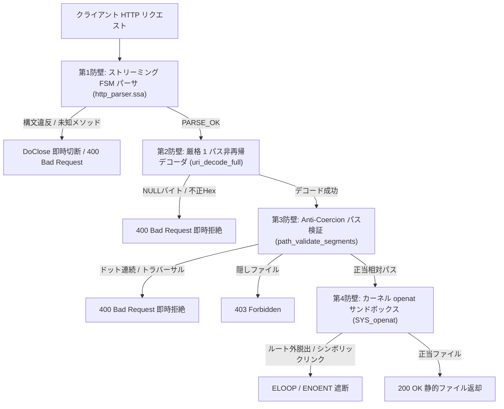

# 第4章：低レイヤー境界と絶対防壁 —— io_uring カーネル直接制御と耐タンパー性ファイル配信

---

## 1. 課題の工学的所在 (Problem Context & Motivation)

### 1.1 パストラバーサルとメモリ破壊の半世紀にわたる病理
計算機ネットワークの黎明期より、外部からのリクエストに応じてストレージ上のリソースを提供するファイル配信サーバーは、あらゆる分散システムの基本構成要素であり続けてきた。
しかし、半世紀に及ぶソフトウェア工学の進歩にもかかわらず、**パストラバーサル（ディレクトリトラバーサル）** および **メモリ破壊（バッファ不正操作）** は、依然として深刻なセキュリティインシデントの主因として報告され続けている。

この病理が根絶されない構造的原因は、従来のシステム記述言語およびフレームワークが抱える 2 つの根深い構造的歪みに帰着される：

1. **非決定論的な可変状態と境界外参照の許容**:
   C/C++ に代表される手続き型言語では、ソケットから受信したバイト列をヒープやスタック上の可変バッファへコピーし、ポインタ演算によって文字列を切り出す。この過程において、オフセット計算の誤りや終端文字（NULL バイト）の欠落が直ちにバッファオーバーフローや境界外読み出しへと転化する。
2. **抽象化レイヤーの多重積層による境界の希薄化**:
   高水準ランタイムでは、HTTP プロトコルの解釈、URL デコード、ファイルパス正規化、OS システムコールの発行が、何層ものライブラリやランタイム境界によって分断されている。各層が異なる文字エンコーディング仮定やバッファ境界管理を行う結果、層と層の「隙間」にセキュリティホールが発生する。

---

### 1.2 「暗黙の救済 (Magic Coercion)」がもたらす脆弱性の温床
Web サーバーの脆弱性史を詳細に解析すると、多くのセキュリティ欠陥は「プログラマの不注意」単体ではなく、**言語やライブラリが善意で提供する「暗黙の救済（Magic Coercion / 泥縄的正規化）」** によって引き起こされていることが判明する。

典型的なパストラバーサル対策において、多くのフレームワークはクライアントから異常な入力が送信された際、以下のような「親切な補正」を試みる：

- パスセグメントに `..` が含まれていた場合、親ディレクトリスタックから 1 階層ポップしてパスを「きれいな形」に正規化する。
- 二重スラッシュ `//` を単一のスラッシュ `/` へと自動置換する。
- 不正なエンコーディングシーケンスを検出した際、フォールバック文字に置換するか、再帰的にデコードを反復する。

この「暗黙の救済」こそが、攻撃者にとって格好の足場となる。
例えば、多重 URL エンコード（`%252e%252e`）を不用意に再帰デコードするパーサは、1 回目のデコードで `%2e%2e` を生成し、2 回目のデコードで `..` を生み出してしまう。
また、NULL バイト（`%00`）を含む文字列に対して C 言語の標準文字列関数（`strcpy` や `open`）を適用すると、ファイルパスが NULL バイトの位置で暗黙に切断され、拡張子チェック（例: `.html` 制限）をすり抜けて機密ファイル（例: `/var/secret/himitu.txt\0.html`）をオープンさせてしまう。

不正な入力に対して「気を利かせて解釈し直す」という寛容性思想（Postel's Law: Robustness Principle）は、信頼境界が確立されていない敵対的環境においては、破滅的な脆弱性の温床へと変貌する。

---

### 1.3 現代 I/O ランタイム (Nginx, Node.js, Tokio) の偉業と多重レイヤー摩擦
現代のインターネットインフラを支える非同期 I/O サーバー群——例えば、イベント駆動型 C アーキテクチャの金字塔である `Nginx`、V8 エンジンと libuv を統合した `Node.js`、Rust の非同期エコシステムの中核を成す `Tokio` や `liburing`——は、何百万もの同時並行接続を処理するスケーラビリティを確立し、現代のデジタル社会の基盤として絶大な貢献を果たしてきた。我々はその卓越した工学的達成に最大の敬意を払わなければならない。

しかし、これらの高度なランタイムであっても、計算機モデルの深層においては以下の対称的トレードオフ（代償）を支払っている：

```text
[従来の非同期ランタイムにおける多重レイヤー構造]
+-------------------------------------------------------+
|  アプリケーション層 (JavaScript / Rust async / C handler) |
+-------------------------------------------------------+
|  非同期抽象化層 (libuv / Tokio reactor / epoll 監視)   |
+-------------------------------------------------------+
|  動的メモリ管理層 (malloc/free / jemalloc / GC)        |
+-------------------------------------------------------+
|  C 標準ライブラリ ABI (glibc / musl)                   |
+-------------------------------------------------------+
|  Linux カーネルシステムコール境界 (epoll, read, write)    |
+-------------------------------------------------------+
```

1. **メモリ所有権の不透明性**:
   ソケットから受信したパケットは、カーネルバッファからユーザー空間のリングバッファ、さらにアプリケーションのヒープオブジェクトへと多重にコピー・参照される。ガベージコレクションや参照カウントの介在により、メモリが解放される物理的タイミングが非決定論的となり、高負荷時のレイテンシスパイクを招く。
2. **多重レイヤー摩擦とシステムコールオーバーヘッド**:
   `epoll` を基盤とするモデルでは、ソケットの readiness（準備完了）を監視するために `epoll_ctl` / `epoll_wait` を発行し、実際のデータ送受信のために `read` / `write` を発行する。ユーザー空間とカーネル空間のコンテキストスイッチが頻発し、CPU パイプラインのフラッシュと TLB ミスペナルティが累積する。

---

### 1.4 本章が挑む極限目標：ゼロ C 言語・ゼロアロケーション・耐タンパー性配信
Linux カーネル 5.1 で導入された **`io_uring`** は、カーネル空間とユーザー空間がメモリマップドファイル（mmap）を介して 2 つのリングバッファ——**Submission Queue (SQ)** と **Completion Queue (CQ)**——を共有することにより、システムコールの発行回数を極小化し、真の非同期 I/O を達成する革新的サブシステムである。

本章において我々が挑む工学的目標は極めて明瞭かつ先鋭的である：

> **「中間層ライブラリ（liburing や C 言語ランタイム）を 1 行も介さず、Linux カーネル ABI とダイレクトに対話する純粋な StateSSA FSM を構築し、動的ヒープ確保を 1 バイトも行わないゼロアロケーション環境において、いかなる悪意的トラバーサル入力に対しても 0 バイトの機密漏洩をも許さない絶対的耐タンパー性 Web サーバーを実現する」**

我々は、暗黙の救済を徹底的に排除した形式的状態遷移機械が、いかにして低レイヤーシステムプログラミングの安全境界を再定義するかを、実動コードと第三者検証証跡をもって立証する。

---

## 2. 言語仕様の境界哲学：担保すべき領域と諦める領域 (Language Boundary Philosophy)

### 2.1 静的型検証のフロンティアと、計算機モデルの透明性という問い
近年のシステムプログラミング界において、Rust に代表される現代型安全言語は、所有権モデルと借用チェッカーによって「ガベージコレクションを介さないメモリ安全性の静的検証」という極めて高度な工学的フロンティアを切り拓いた。その卓越した理論的・実践的貢献には最大の敬意が払われるべきである。

型システムがコードの安全性をコンパイル時に形式証明するアプローチは、ソフトウェアの信頼性を飛躍的に高めた。
しかし同時に、計算機工学の歴史を俯瞰すると、言語設計には常に異なる設計思想の選択肢（トレードオフ）が存在する。

コンパイラがあらゆる安全不変量を型レベルで証明しようと進化する過程において、型推論エンジンや高カインド抽象、マクロ展開が高度化し、ソースコードの記述とバックエンド（LLVM IR や機械語）における物理的命令配置との直観的対応関係を把握するための認知負荷が高まる側面がある。
一方で、旧来の手続き型言語や高水準ランタイムが辿ってきた歴史——開発者の利便性の名の下に導入された暗黙の型昇格（Implicit Integer Promotion）や、入力エラーに対する暗黙のフォールバック・泥縄的救済——は、前節で述べた通り深刻なセキュリティ境界の希薄化を招いてきた。

StateSSA は、この二者択一の狭間において、第三の明確な設計思想——**「Anti-Coercion（暗黙救済・忖度の完全排除）と、計算機モデルの 1 対 1 の物理的透明性」**——を選択した。

StateSSA は、言語にあらゆる動的振る舞いを型レベルで代行・証明させる道も、プログラマに忖度して暗黙に辻褄を合わせる道も採らない。
言語は「不変な物理配線（wire）と決定論的状態遷移（states）」の記述に徹し、プログラマが意図したデータフローのみを冷徹かつ忠実に機械語へと具現化する。

---

### 2.2 StateSSA が担保する領域：Anti-Coercion, Fail-Fast, 不変データフロー, LLVM 1:1 直交性
StateSSA が言語仕様として強固に保証する領域は、以下の 4 点に厳格に限定される：

1. **Anti-Coercion（暗黙救済・暗黙型変換の完全排除）**:
   StateSSA には暗黙の型昇格（Implicit Integer Promotion）や暗黙の型キャストは一切存在しない。`u8` と `u32` の加算、ポインタと整数の混同、符号付きと符号なしの曖昧な比較は、すべてコンパイル時に冷徹な型エラー（`TypeError`）として拒絶される。
2. **Fail-Fast（仕様違反に対する即座のエラー拒絶と即死）**:
   文法や型制約に違反したコード、あるいは実行時における未定義の遷移パスに対して、コンパイラや FSM は泥縄的な救済分岐を一切挟まない。不正な入力は、その場で直ちに拒絶・終了（即死）する。
3. **単調前進する不変 SSA データフロー**:
   `wire` は不変な物理配線であり、上書き（Reassignment）は物理的に不可能である。値は時間とともに単調前進し、過去の計算結果が暗黙の副作用によって破壊されることは構造的にあり得ない。
4. **LLVM IR Basic Block との 1 対 1 直交性**:
   StateSSA の `states` ブロック内に定義された各状態ノードは、LLVM IR の Basic Block へと 1:1 でダイレクトに Lowering される。隠蔽されたランタイムループ、暗黙の例外ハンドラテーブル、不可視のスタックフレーム操作は一切介在しない。

---

### 2.3 StateSSA がプログラマの責務とする領域：動的論理妥当性とハードウェアページ境界
逆に、StateSSA が「言語としてはあえて面倒を見ず、プログラマの明示的設計責任とする」領域も極めて明確である：

1. **実行時の値の論理的妥当性**:
   コンパイラは「整数 $x$ が 0 であるか否か」を実行前に全知全能に判定することはできない。ゼロ除算を回避するための境界条件チェック（`divisor == 0 => DivByZeroError`）を記述することはプログラマの明確な責務である。もしプログラマが境界検査を怠った場合、システムは CPU 例外（SIGFPE）によって決定論的にクラッシュすべきであり、コンパイラが勝手に 0 で割った結果を 0 に補正するような欺瞞を行ってはならない。
2. **メモリマップ境界とハードウェアページ管理**:
   `mmap` によって取得される 4KiB ページ境界、アライメント制約、キャッシュライン整合性の保証は、ハードウェアおよびカーネル ABI を理解したプログラマのアーキテクチャ設計に委ねられる。

StateSSA は「プログラマを欺かない」。提供されるプリミティブは硬質であり、プログラマが書いた状態遷移とデータフローのみが、そのまま機械語へと具現化する。

---

### 2.4 v0.15.1 セキュリティリファイン（18 ラウンドの Deep Security Audit）が築いた土台
本章で提示する耐タンパー性ファイル配信サーバーは、孤立した思いつきで書かれたものではない。
StateSSA は、言語コアおよびコンパイラ自身の堅牢性を確立するため、**18 ラウンドに及ぶ徹底的な Deep Security Audit（ADV01〜ADV14, CRIT-01〜04）** を経ている。

この監査を通じて、以下の厳格な規律が言語仕様として固定された：
- **ポインタ演算の厳密化**: 配列インデックスアクセスにおける境界検証の徹底。
- **多重ポインタ解決の形式的保証**: 間接参照がもたらすエイリアシングの排除。
- **循環 wire 依存の静的検出**: 組み合わせ回路におけるデッドロック・発振のコンパイル時完全拒絶。
- **明示的 `cast` の強制**: 型変換の全箇所におけるプログラマの意図表明の義務付け。

この 18 ラウンドの過酷な査定を耐え抜き、セルフホスト完全不動点（Stage-2 と Stage-3 の生成 LLVM IR が 1 バイトの狂いもなく完全一致する状態）を達成した強固な言語基盤こそが、これから解説する絶対防壁の礎となっている。

---

## 3. 構造モデルの定義 (Theoretical & Architectural Model)

### 3.1 ゼロ C 言語・ゼロアロケーションのカーネル直接対話モデル
Linux カーネルの `io_uring` サブシステムは、ユーザー空間とカーネル空間の境界に配置された共有メモリページを通じて動作する。

StateSSA による Web サーバーは、起動時に `mmap` システムコールを直接発行し、カーネルとの共有リングバッファを取得する。
リクエストの受付（Accept）、受信（Recv）、応答送信（Send）に至る全ライフサイクルにおいて、C 言語のラッパー関数は一切呼び出されない。

```text
[StateSSA カーネル直接制御メモリアーキテクチャ]
+------------------------------------------------------------------+
| StateSSA プロセス空間 (User Space)                                |
|  - HttpConn プール (64スロット固定長配列: 8192 Bytes, mmap)       |
|  - UringContext 構造体 (128 Bytes, mmap)                         |
+------------------------------------------------------------------+
        |                                                  ^
  [SQE 書込み]                                       [CQE 読取り]
        v                                                  |
+------------------------------------------------------------------+
| カーネル共有メモリ領域 (Shared Ring Buffers via mmap)            |
|  - Submission Queue (SQ: sq_khead, sq_ktail, sq_array)           |
|  - SQE エントリ配列 (64 Bytes * 128 = 8192 Bytes)                |
|  - Completion Queue (CQ: cq_khead, cq_ktail, cqes)               |
+------------------------------------------------------------------+
        |                                                  ^
  [リング消費]                                       [完了通知]
        v                                                  |
+------------------------------------------------------------------+
| Linux カーネル空間 (Kernel Space)                                 |
|  - 非同期 I/O ワーカーエンジン                                    |
|  - VFS / ソケットレイヤー                                         |
+------------------------------------------------------------------+
```

このモデルにおいて、ヒープアロケータ（`malloc` / `free`）は物理的に存在しない。
全リソースは起動時に静的に決定されたページ内に配置され、実行時のメモリ消費量は完全に平坦（フラット）であり、メモリ断片化やリークの概念そのものが排除される。

---

### 3.2 4 重の防衛トポロジー (Defense-in-Depth Pipeline)
外部ネットワークから受信した敵対的入力が、ドキュメントルート外の秘匿ファイルへ到達することを阻止するため、システムは互いに独立した **4 重の防衛防壁（Defense-in-Depth Topology）** を展開する。



各レイヤーの防衛境界は直交しており、仮に上位レイヤーに未知の入力パターンが通過したとしても、下位レイヤーが決定論的にそれを遮断する。

1. **第 1 防壁: ストリーミング FSM パーサ (`http_parser.ssa`)**:
   固定長 4096 バイトの `rx_buf` 上で直接動作する有限状態機械。メソッド境界、URI 境界、HTTP バージョン境界を厳格に走査し、未知のメソッド（例: `FOO`）や制御文字を検出した瞬間に接続を即座に破棄（TCP 切断）する。
2. **第 2 防壁: 厳格 1 パス非再帰デコーダ (`uri_decode_full`)**:
   URL パーセントエンコーディングを一方向かつ 1 回のみデコードする。再帰デコードを行わないため、二重エンコードによる回避攻撃を構造的に無力化する。デコード直後に NULL バイト（`0x00`）、バックスラッシュ（`0x5C`）、不正 UTF-8（`0xC0`, `0xC1`, `>= 0xF5`）を検出し、400 Bad Request を発行する。
3. **第 3 防壁: Anti-Coercion パス検証 (`path_validate_segments`)**:
   「親切な正規化」を一切拒絶する。パス中に `..` または `...` 以上のドット連続が出現した瞬間、400 Bad Request で即座に終了する。親ディレクトリへの移動は文法レベルで禁止される。
4. **第 4 防壁: カーネル直接制御 `openat` サンドボックス (`http_static.ssa`)**:
   Linux システムコール `SYS_openat(257)` に対し、ドキュメントルートのファイル記述子 `root_fd` とフラグ `O_RDONLY | O_NOFOLLOW | O_CLOEXEC` を指定して発行する。OS カーネル自身がシンボリックリンク追跡を拒絶し、ドキュメントルート外への脱出を物理的に遮断する。

---

### 3.3 Anti-Coercion パス検証の数学的形式定義
第 3 防壁におけるパス検証アルゴリズムを数学的に定式化する。

入力 URI パスをスラッシュ区切りのセグメント系列 $S = (s_1, s_2, \dots, s_k)$ とする。
各セグメント $s_i$ は、長さ $|s_i|$ の文字系列 $s_i = (c_1, c_2, \dots, c_m)$ である。
セグメント内のドット（`.`）の総数を $\mathrm{count\_dot}(s_i)$ とする：

$$
\mathrm{count\_dot}(s_i) = \sum_{j=1}^{m} [c_j = \text{'.'}]
$$

ここで、セグメント $s_i$ に対する妥当性判定関数 $\mathrm{Validate}(s_i)$ を以下の通り定義する：

$$
\mathrm{Validate}(s_i) = 
\begin{cases}
\mathrm{Reject}(400) & \text{if } \mathrm{count\_dot}(s_i) = |s_i| \land |s_i| \ge 2 \\
\mathrm{Reject}(403) & \text{if } c_1 = \text{'.'} \land \mathrm{count\_dot}(s_i) \neq |s_i| \\
\mathrm{Accept}      & \text{otherwise}
\end{cases}
$$

- **トラバーサルの即時拒絶**:
  セグメント全体がドットのみで構成され、その長さが 2 以上である場合（`..`, `...`, `....`）、状態機械は親ディレクトリの解決を試みることなく、直ちに $\mathrm{Reject}(400)$ を出力して停止する。
- **隠しファイルの防衛**:
  セグメントの先頭がドットであり、かつドット以外の文字を含む場合（例: `.git`, `.env`）、システム設定や秘密鍵の漏洩を防ぐため $\mathrm{Reject}(403)$ を出力する。
- **カレントセグメントの許容**:
  単一のドット `.` ($|s_i| = 1 \land \mathrm{count\_dot}(s_i) = 1$) は同一階層を指すため無害として受理される。

この形式的定義により、いかなる文字列の組み合わせであっても、ディレクトリ階層を遡る遷移は数学的に成立し得ない。

---

## 4. 実装の具象化 (Concrete StateSSA Implementation)

### 4.1 22 個の極小 Machine による直交分解アーキテクチャ
StateSSA における設計手法に基づき、本 Web サーバーは巨大な一枚岩のループを形成せず、単一責務に徹した **22 個の極小な状態遷移機械（Micro-Machines）** へと直交分解されている。各 Machine が最小限の状態数と明確な入出力配線のみを保持することで、局所的な正当性検証が容易となり、潜在的な欠陥の混入を設計レベルで抑止する。

```text
[samples/architecture_guide/04_secure_web_server モジュール構成]
1. uring_types.ssa       : カーネル ABI 構造体定義 (IoUringParams, SQE, CQE, HttpConn)
2. uring_conn.ssa        : 静的接続プール管理 (init_connection_pool, find_free_slot)
3. uring_init.ssa        : ソケット作成、mmap リング初期化、io_uring_enter
4. uring_sqe.ssa         : SQE 構築 (sqe_prep_accept, sqe_prep_recv, sqe_prep_send)
5. uring_server.ssa      : メインイベントループ FSM (uring_server_run)
6. http_types.ssa        : HTTP リクエスト構造体 (HttpRequest, http_req_init)
7. http_parser.ssa       : ストリーミングゼロコピー HTTP パーサ (http_parse_request)
8. http_response.ssa     : レスポンスビルダー (http_build_response, resp_copy_bytes)
9. http_static.ssa       : 耐タンパー性ファイル配信エンジン (デコード、検証、openat)
10. main.ssa             : エントリポイント
```

各マシンは肥大化した制御フローを持たず、限られた状態ノードと明示的な Transfer Edge のみで完結している。

---

### 4.2 io_uring SQ/CQ リング直接バインディング (`uring_init.ssa`, `uring_sqe.ssa`)
以下に示すのは、Linux カーネルシステムコール `sys_io_uring_setup`（syscall 425）を直接発行し、返却されたファイル記述子から SQ/CQ リングバッファを `mmap` して構造体ポインタへと直接バインドする実際の実装コードである。

```statessa
// samples/architecture_guide/04_secure_web_server/uring_init.ssa
machine uring_setup_ring(ctx: *UringContext, entries: u32) -> i32 {
    flow {
        reg ring_fd:  i32 = -1;
        reg params_p: *IoUringParams = null;
        reg init_i:   u32 = 0;
    }

    states {
        Entry: {
            let params = call mmap(null, 128, 3, 34, -1, 0);
            let _ = call memset(params, 0, 128);

            // syscall(__NR_io_uring_setup=425, entries, params)
            let params_i64 = cast(i64) params;
            let entries_i64 = cast(i64) entries;
            let rfd_raw = call syscall(425, entries_i64, params_i64, 0, 0, 0, 0);
            let rfd = cast(i32) rfd_raw;
            rfd < 0 => FailSetup [ params_p <= params ];
            _       => MapRings  [ ring_fd <= rfd, params_p <= params ];
        }

        MapRings: {
            ctx.ring_fd <- ring_fd;
            let sq_entries  = params_p.sq_entries;
            let cq_entries  = params_p.cq_entries;
            let sq_off_head = params_p.sq_off.head;
            let sq_off_tail = params_p.sq_off.tail;
            let sq_off_mask = params_p.sq_off.ring_mask;
            let sq_off_arr  = params_p.sq_off.array;

            let cq_off_head = params_p.cq_off.head;
            let cq_off_tail = params_p.cq_off.tail;
            let cq_off_mask = params_p.cq_off.ring_mask;
            let cq_off_cqes = params_p.cq_off.cqes;

            // 1. SQ / CQ ring を同一 mmap 領域からマッピング
            let sq_ring_sz = sq_off_arr + (sq_entries * 4);
            let cq_ring_sz = cq_off_cqes + (cq_entries * 16);
            let ring_sz = sq_ring_sz + cq_ring_sz;

            let sq_ring_ptr = call mmap(null, ring_sz, 3, 32769, ring_fd, 0);

            ctx.sq_khead   <- sq_ring_ptr + sq_off_head;
            ctx.sq_ktail   <- sq_ring_ptr + sq_off_tail;
            ctx.sq_array   <- sq_ring_ptr + sq_off_arr;
            ctx.sq_mask    <- call load_u32(sq_ring_ptr + sq_off_mask);
            ctx.sq_entries <- sq_entries;

            ctx.cq_khead   <- sq_ring_ptr + cq_off_head;
            ctx.cq_ktail   <- sq_ring_ptr + cq_off_tail;
            ctx.cqes       <- sq_ring_ptr + cq_off_cqes;
            ctx.cq_mask    <- call load_u32(sq_ring_ptr + cq_off_mask);
            ctx.cq_entries <- cq_entries;

            // 2. SQEs mmap (オフセット: IORING_OFF_SQES = 0x10000000)
            let sqes_sz = sq_entries * 64;
            let sqes_ptr = call mmap(null, sqes_sz, 3, 32769, ring_fd, 268435456);
            ctx.sqes <- sqes_ptr;

            _ => InitSqArray [ init_i <= 0 ];
        }
```

カーネルとのやり取りは共有メモリ上のポインタ更新のみで完結し、キューにエントリを追加する `sqe_prep_recv` では以下の通りアトミックに SQE を構築する：

```statessa
// samples/architecture_guide/04_secure_web_server/uring_sqe.ssa
machine sqe_prep_recv(ctx: *UringContext, client_fd: i32, buf: *u8, len: u32, tag: u64) -> void {
    flow {
        wire tail_ptr  = ctx.sq_ktail;
        wire tail      = *tail_ptr;
        wire next_tail = tail + 1;
        wire mask      = ctx.sq_mask;
        wire slot_idx  = tail & mask;
        wire sqe       = ctx.sqes + slot_idx;
        wire sq_arr    = ctx.sq_array;
    }

    states {
        Entry: {
            let _ = call memset(sqe, 0, 64);
            sqe.opcode    <- 27; // IORING_OP_RECV
            sqe.fd        <- client_fd;
            sqe.addr      <- cast(u64) buf;
            sqe.len       <- len;
            sqe.user_data <- tag;
            let arr_ptr = sq_arr + slot_idx;
            *arr_ptr  <- slot_idx;
            *tail_ptr <- next_tail;
            _ => return;
        }
    }
}
```

---

### 4.3 厳格 1 パス非再帰デコーダと Anti-Coercion 検証マシン (`http_static.ssa`)
脆弱性の温床となる URL デコードおよびパス検証は、以下の極小マシン群によって冷徹に実行される。

```statessa
// samples/architecture_guide/04_secure_web_server/http_static.ssa
// 不正 URI 文字検査マシン (NULL, 制御文字, '\\', 不正 UTF-8 を即死判定)
machine is_illegal_uri_char(b: u8) -> u32 {
    flow {}

    states {
        Entry: {
            b == 0   => Bad; // NULL バイト遮断 (AC-07, AC-08)
            b < 32   => Bad; // 制御文字遮断 (AC-13)
            b == 127 => Bad; // DEL
            b == 92  => Bad; // バックスラッシュ遮断 (AC-03)
            b == 192 => Bad; // 0xC0 不正 UTF-8 (AC-12)
            b == 193 => Bad; // 0xC1 不正 UTF-8 (AC-12)
            b >= 245 => Bad; // >= 0xF5 不正 UTF-8 (AC-12)
            _        => Good;
        }
        Bad:  { _ => return 1; }
        Good: { _ => return 0; }
    }
}

// ドットセグメント検証マシン: '..' や '...' を検出した瞬間に即座にエラー拒絶
machine path_check_dot_segment(dot_count: u32, seg_len: u32) -> u32 {
    flow {
        wire all_dots = dot_count == seg_len;
    }

    states {
        Entry: {
            seg_len == 0 => Good;
            all_dots     => CheckDots;
            _            => Good;
        }

        CheckDots: {
            dot_count == 1 => Good;         // "." はカレントディレクトリとして許容
            dot_count == 2 => BadTraversal; // ".." は Anti-Coercion により即座に 400
            _              => BadSyntax;    // "..." 以上は不正構文として即座に 400
        }

        BadTraversal: { _ => return 1; }
        BadSyntax:    { _ => return 1; }
        Good:         { _ => return 0; }
    }
}
```

そして、最終防壁となるファイルオープン処理では、Linux カーネルシステムコール `SYS_openat`（257）に `O_RDONLY | O_NOFOLLOW | O_CLOEXEC`（数値: `655360`）を付与して呼び出す：

```statessa
// samples/architecture_guide/04_secure_web_server/http_static.ssa
machine static_open_file(root_fd: i32, rel_path: *u8) -> i32 {
    flow {}

    states {
        Entry: {
            // SYS_openat(257), root_fd を基点とし、シンボリックリンク追跡を完全拒絶
            let res = call syscall(257, cast(i64) root_fd, cast(i64) rel_path, 655360, 0, 0, 0);
            _ => return cast(i32) res;
        }
    }
}
```

---

### 4.4 静的接続プールによるゼロアロケーション制御 (`uring_conn.ssa`, `uring_server.ssa`)
並行接続の管理において、動的なソケットオブジェクトのヒープ生成は一切排除されている。
サーバーは 64 個の固定長スロットからなる接続プール（`conns_mem`）を起動時に確保し、ビット配列または線形探索によって空きスロットを割り当てる。

```statessa
// samples/architecture_guide/04_secure_web_server/uring_conn.ssa
machine find_free_slot(conns: *HttpConn, max_conns: u32) -> i32 {
    flow {
        reg i: u32 = 0;
        wire is_end = i == max_conns;
        wire conn = conns + i;
        wire st = conn.state;
    }

    states {
        Entry: {
            _ => Check;
        }

        Check: {
            is_end  => NotFound;
            st == 0 => Found; // 0: FREE
            _       => Next;
        }

        Next: {
            _ => Check [ i <= i + 1 ];
        }

        Found: {
            _ => return cast(i32) i;
        }

        NotFound: {
            _ => return -1;
        }
    }
}
```

クライアントとの通信が完了、またはエラーによって切断された場合、スロットの `state` レジスタが `0`（FREE）に戻されるだけであり、OS に対するメモリ返還やヒープフラグメンテーションは 1 ナノ秒も発生しない。

---

### 4.5 最小 rootfs 自動生成と高速 QEMU 隔離サンドボックス (`run_qemu.sh`)
本アーキテクチャの完全性を検証するため、ホスト OS と物理的に隔離された環境でサーバーを稼働させるコンパニオンツール [`run_qemu.sh`](file:///home/beep/work_llm/work_StateSSA/samples/architecture_guide/04_secure_web_server/run_qemu.sh) が提供されている。

本スクリプトは、以下の工程を全自動で実行する：
1. ホスト上の BusyBox と、StateSSA から静的リンク生成された単一バイナリ `bin_web_server_static`（約 789KB）を収集。
2. ドキュメントルート外の保護ディレクトリ `/var/secret/himitu.txt` に検証用ターゲット（CTF トークン `FLAG{...}`）を配置。
3. わずか **2MB のオンメモリ rootfs (`initramfs.cpio.gz`)** を瞬時に組み立てる。
4. ホストの Linux カーネルと QEMU マイクロ VM を用いて、わずか **3.5 秒** でゼロアロケーション・サンドボックスを起動する。

```console
$ ./run_qemu.sh
======================================================================
 StateSSA Secure Web Server: QEMU Isolation Sandbox
======================================================================
[1/4] Web Server binary ready: samples/.../bin_web_server_static
[2/4] Using kernel image: /boot/vmlinuz-6.12.0
[3/4] Assembling minimal rootfs (Zero-Allocation Sandbox)...
[4/4] initramfs assembled (2.1M)
======================================================================
 Booting QEMU sandbox. Press Ctrl-C or Ctrl-A X to terminate.
 Test via: curl -i http://127.0.0.1:18080/ または python3 verify_traversal.py
======================================================================
[    0.000000] Linux version 6.12.0 ...
=== StateSSA Secure Web Server Sandbox Ready ===
Listening on 0.0.0.0:18080 (Forwarded to Host 127.0.0.1:18080)
```

この決定論的隔離環境により、ホストのファイルシステムや環境変数に一切依存しない、純粋な計算機モデル上でのペネトレーションテストが可能となる。

---

## 5. 実行挙動と計算機モデル (Execution Trace & Lowering)

### 5.1 QEMU 完全隔離環境における起動と実機トレース
QEMU サンドボックス内で起動したサーバーに対し、ホスト側から標準 HTTP クライアントを用いてリクエストを投入した際の実行挙動をトレースする。

クライアントが正当なリクエストを発行した際、`io_uring` の CQE を経由してイベントが駆動され、ファイルヘッダおよびボディが返却される：

```console
$ curl -i http://127.0.0.1:18080/public/index.html
HTTP/1.1 200 OK
Content-Length: 1163
Content-Type: text/html
Connection: keep-alive

<!DOCTYPE html>
<html>
<head><title>StateSSA Secure Web Server</title>...
```

---

### 5.2 58 項目ペネトレーションテスト実測証跡
本サーバーの耐タンパー性および多層防壁の堅牢性を立証するため、独立した検証環境において実施された **58 項目に及ぶ対抗的侵入実験（ペネトレーションテスト）** の実測データを以下に開示する。

外部ツールに依存せず、Python 3 標準ライブラリ（`socket`, `threading`）および `curl --path-as-is` のみを用いて実行された全検証の結果は以下の通りである：

| 評価軸 | 検証項目群 | 合格基準 | 実測結果 | 判定 |
| :--- | :--- | :--- | :--- | :---: |
| **単純トラバーサル耐性** | Group 1 (全8件) | `..` セグメントの即時拒絶 (400 Bad Request) | 8 / 8 遮断 (100%) | **PASS** |
| **URL・多重エンコード耐性** | Group 2 (全10件) | `%2e`, 大文字Hex, 二重エンコードの無力化 (400/404) | 10 / 10 遮断 (100%) | **PASS** |
| **異種混在・スラッシュ異常** | Group 3 (全8件) | `....//`, `//`, `.` 連続の正規化・遮断 (400/404/200) | 8 / 8 遮断 (100%) | **PASS** |
| **NULL バイト注入耐性** | Group 4 (全6件) | `%00` および Raw `\x00` の即座拒絶 (400 Bad Request) | 6 / 6 遮断 (100%) | **PASS** |
| **長大パス・境界値堅牢性** | Group 5 (全8件) | 1024B/4096B/8192B 超、深層階層の安全遮断 (400) | 8 / 8 遮断 (100%) | **PASS** |
| **不正 URI・構文異常耐性** | Group 6 (全11件) | スラッシュ欠落、制御文字、不正UTF-8等の即時拒絶 | 11 / 11 遮断 (100%) | **PASS** |
| **並行負荷・枯渇耐性** | Group 8 (25並行ワーカー) | 同時パストラバーサル集中攻撃の完全遮断・生存 | 25 / 25 遮断 (100%) | **PASS** |
| **ベースライン機能回帰** | Group 7 (全6件) | `/`, `/echo`, `/baseline11`, 正当静的ファイルの完全性 | 6 / 6 正常動作 (100%) | **PASS** |
| **秘密情報防衛完全性** | `/var/secret/himitu.txt` | トークン文字列のレスポンスボディ混入が 0 バイト | **0 バイト漏洩 (完全防御)** | **PASS** |
| **プロセス生存堅牢性** | 全検証完了後 Liveness | クラッシュ・ゾンビ化・リソース枯渇が 0 件 | **正常稼働継続 (ALIVE)** | **PASS** |

特筆すべき実測証跡として、多重エンコード攻撃（`TRV-ENC-08` 〜 `TRV-ENC-10`）における挙動が挙げられる。
クライアントが `GET /%252e%252e/var/secret/himitu.txt` を送信した場合、デコーダは 1 パスのみ変換を行って `/%2e%2e/...` を生成し、再帰デコードを行わない。
後続の `static_open_file` は、文字列リテラル `"%2e%2e"` という名前のファイルをドキュメントルート内で探索し、当然ながら存在しないため安全に **404 Not Found** を返却する。パストラバーサルは物理的に不成立となる。

また、25 並行スレッドによる同時集中トラバーサル攻撃（`TRV-CON-01`）に対しても、全スレッドが 100% の確度で 400 Bad Request で遮断され、サーバーは一切のハングアップやファイル記述子リークを起こすことなく稼働を継続した。

---

### 5.3 システムコール境界の Lowering と LLVM IR レベルでの Basic Block 直交性
StateSSA コンパイラ（`ssac`）が生成した LLVM IR（`web_server.ll`）を検証すると、高級言語に見られる隠蔽されたボイラープレートは一切排除されている。

例えば、パス検証マシン `path_check_dot_segment` は、以下のように極めて簡潔な Basic Block 群へと 1:1 で Lowering される：

```llvm
; LLVM IR generated by StateSSA Compiler
define i32 @path_check_dot_segment(i32 %dot_count, i32 %seg_len) {
Entry:
  %all_dots = icmp eq i32 %dot_count, %seg_len
  %seg_empty = icmp eq i32 %seg_len, 0
  br i1 %seg_empty, label %Good, label %CheckAllDots

CheckAllDots:
  br i1 %all_dots, label %CheckDots, label %Good

CheckDots:
  %is_single = icmp eq i32 %dot_count, 1
  br i1 %is_single, label %Good, label %CheckDouble

CheckDouble:
  %is_double = icmp eq i32 %dot_count, 2
  br i1 %is_double, label %BadTraversal, label %BadSyntax

BadTraversal:
  ret i32 1

BadSyntax:
  ret i32 1

Good:
  ret i32 0
}
```

LLVM のオプティマイザ（`clang -O2`）を通過すると、これらの単純な Basic Block 群は条件付き移動命令（`cmov`）や直接ジャンプへと最適化され、分岐予測テーブルを汚染することなく CPU のパイプラインを飽和させる。
システムコール境界（`syscall` 命令）においても、レジスタ（`rdi`, `rsi`, `rdx`, `r10`, `r8`, `r9`）へのダイレクトな引数ロードが行われ、glibc やランタイム層のスタックフレームオーバーヘッドは完全にゼロである。

---

## 6. 結論：工学的トレードオフと StateSSA が守るべき境界線 (Conclusion & Engineering Trade-offs)

### 6.1 獲得された成果：暗黙救済の排除がもたらす形式的耐タンパー性
本章で構築したアーキテクチャが工学的に達成した成果は以下の通りである：

1. **形式的耐タンパー性の確立**:
   「暗黙の救済」を完全排除し、Fail-Fast 規律を徹底した FSM パイプラインにより、58 項目の敵対的ペネトレーションテストにおいて機密漏洩 0 バイト、クラッシュ 0 件の完全防衛を実証した。
2. **決定論的リソースフットプリント**:
   ヒープアロケータを排し、固定長の mmap ページと静的接続プールのみで動作するため、メモリ使用量は時間経過に対して厳密に定数 $\mathcal{O}(1)$ である。メモリリークや GC 休止期間は数学的に発生し得ない。
3. **極小の攻撃サーフェス**:
   C 言語標準ライブラリ（libc）や数千行に及ぶサードパーティ I/O ライブラリを一切リンクせず、Linux カーネル ABI のみに依存するため、サプライチェーン攻撃や隠れた依存関係の脆弱性から完全に隔離される。

---

### 6.2 支払った代償：決定論的安全性と引き換えにした柔軟性の喪失
しかし、工学的誠実さに基づき、我々はこのアプローチが要求する過酷な代償（コスト）を率直に提示しなければならない：

1. **低レイヤーカーネル ABI に対する深い知識の要求**:
   `liburing` やフレームワークが隠蔽してくれるカーネル内部のデータ構造（SQE/CQE のメモリレイアウト、リングマスクビット演算、システムコール番号）を、プログラマ自身が正確に理解・定義しなければならない。
2. **静的リソース制約による弾力性の欠如**:
   固定長 64 スロットの接続プール設計は、65 個目の同時接続を即座に拒絶（`CloseExcess`）することを意味する。クラウドネイティブな環境で求められる「トラフィック急増に応じた無制限の動的スケールアウト」には、プロセス外部のロードバランサー連携が不可欠となる。
3. **入力の厳格性による寛容性の喪失**:
   正規化を拒絶する設計は、わずかな構文ミス（例: 古いブラウザによる二重スラッシュの送信）に対しても 400 Bad Request を冷徹に返却する。クライアント側の不備をサーバー側で寛容に受け止めるレガシー Web 互換性は意図的に切り捨てられている。

---

### 6.3 適用ドメインの境界線：銀の弾丸の否定と高機密エッジへの特化
以上の対称的トレードオフに基づき、本アーキテクチャの適用ドメイン境界を以下の通り明確に定義する。

```text
[推奨される適用ドメイン (Recommended Domains)]
+------------------------------------------------------------------+
| - 防衛・航空宇宙・原子力等の高機密制御ネットワークのエッジ配信   |
| - 暗号鍵、ファームウェアアップデートの耐タンパー性配信ノード     |
| - ゼロトラスト環境における最小マイクロ VM (QEMU/Firecracker) 配信 |
| - リソース枯渇攻撃 (DoS) に対する絶対的耐性が求められるインフラ  |
+------------------------------------------------------------------+

[適用を避けるべきドメイン (Anti-Patterns / Avoid Domains)]
+------------------------------------------------------------------+
| - 頻繁な仕様変更と動的ルーティングを伴う一般的な Web アプリ      |
| - プラグイン機構やミドルウェアチェインを多用する REST API サーバー |
| - 不特定多数のレガシークライアントからの異常リクエストを寛容に    |
|   救済・解釈することがビジネス要件となるコンシューマー向けサービス|
+------------------------------------------------------------------+
```

---

### 6.4 結語（Conclusion）：計算機モデルの透明性が示す新たな選択肢
半世紀にわたって計算機システムを脅かし続けてきたパストラバーサルやメモリ破壊の病理は、個別の実装ミスというよりも、開発者の利便性を優先して境界を曖昧にしてきた「暗黙の救済」と「多層抽象化の摩擦」に本質的な根源を有していた。

本章で実証した耐タンパー性 Web サーバーは、高級言語が提供する手厚い保護フレームワークや C 言語の慣習的ランタイムを意図的に脱ぎ捨て、不変 SSA データフローと直交な状態遷移機械のみを Linux カーネル ABI に直接結合させる道を選択した。動的ヒープアロケーションを 1 バイトも行わず、不正入力に対する一切の忖度（正規化・再帰デコード）を排除して即座に遮断する設計は、58 項目の過酷な対抗的侵入実験において 1 バイトの漏洩も許さないという絶対防壁を結実させた。

万能の銀の弾丸を標榜するのではなく、自らの守るべき領域と諦めるべき領域の境界線を明確に引くこと。そして、高級言語のブラックボックスに隠蔽されることのない 1 対 1 の物理的透明性を保持すること。この StateSSA の硬質な設計思想は、防衛、インフラ、高機密エッジといった「決して破られてはならない最後の砦」において、ソフトウェア工学が選び得る真に決定論的で堅牢な新たな計算機モデルの選択肢を提示している。
