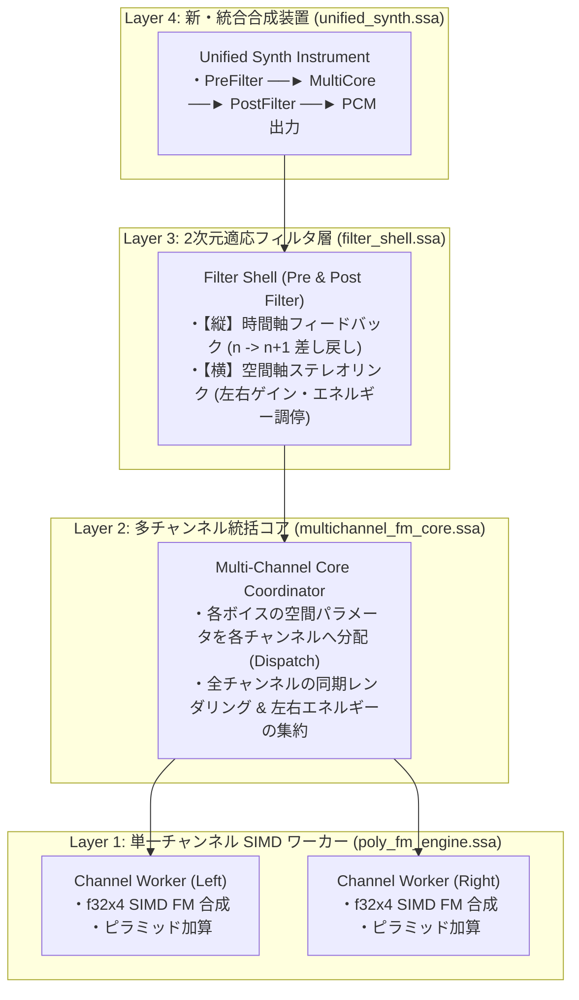
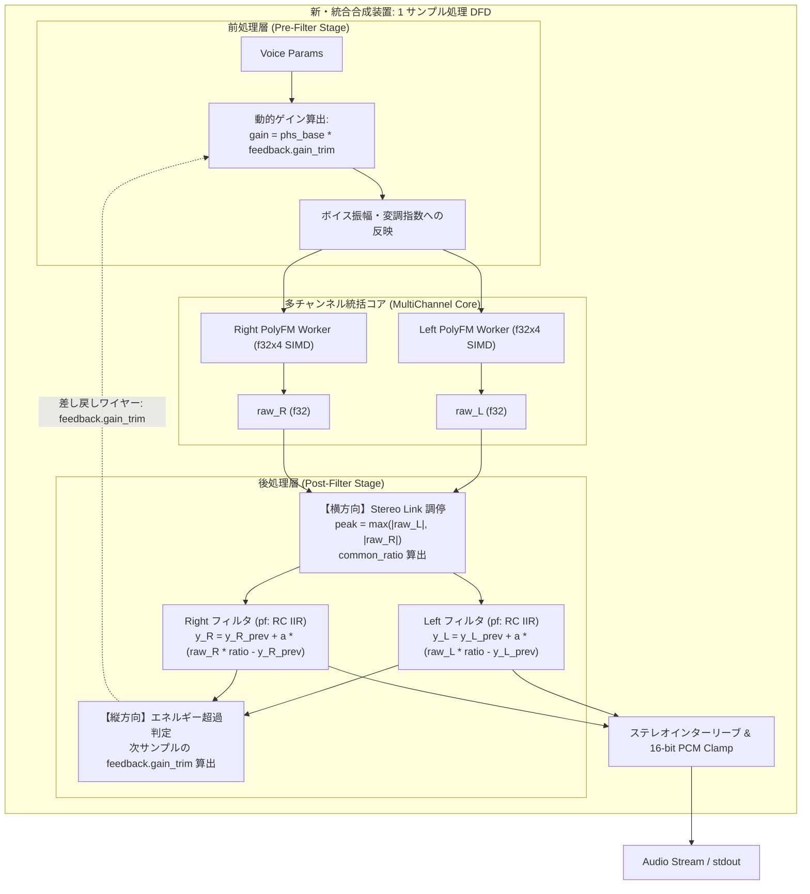

# StateSSA 08_midi_player: 新・統合合成装置 (Unified Synthesis Instrument) アーキテクチャ仕様書

## 1. 概要と基本哲学

本仕様書は、StateSSA 08_midi_player における音響合成アーキテクチャの抜本的刷新を定義する。

従来の「FM合成エンジンに外付けでエフェクトを被せる」という発想を完全に脱却し、**「前処理層・多チャンネル合成コア・後処理層が、縦方向（時間軸）と横方向（ステレオ空間軸）の 2 次元通信マトリクスで有機的に結合した、ひとつの自律型統合合成装置（Unified Synthesis Instrument）」** として再定義する。

### コア設計思想
1. **バースト・パイプライン哲学**:
   UNIX パイプラインを介したバースト生成プレイヤーであり、再生レイテンシの制約に縛られない。CPU クロック全開の爆速（実時間の 40 倍速以上）で先回り計算できるため、数秒に及ぶサンプル履歴や長大なリングバッファ、重厚な時間窓解析であっても、リアルタイム性を待たずに高速演算ループの中で自己完結する。
2. **2 次元通信マトリクス (2D Communication Matrix)**:
   - **縦方向（時間軸フィードバック / Temporal Feedback: $n \to n+1$）**:
     後処理層で観測されたエネルギー超過や過渡応答を、次のサンプルの前処理入力トリムへ瞬時に差し戻し、合成前のヘッドルームを先回りで動的に適正化する。
   - **横方向（空間軸ステレオ調停 / Spatial Cross-Channel Link: Left $\leftrightarrow$ Right）**:
     左右（および多チャンネル）のチャンネル間で瞬時エネルギーを相互監視し、共通の抑制比（`common_ratio`）を適用することで、不自然な音像定位の左右崩壊（Stereo Panning Drift）を物理的に防ぐ。
3. **4 層レイヤード・アーキテクチャ (Layered Modularity)**:
   既存の実績ある高速 SIMD FM コア（`poly_fm_engine.ssa`）を「単一チャンネル計算ワーカー」として安全に再利用し、その上位に多チャンネル統括コア、適応フィルタ層、新合成装置を階層的に配置する。

---

## 2. 4 層レイヤード・アーキテクチャ

```text
projects/samples/08_midi_player/
├── midi_player.ssa           # [Layer 5 / CLI] トップレベル進行、引数解析 (-nc pf, phs 等)
├── unified_synth.ssa         # [Layer 4 / Instrument] 新・統合合成装置本体 (旧 synth_pipeline)
├── filter_shell.ssa          # [Layer 3 / 2D Filter] 縦横通信適応フィルタ・シェル
├── multichannel_fm_core.ssa  # [Layer 2 / Core Coordinator] 多チャンネル統括コア
├── poly_fm_engine.ssa        # [Layer 1 / Pipe Worker] 単一チャンネル SIMD FM 合成ワーカー (再利用)
├── spatial_stage.ssa         # [Spatial Projection] 3D 音響空間パラメータ計算
├── midi_types.ssa            # [Common Types] 共通構造体定義
└── midi_parser.ssa           # [Binary Parser] SMF 解析 & 事前スキャン
```



---

## 3. 2 次元通信マトリクスと詳細 DFD



---

## 4. データ構造定義 (`midi_types.ssa`)

```ssa
// 1. 縦方向（時間軸）フィードバック信号
type FeedbackSignal = {
    gain_trim:       f32,   // Dynamic gain attenuation factor (1.0 = none, <1.0 = attenuate)
    overflow_flag:   u32,   // Saturation / clip detected flag
    residual_energy: f32    // Transient / residual filter energy
};

// 2. 横方向（ステレオ空間軸）調停信号
type StereoLinkState = {
    peak_L:       f32,      // Instantaneous peak magnitude (Left)
    peak_R:       f32,      // Instantaneous peak magnitude (Right)
    common_ratio: f32       // Unified gain attenuation ratio preserving stereo image
};

// 3. 2次元適応フィルタ・コンテキスト (汎用状態メモリ)
type FilterContext = {
    nc_mode:       u32,     // 0: None(Hard), 1: PHS, 2: PF(RC Low-Pass), 3: SC, 4: LP
    sample_rate:   f32,     // Audio sampling frequency (e.g. 44100.0)
    prev_y_L:      f32,     // Last filter output sample y[n-1] (Left)
    prev_y_R:      f32,     // Last filter output sample y[n-1] (Right)
    alpha:         f32,     // IIR smoothing factor (alpha = dt / (RC + dt))
    phs_base_gain: f32,     // Deterministic peak polyphony scaling: sqrt(8.0 / N_peak)
    gain_trim:     f32,     // Temporal feedback trim factor
    common_ratio:  f32      // Spatial stereo link ratio
};

// 4. 多チャンネル統括コア
type MultiChannelCore = {
    engine_L:     *PolyFMEngine, // Left channel FM synthesis worker
    engine_R:     *PolyFMEngine, // Right channel FM synthesis worker (null in mono)
    is_stereo:    i1,            // 1: Stereo, 0: Mono
    num_channels: u32,           // Total active channels (1 or 2)
    total_blocks: u32            // Allocated SIMD voice blocks (K)
};

// 5. 新・統合合成装置本体
type UnifiedSynth = {
    core:         *MultiChannelCore, // Coordinated multi-channel FM core
    filter:       *FilterContext,    // 2D adaptive filter shell
    is_stereo:    i1,                // Stereo output mode flag
    raw_l_buf:    *f32,              // Intermediate float scratch buffer (Left, 2048)
    raw_r_buf:    *f32,              // Intermediate float scratch buffer (Right, 2048)
    pcm_out_buf:  *i16               // Interleaved 16-bit PCM scratch buffer (4096)
};
```

---

## 5. 後処理層 StateMachine 遷移設計 (`stateDiagram-v2`)

```mermaid
stateDiagram-v2
    direction TB

    [*] --> LoadSampleInputs
    
    state LoadSampleInputs {
        note right of LoadSampleInputs: raw_L, raw_R, prev_yL, prev_yR, feedback を受領
    }

    LoadSampleInputs --> HorizontalStereoCoord: 横方向通信へ
    
    state HorizontalStereoCoord {
        note right of HorizontalStereoCoord: max(|raw_L|, |raw_R|) を計測し common_ratio を決定
    }

    HorizontalStereoCoord --> CheckNCMode: モード判定
    
    state CheckNCMode {
        CheckNCMode --> ModeBypass: nc == None / PHS
        CheckNCMode --> ModePF: nc == PF (RC ローパス)
    }

    state ModePF {
        ApplyIIR_L: y_L = prev_yL + alpha * (raw_L * ratio - prev_yL)
        ApplyIIR_R: y_R = prev_yR + alpha * (raw_R * ratio - prev_yR)
        ApplyIIR_L --> ApplyIIR_R
    }

    state ModeBypass {
        Bypass_L: y_L = raw_L * ratio
        Bypass_R: y_R = raw_R * ratio
        Bypass_L --> Bypass_R
    }

    ModePF --> CalcTemporalFeedback
    ModeBypass --> CalcTemporalFeedback

    state CalcTemporalFeedback {
        note right of CalcTemporalFeedback: y_L, y_R のエネルギーを評価し<br>次ステップの feedback_trim を算出
    }

    CalcTemporalFeedback --> WritePCMAndAdvance: PCM 変換 & バッファ書き込み
    
    state WritePCMAndAdvance {
        note right of WritePCMAndAdvance: Phi 接合点へ (y_L, y_R, next_trim) を差し戻し
    }

    WritePCMAndAdvance --> [*]: 次サンプルへ
```

---

## 6. フィルタ方式と拡張性体系

| モード名 | CLI オプション | 物理的役割と介入レイヤー |
| :--- | :--- | :--- |
| **`dynamic` (Default)** | (指定なし) / `-nc dynamic` | **【新標準・全音フルパワー】** 全ボイスの振幅を 1.0 に固定し、ピークホールド＋ソフトサチュレーション＋動的復帰（300ms）で音割れを防ぎながら圧倒的な音圧を実現。 |
| **`dyn_pf`** | `-nc dyn_pf` | **【実機バーチャル・アナログ再現】** dynamic の全音フルパワー生波形に対し、当時の A級オペアンプのトランジスタ非線形飽和（$x/\sqrt{1+x^2}$）、スルーレート制限なまり、7.5kHz 実機 RC フィルタを直列適用した、粘りと太さのある実機基板完全模倣モード。 |
| **`dyn_phs`** | `-nc dyn_phs` | **【ブリックウォール・マキシマイザー】** dynamic の全音フルパワー音圧を 100% 保持しつつ、事前スキャン PHS で音割れ（クリップ）だけを極限まで根絶する音圧最大化モード。 |
| **`normal`** | `-nc normal` | **【生 FM 出力（ハードクリップ）】** フィルタやリミッターを一切介さず、生 FM 波形をそのまま出力（超過時は純粋なハードクリップ）。 |
| **`pf`** | `-nc pf` | **【周波数領域・後処理】** 実機 DAC 直後のアナログ RC ローパス回路再現。階段波形と高域クリックを平滑化。 |
| **`phs`** | `-nc phs` | **【決定論統計・前処理】** 事前スキャンの $N_{peak}$ から $\sqrt{8.0/N_{peak}}$ でボイス初期振幅をトリム。 |

---

## 7. インタラクティブ CLI HUD ＆ トラック制御

マルチトラック演奏およびストリーミング再生（`| aplay -f cd`）時の操作性を向上させるため、非同期 I/O を用いたリアルタイム HUD とトラック制御を実装。

### 7.1 ストリーム完全保護アーキテクチャ
- **音声データ（`stdout`, fd 1）**: 16-bit PCM バイナリストリームのみを出力。テキストや制御コードの一切の混入を排除。
- **ターミナル HUD（`stderr`, fd 2）**: 楽曲タイトル、曲番号（`[Track i/N]`）、リアルタイムタイムコード（`Time: mm:ss`）、操作案内を標準エラー出力へ分離出力。

### 7.2 ノンブロッキング [Enter] スキップ（`isatty` 端末保護）
- `isatty(0) == 1`（キーボード対話時）のみ、各合成チャンク（2048 サンプル $\approx 46\text{ms}$）ごとに POSIX `poll(fd 0, POLLIN, timeout=0)` を実行。
- ユーザーが `[Enter]`（ASCII 10 または 13）を押下した瞬間に入力を検知し、安全にボイスアリーナを解放して次曲へシームレスに移行。
- `isatty(0) == 0`（パイプライン接続時）はキー監視を完全バイパスし、誤スキップの発生を 100% 根絶。
