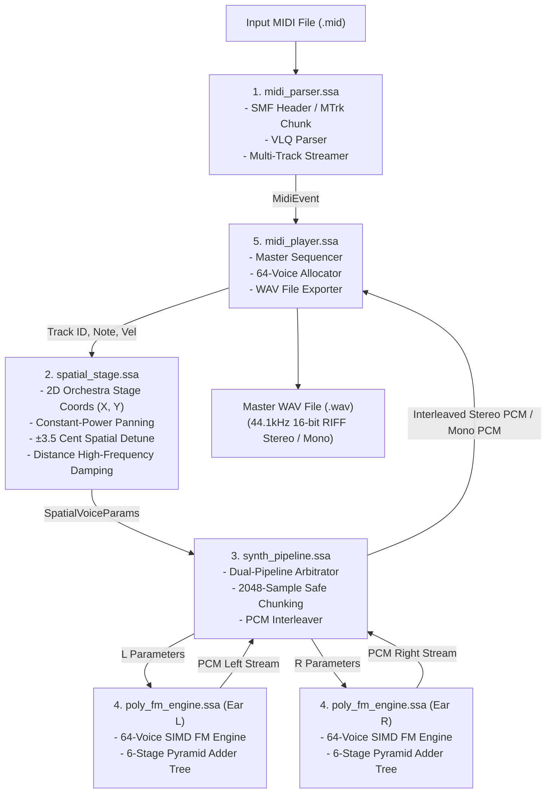

# Sample 08: Multi-Track Standard MIDI File (SMF) Player

Standard MIDI File (SMF Format 0 および Format 1) を直接ストリーミング解析し、SIMD 和音合成エンジンと 2D 空間音響ステージを介して 44.1kHz 16-bit RIFF WAV（3D ステレオ または モノラル）を出力する、完全 StateSSA 実装のマルチトラック MIDI プレイヤーです。

C 言語ラッパーや中間層を一切介さず、**100% StateSSA 言語のみ** でバイナリ構文解析・動的ボイスアロケーション・空間定位計算・パイプライン合成・RIFF WAV ヘッダ構築を実行します。

---

## 1. 5モジュール疎結合アーキテクチャ (Decoupled Architecture)

本サンプルは、責務ごとに完全に分離された 5 つの独立モジュールによって構成されています。



### モジュール一覧
1. **`midi_types.ssa`**: MIDI ヘッダ、トラックカーソル、空間ボイスパラメータ、ボイススロット、パイプライン構造体の定義。
2. **`midi_parser.ssa`**: SMF Format 0/1 のストリーミング解析機。可変長数量（VLQ）の復元、ランニングステータスバイトの補完、Set Tempo や End-of-Track のディスパッチ。
3. **`spatial_stage.ssa`**: オーケストラの 2D 空間配置 $(X, Y)$ に基づく音響設計モジュール。等パワー定位則、奥行きによる空気減衰、左右微小デチューン（$\pm 3.5$ セント）を計算。
4. **`synth_pipeline.ssa`**: デュアル・パイプライン調停モジュール。2048 サンプルの安全なチャンク分割ループにより、任意の休符・待機時間であっても L1 キャッシュ（4KB）内で高速かつ安全にレンダリング・インターリーブを実行。
5. **`poly_fm_engine.ssa`**: Sample 07 と完全同一の SIMD FM 和音合成エンジン。16 ブロック（64 ボイス）のピラミッド二分木加算コアを内蔵。
6. **`midi_player.ssa`**: 最上位シーケンサ。全トラックの最小待機時間 $\Delta T$ の動的探索、タイムライン進行、ボイススロット探索、44.1kHz 16-bit PCM RIFF WAV への直接書き出し。

---

## 2. 空間音響設計 (Detuned Stereo Architecture)

本サンプルでは、左右のパイプラインにわずかな位相差とピッチ微小変化（$\pm 3.5$ セント）を与える「完全独立デュアル・パイプライン（Detuned Stereo）」を採用しています。

- **Left Ear**: $f_L = f_0 \times 2^{-3.5 / 1200} \approx 0.99798 \times f_0$
- **Right Ear**: $f_R = f_0 \times 2^{+3.5 / 1200} \approx 1.00202 \times f_0$

これにより、ヘッドホンやステレオスピーカーで聴いた際に自然な頭外定位と豊かな立体音場が得られます。

---

## 3. ビルドと実行

### ビルド
プロジェクトルートから `make` を実行します。
```bash
make 08_midi_player
```

### 実行

```bash
# 1. リアルタイム・ストリーミング再生 (UNIX パイプライン、デフォルト: dynamic / フルパワー音圧)
./build/08/midi_player song.mid | aplay -f cd

# 2. 実機バーチャル・アナログ再現モード (-nc dyn_pf) での再生
# ※ A級オペアンプ熱スルーレート制限・トランジスタ非線形飽和・7.5kHz RC フィルタを直列適用し、
#   可能な限りメガドライブやサウンドブラスター等の実機基板のフィルタ特性・太く温かい出音に近づけた最上位モード
./build/08/midi_player song.mid -nc dyn_pf | aplay -f cd

# 3. 生 FM 音源出力モード (-nc normal) での再生
./build/08/midi_player song.mid -nc normal | aplay -f cd

# 4. 複数曲の連続ジュークボックス再生 (ワイルドカード対応、[Enter] で次曲スキップ可能)
./build/08/midi_player *.mid | aplay -f cd

# 5. 3D ステレオ WAV ファイルへの高速レンダリング (-o オプション)
./build/08/midi_player song.mid -o output_stereo.wav

# 6. モノラル WAV ファイルへのレンダリング (--mono)
./build/08/midi_player song.mid -o output_mono.wav --mono
```

### 音響特性・ノイズ制御オプション (`-nc <mode>`)

| オプション | モード名 | 物理的役割と特徴 |
| :--- | :--- | :--- |
| **(指定なし)** | **`dynamic` (Default)** | **【新標準・全音フルパワー】** ピークホールド＋ソフトサチュレーション＋動的復帰（300ms）で音割れ（クリップ）を防ぎながら圧倒的な音圧を実現。 |
| **`-nc dyn_pf`** | **`dyn_pf`** | **【実機バーチャル・アナログ再現】** 当時の A級オペアンプの過渡応答なまり（物理スルーレート制限 $S_{max} = 1.5$）、トランジスタ非線形飽和（$x/\sqrt{1+x^2}$）、および実機 DAC 直後の 7.5kHz RC アナログローパス回路（$\alpha = 0.5$）を直列適用。**可能な限り実機ハードウェア基板のフィルタ特性・太さと粘りのある温かい出音に近づけた最上位再現モード**。 |
| **`-nc dyn_phs`** | **`dyn_phs`** | **【ブリックウォール・マキシマイザー】** dynamic の全音フルパワー音圧を 100% 保持しつつ、事前スキャン PHS でクリップを極限まで根絶する音圧最大化モード。 |
| **`-nc normal`** | **`normal`** | **【生 FM 合成出力】** フィルタやリミッターを一切介さず、FM 合成コアから生成された純粋な生波形を出力（超過時はハードクリップ）。 |
| **`-nc pf`** | **`pf`** | **【固定ポストフィルタ】** 7.5kHz アナログ RC ローパス回路のみを適用。 |
| **`-nc phs`** | **`phs`** | **【事前スキャン決定論トリム】** ピーク発音数 $N_{peak}$ から $\sqrt{8.0/N_{peak}}$ でボイス初期振幅を一括減衰。 |
